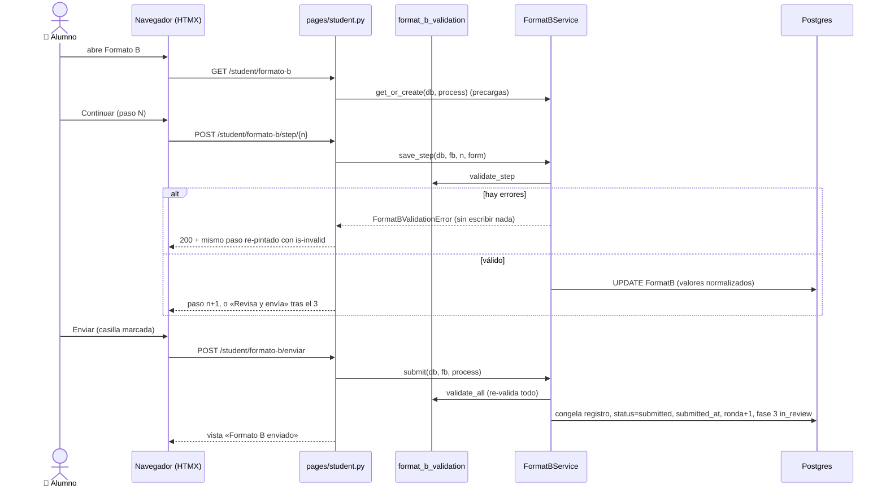

# El alumno llena y envía el Formato B (Fase 3)

> **Objetivo:** el alumno completa el Formato B en 3 pasos con validación en línea, lo revisa y lo
> envía; queda en la cola FIFO de Titulación. Si se lo regresan con observaciones, ve exactamente
> qué campos corregir y lo reenvía.

| | |
|---|---|
| **Actor(es)** | 👤 Alumno (`graduate`) |
| **Permiso(s)** | `format_b.page.fill` (páginas) · `format_b.api.save` (guardar paso) · `format_b.api.submit` (enviar; declarado desde antes, hoy lo exige `POST /student/formato-b/enviar`) |
| **Trigger** | El alumno toca **«Llenar Formato B»** en la tarjeta «Tu proceso» del dashboard ([acordeón de fases](xcut_student_phase_detail.md)); el CTA solo aparece con la fase 3 activa |
| **Precondiciones** | Proceso `active` y **la fase 3 es su `current_phase`** (`in_progress` o `rejected`), validado por [`PhaseService.assert_student_can_act`](engine_student_phase_lock.md); corte `TITULATEC_HANDOFF_PHASE` por encima de la fase 3 (en producción = 3: nada de esto es alcanzable) |
| **Sub-flujos** | → [Titulación revisa el Formato B](phase3_titulacion_review_formato_b.md) |
| **Estado final** | `FormatB.status=submitted` + fase 3 `in_review` + `submitted_at` / ronda |

Estados: [máquina de estados](00_state_machine.md#estado-del-formato-b-formatbstatus--fase-3).
Spec: `docs/superpowers/specs/2026-10-21-titulatec-fase3-formato-b-titulacion-design.md`.

## Ruta en la app (UI)

1. Dashboard → «Llenar Formato B» (o `/titulatec/student/formato-b`). Arranca en el paso 1.
2. Stepper **Personal → Escolar → Proyecto** (parciales en `partials/formato_b/`, swap sobre
   `#formato-b-body`). «Continuar» valida el paso; «Atrás» no valida ni guarda.
3. Tras el paso 3, «Continuar a revisión» lleva a **«Revisa y envía»**: resumen de solo lectura de
   los tres bloques, cada uno con «Editar» (vuelve a su paso), casilla obligatoria «Confirmo que
   mis datos son correctos» y «Enviar Formato B».
4. Enviado: vista de solo lectura «Enviado el … · Titulación lo revisa en orden de llegada» (no se
   muestra la posición en la cola). Aprobado: «Aprobado el …».
5. Con observaciones: banner arriba (fecha, nota general, lista de campos con liga a su paso) y
   cada campo observado en ámbar con «Observación de Titulación: …» (o «Corregido ✓» si ya cambió).

## Secuencia

## Pasos detallados

| # | Actor | UI / dónde | Acción | Endpoint | Service · método | Efecto en BD | Eventos / Notif |
|---|---|---|---|---|---|---|---|
| 1 | 👤 | `/student/formato-b` | abrir | `GET /student/formato-b` | `FormatBService.get_or_create` (tras la guarda de fase; si ya está `approved` se sirve la solo lectura aun en fase 4+) | `FormatB(status=draft)` con precargas: nº control y nombre del `User`; teléfono del perfil; retícula del perfil; modalidad del proceso | — |
| 2 | 👤 | stepper | guardar paso | `POST /student/formato-b/step/{n}` (n=1..3; otro n → 404) | `FormatBService.save_step` → `validate_step` | `FormatB` campos del paso, normalizados; **solo si todo el paso es válido** (si no, no escribe nada). `rejected` se **conserva** | auditoría `format_b.step_saved` (solo nombres de campos) |
| 2b | 👤 | «Atrás» / «Editar» | ver un paso | `GET /student/formato-b/step/{n}` | `FormatBService.to_ctx` / `display_sections` | — | — |
| 3 | 👤 | tras el paso 3 | ver «Revisa y envía» | `GET /student/formato-b/revision` | `FormatBService.display_sections`, `progress` | — | — |
| 4 | 👤 | «Enviar Formato B» | enviar | `POST /student/formato-b/enviar` (form `confirm=1`) | `FormatBService.submit` | `FormatB`: `status=submitted`, `submitted_at=db_now()` (llave FIFO), `submission_count += 1`, congela nombre/control/carrera/nombre de la modalidad; proyecto NULL si la modalidad no lo pide; `ProcessPhase[3]=in_review` | `ProcessEvent(format_b_submitted, {round})`, auditoría `format_b.submitted` |

### Reglas de validación (servidor = autoridad)

Una función pura por paso (`services/format_b_validation.py`: `validate_step`, `validate_all`,
`ValidationCtx`); `submit` re-valida todo con `validate_all`. El form lleva `novalidate` (los
mensajes los pinta el servidor) con `inputmode`/`maxlength`/`autocomplete` para el teclado móvil.
Normalización común: `strip()` + colapsar espacios.

| Paso | Campo | Regla |
|---|---|---|
| 1 | `first_name`, `last_name`, `middle_name` | **no editables** (D6): vienen del `User`; aviso de que Titulación los compara con el acta y, si hay un error, los corrige al revisar |
| 1 | `gender` | `male` \| `female` \| `unspecified` |
| 1 | `age` | entero 18–99 |
| 1 | `mobile_phone` | obligatorio; 10 dígitos tras quitar separadores y un `+52` inicial; se guarda normalizado |
| 1 | `phone` | opcional; misma regla |
| 1 | `postal_code` | exactamente 5 dígitos |
| 1 | `neighborhood`, `street` | 2–120 caracteres |
| 1 | `ext_number` | 1–10; letras, dígitos, guion, espacio o `S/N` |
| 1 | `int_number` | opcional, ≤ 10 |
| 2 | `control_number`, `program_id` | no editables: nº de control del `User`; la carrera es la de `process.program_id` (el alumno ya no la elige) |
| 2 | `modality_id` («Tipo de titulación») | obligatorio; una de las modalidades **activas** del catálogo (las mismas para todos los niveles) |
| 2 | `study_plan` | 2–40, se guarda en MAYÚSCULAS |
| 2 | `admission_date` | mes válido, ≥ enero de 1980 y anterior al egreso |
| 2 | `graduation_date` | mes válido, posterior al ingreso y ≤ mes actual (reloj de Juárez, `db_now`) |
| 3 | `project_name` | 10–500 caracteres; **no se pide si la modalidad elegida tiene `requires_synodals = false`** (hoy EGEL): la regla sale del catálogo, nunca de comparar el código `egel`; al enviar se guarda NULL |

Un error de validación responde **200** con el paso re-pintado (htmx no hace swap en un 4xx):
resumen «Revisa N campos», `is-invalid` + mensaje bajo cada campo, foco en el primero, y lo que el
alumno escribió se conserva. Si `submit` encuentra un borrador viejo inválido, lleva al primer paso
con errores.

### Casilla de confirmación (servidor)

La casilla «Confirmo que mis datos son correctos» la exige **el servidor**, no solo el JS: sin
`confirm=1`, `POST /enviar` re-pinta «Revisa y envía» con el error (200). La ruta es `async`
canónica (lee el form y delega en `_cuerpo_formato_b_submit` con `run_in_threadpool`).

## Estado resultante

- `FormatB.status=submitted`; fase 3 `in_review`; `submitted_at` fija su lugar en la cola FIFO.
- El alumno solo ve solo lectura: **editar o reenviar un Formato B enviado/aprobado responde
  `400` + `X-Tt-Error`** (corrige el hueco P8).
- Aparece en «Por revisar» de la pestaña Titulación y en la tarjeta de solo lectura del expediente.

## Caminos alternos / errores ❗

- **Con observaciones** ([Titulación observa](phase3_titulacion_review_formato_b.md)): `FormatB.status`
  y la fase 3 quedan `rejected` **hasta el reenvío**; guardar pasos ya no los regresa a `draft` (se
  conserva la señal). La fase 3 sigue siendo su `current_phase`, así que la guarda no lo estorba.
  El banner y los campos ámbar salen de `review_observations`; «Corregido ✓» se decide
  comparando el valor actual con el de cuando se observó. En «Revisa y envía» se listan los observados
  y, si alguno **no cambió**, avisa («No cambiaste: C.P.») pero **permite** enviar (el alumno puede
  tener razón). El reenvío sube la ronda y **va al final de la cola** (cuenta desde el nuevo
  `submitted_at`).
- **Fuera de la fase 3** ([guarda de fase](engine_student_phase_lock.md)): `GET /student/formato-b`
  responde `302` a `/student/dashboard?fase=3`; los parciales y mutaciones devuelven `400` +
  `X-Tt-Error`. El 302 va **antes** de `get_or_create` (ese `commit` creaba la fila con un simple
  GET desde otra fase). **Excepción**: con el Formato B `approved`, el GET de solo lectura se sirve
  aunque `current_phase` ya sea 4+; toda acción sigue bloqueada.
- **Ya enviado** (doble clic, dos pestañas): el segundo envío da `ALREADY_SUBMITTED_MSG` (400); la
  ronda sube una vez. La verificación se repite bajo el bloqueo del proceso.
- **Corte a T-soft ≤ fase 3** (producción): ninguna ruta opera (`HANDOFF_MSG`); ver
  [corte a T-soft](xcut_titulacion_handoff.md).
- **Nombre mal en el registro**: el alumno no lo edita; lo corrige Titulación al revisar
  ([flujo](phase3_titulacion_review_formato_b.md), paso 4) sin regresarle el Formato B.
- Tras aprobarse, el aviso/correo de avance dice «Tu Formato B fue aprobado. En máximo 5 días
  hábiles se asignan tus sinodales» solo si la siguiente fase real es la de sinodales; para una
  modalidad que la salta (EGEL → fase 6) el texto es el genérico de la fase siguiente.

## Flujos relacionados

- ← Previo: [cita de cotejo](phase2_appointment_loop.md).
- → [Titulación revisa el Formato B](phase3_titulacion_review_formato_b.md) (dictamen, FIFO, observaciones).
- ⤵ Aprobación de fase: [motor de avance](engine_approve_advance_phase.md).
- 🖥️ Entrada y seguimiento: [acordeón de fases del dashboard](xcut_student_phase_detail.md) — el
  panel de la fase 3 dice **en qué paso va** (1/3, 2/3, 3/3) y si ya está enviado. El paso se
  deriva de campos que llenó el alumno, no de los que `get_or_create` precarga (`PRELOADED_FIELDS`):
  si contaran, el paso 2 se vería completo desde el minuto cero.
