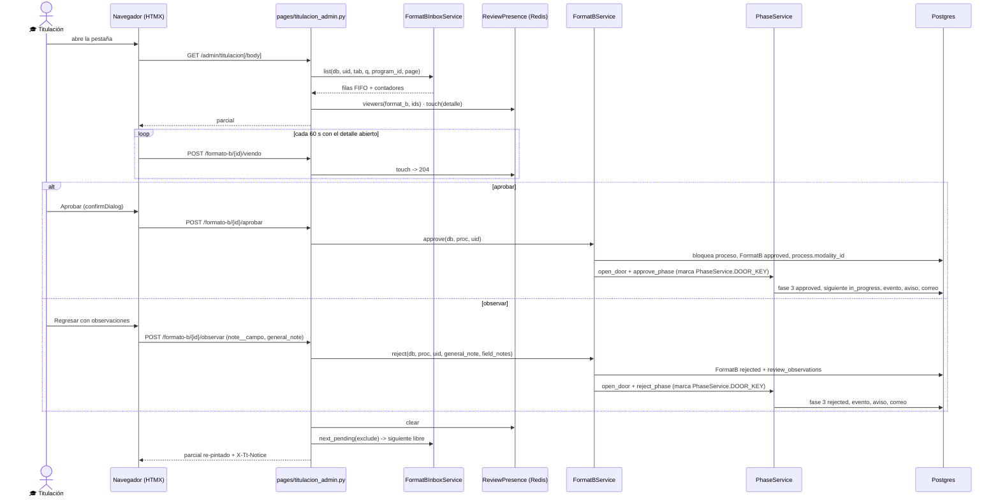

# Titulación revisa el Formato B (pestaña «Titulación», FIFO)

> **Objetivo:** el Departamento de Titulación dictamina los Formatos B enviados, en orden de llegada,
> con observaciones por campo; el dictamen mueve el proceso (aprobado ⇒ siguiente fase aplicable,
> observado ⇒ regresa al alumno) con aviso in-app y correo.

| | |
|---|---|
| **Actor(es)** | 🎓 Departamento de Titulación (`titulatec_titulacion`) y la jefatura de la División (`titulatec_titulaciones`); `admin` |
| **Permiso(s)** | abrir: `titulatec.titulacion.page.list` **y** `titulatec.format_b.api.read.all` (la guarda `_exigir_bandeja` pide los dos) · aprobar `format_b.api.approve` · observar `format_b.api.reject` · corregir registro `format_b.api.correct_registry` |
| **Trigger** | El alumno envía su Formato B ([flujo del alumno](phase3_student_formato_b.md)); aparece en «Por revisar» |
| **Precondiciones** | Corte `TITULATEC_HANDOFF_PHASE` **> 3** (dev = 10; con 3, producción, la pestaña es un estado vacío y toda acción responde 400); proceso `active`; Formato B `submitted` |
| **Sub-flujos** | ⤵ [motor de avance de fase](engine_approve_advance_phase.md) (`approve_phase` / `reject_phase`, con la puerta única de la fase 3) · ⤵ [correos del proceso](xcut_student_email_notifications.md) |
| **Estado final** | Aprobado: `FormatB.status=approved` + fase 3 `approved` (misma transacción) + `process.modality_id` grabado + `current_phase` = siguiente aplicable. Observado: `FormatB.status=rejected` + fase 3 `rejected` + `review_observations` |

Estados y glosario: [máquina de estados](00_state_machine.md#estado-del-formato-b-formatbstatus--fase-3) ·
[glosario](_glossary.md). Spec: `docs/superpowers/specs/2026-10-21-titulatec-fase3-formato-b-titulacion-design.md`.

## Ruta en la app (UI)

1. Menú admin **Titulación** (`bi-journal-check`, después de «Citas de cotejo»;
   `/titulatec/admin/titulacion`). El Departamento de Titulación **aterriza aquí** si tiene
   `titulacion.page.list` **y** la fase del Formato B se opera en la app; si no, aterriza en
   Liberados como siempre (la División y `admin` siguen aterrizando en la Bandeja). Desde la
   revisión de la fase 4 (ruling R5) el ítem del menú también se oculta con el corte en la fase
   `format_b` o antes (`nav._NAV_PHASE_GATE`): con el corte en 3 (producción) no se ve aunque el
   permiso esté sembrado.
2. Pestañas: **Por revisar** (default, FIFO), **Con observaciones**, **Aprobados**, **Sin enviar**,
   con contador, búsqueda (control/nombre/folio), filtro por carrera y paginación de 50.
3. Master-detail: la lista a la izquierda (posición en la cola, semáforo de espera, «Reenvío
   (ronda N)», «👁 Fulano lo está revisando») y el detalle a la derecha con los tres bloques
   (Personal / Escolar / Proyecto) y **todos** los campos.
4. En el detalle: ⚑ por campo editable abre su nota; marcar ≥ 1 campo deshabilita «Aprobar» y el
   botón «Regresar con observaciones (N)» cuenta; nota general; botones para ver el **acta de
   nacimiento** y la **CURP** de la fase 1 en el visor; lápiz «Corregir» en nombre y carrera.
5. Tras dictaminar se re-pinta la misma vista y se selecciona el **siguiente** de la cola que nadie
   más tenga abierto.

## Secuencia

## Pasos detallados

Todas las rutas de `{process_id}` empiezan con `assert_process_in_scope` (primera sentencia del
`try`, 404 fuera de alcance), luego `_exigir_bandeja` (403) y, las que escriben, `_operable` (con
el corte en la fase 3 o antes: 400 con `HANDOFF_MSG`). Formas canónicas de ruta (§1 del CLAUDE.md
de la app): las `async` solo leen el form y delegan en `_cuerpo_*` con `run_in_threadpool`.

| # | Actor | UI / dónde | Acción | Endpoint | Service · método | Efecto en BD | Eventos / Notif |
|---|---|---|---|---|---|---|---|
| 1 | 🎓 | menú «Titulación» | abrir / cambiar pestaña, buscar, paginar | `GET /admin/titulacion` · `GET /admin/titulacion/body` (`tab, q, carrera, page, selected`) | `FormatBInboxService.list` (UNA consulta de contadores + UNA de lista; alcance por carrera ANTES de contar) | solo lectura | — |
| 2 | 🤖 | detalle abierto | marca «lo tengo abierto» (al abrir y cada 60 s) | `POST /admin/titulacion/formato-b/{id}/viendo` → 204 | `ReviewPresence.touch` | Redis `titulatec:presence:format_b:{id}` (vigencia ~120 s; hash con `EXPIRE 300`) | — |
| 3 | 🎓 | botones «Documento» | cotejar nombre con acta/CURP | `GET /admin/titulacion/formato-b/{id}/documento/{type_code}` | `DocumentService.get_document` (solo tipos cuya fase es `initial_docs`; si no, 404) | solo lectura (sirve el archivo inline) | — |
| 4 | 🎓 | lápiz «Corregir» (nombre/carrera) | corrige el registro con motivo | `POST /admin/titulacion/formato-b/{id}/registro` | `FormatBService.correct_registry` | `core_users` (nombre), `titulatec_processes.program_id`, copia congelada del `FormatB`; no regresa el Formato B | `ProcessEvent(format_b_registry_corrected)`, aviso `REGISTRY_CORRECTED`, bitácora `format_b.registry_corrected` (antes/después + motivo) |
| 5 | 🎓 | «Aprobar» | aprueba | `POST /admin/titulacion/formato-b/{id}/aprobar` | `FormatBService.approve` → `PhaseService.approve_phase` | `FormatB` approved (`approved_by/at`, `reviewed_by/at`, `rejection_reason=NULL`); `process.modality_id = fb.modality_id`; fase 3 approved; siguiente fase aplicable `in_progress`; `current_phase` | `ProcessEvent(phase_approved, payload.format_b.round)`, aviso `PHASE_APPROVED`, correo de fase aprobada (con promesa de sinodales solo si la siguiente real es `synodal_assignment`), bitácora `format_b.reviewed` |
| 6 | 🎓 | «Regresar con observaciones (N)» | observa | `POST /admin/titulacion/formato-b/{id}/observar` (`general_note`, `note__{campo}`) | `FormatBService.reject` → `PhaseService.reject_phase` | `FormatB` rejected + `review_observations` + `rejection_reason`=nota general; fase 3 rejected; `current_phase`=3 | `ProcessEvent(phase_rejected, payload.format_b.{round, fields} + reason)`, aviso `PHASE_REJECTED`, correo de fase rechazada con el motivo legible, bitácora `format_b.reviewed` |
| 7 | 🤖 | tras 5 o 6 | limpia presencia y elige el siguiente | (misma respuesta) | `ReviewPresence.clear` · `FormatBInboxService.next_pending` (salta los abiertos por otros, hasta 10 intentos) | Redis | — |

Notas de cada paso:

- **Aprobar (5)** exige el estado `submitted` **bajo el bloqueo del proceso** (si otro llegó antes:
  «Este Formato B ya fue dictaminado por X el …») **y la modalidad elegida** (`NO_MODALITY_MSG`): un
  Formato B enviado antes de existir la columna `modality_id` no se puede aprobar; hay que
  observarlo para que el alumno elija su «Tipo de titulación». La UI lo explica y deja el botón
  deshabilitado (`no_modality_msg`). La modalidad se graba en el proceso **antes** de aprobar la
  fase, porque `_next_applicable` lee `Modality.skips_phases` (residencias → fase 4; EGEL → 6).
- **Observar (6)**: al menos una observación (nota general o de campo); las cajas vacías no cuentan
  (la UI puede mandarlas todas); solo se observan campos que llena el alumno (`EDITABLE_FIELDS`,
  incluida la modalidad; el proyecto no si la modalidad no lo pide); cada nota ≤ 1000 caracteres.
  `review_observations` = `{"general", "fields": {campo: {"note", "value"}}, "reviewer_id", "at"}`
  donde `value` es el valor al observarse (sirve para «Corregido ✓» del alumno y el «antes → ahora»
  del revisor en la ronda siguiente). **Sobrevive al reenvío**; un nuevo rechazo la reemplaza; la
  aprobación la deja tal cual.
- **Corregir registro (4)**: solo con el Formato B `submitted`, bajo el mismo bloqueo y la misma
  guarda del motor. Nombre(s) y apellido paterno obligatorios, materno opcional, motivo obligatorio
  (≤ 500). La carrera nueva debe ser del **mismo nivel** que la actual; el nivel lo compara
  `TrackService.same_level` (nadie más lee `Program.level`; la lista del selector sale de
  `TrackService.programs_same_level`). El nº de control no se corrige aquí. Cambiar la carrera mueve
  el proceso al alcance de otro encargado de Escolares: es esperado. Sin cambios reales → 400.

### Una sola puerta de dictamen

`FormatBService.approve` / `.reject` abren la puerta con `PhaseService.open_door(db, "format_b", ...)`
(marca `PhaseService.DOOR_KEY` en `db.info`) justo antes de llamar a `approve_phase` / `reject_phase`
y la cierran con `close_door` en el `finally`; el motor (`_door_guard`) la exige y la consume. Desde
la fase 4 el mecanismo es un registro de fases con puerta (`format_b` y `synodal_assignment`; ver
[asignación de sinodales](phase4_department_assign_synodals.md)). Sin ella, cualquier intento de aprobar o rechazar la fase 3 (los botones
genéricos «Aprobar/Rechazar fase» del expediente, o un POST forzado a `phase/{n}/approve`) responde
`FORMAT_B_ONLY_MSG`. Invariante: Formato B `approved` ⇔ fase 3 `approved`, en una sola
transacción. La ruta vieja `POST /admin/processes/{id}/format-b/review` y `FormatBService.review`
se retiraron. El expediente muestra la tarjeta de la fase 3 **solo lectura** con «Abrir en
Titulación» ([expediente](xcut_admin_process_expediente.md)).

### Presencia («quién lo está revisando»)

Cosmética y **fail-open**: Redis caído ⇒ sin insignias y todo lo demás funciona. Nunca `KEYS`/`SCAN`
(el keyspace se comparte con la caché de authz); lecturas por clave exacta en una sola ida
(pipeline) por página. Nunca se muestra a uno mismo. La protección real contra el doble dictamen es
el bloqueo del proceso + la verificación de estado, no la presencia.

### Bandeja: las 4 pestañas

| Tab | Qué lista | Orden |
|---|---|---|
| `pending` Por revisar | `FormatB.status=submitted` y proceso `active` | **FIFO**: `submitted_at ASC`, empate `process_id` |
| `observed` Con observaciones | `status=rejected`, proceso no cancelado | `reviewed_at DESC` |
| `approved` Aprobados | `status=approved`, proceso no cancelado | `approved_at DESC` |
| `unsent` Sin enviar | proceso `active` con `current_phase` = fase 3 y Formato B inexistente o `draft` | antigüedad en la fase 3 (`ProcessPhase.started_at`) |

Semáforo de espera en **días hábiles** desde `submitted_at`: neutro < 3, ámbar ≥ 3
(`WAIT_WARN_DAYS`), rojo ≥ 5 (`WAIT_LATE_DAYS`). Un **reenvío va al final** (cuenta desde el nuevo
`submitted_at`, D3). Los contadores respetan búsqueda y carrera, no la pestaña ni la página.
`program_id IS NULL` queda fuera del alcance de todos.

## Estado resultante

- Aprobado: `FormatB.status=approved`; fase 3 `approved`; `process.modality_id` = la elegida;
  `current_phase` = siguiente aplicable (4, o 6 para EGEL); la siguiente fase pasa a `in_progress`
  si estaba `pending`/`rejected`.
- Observado: `FormatB.status=rejected` (se conserva hasta el reenvío); fase 3 `rejected`;
  `current_phase=3`; el alumno ve el banner y los campos en ámbar.
- Con el Formato B resuelto, el proceso sale de «Por revisar» y entra a «Aprobados» o «Con
  observaciones».

## Caminos alternos / errores ❗

- **Fuera de alcance o inexistente** → 404 (el guard); sin poder abrir la pestaña (`_exigir_bandeja`)
  → 403, aunque tenga el permiso de la acción (los permisos `format_b.api.*` existían antes que la
  pestaña).
- **Corte ≤ 3** (producción): la pestaña pinta «La fase 3 se opera en T-soft» sin lista ni
  acciones; aprobar, observar y corregir responden 400 + `X-Tt-Error` (`HANDOFF_MSG`). Además el
  permiso `titulacion.page.list` no existe en producción mientras no se corra
  `init-titulatec-fase-2`.
- **Ya dictaminado por otro** (carrera de dos revisores) o **no enviado** → 400 con el mensaje de
  `already_reviewed_msg` / `NOT_IN_REVIEW_MSG`; nada escrito.
- **Proceso pausado/revocado, o fase distinta de la 3** → 400 con el mensaje de
  `assert_can_transition`.
- **Aprobar sin modalidad** → 400 `NO_MODALITY_MSG` (observar es el camino).
- **Observar sin nada** → 400 `NEED_OBSERVATION_MSG`; campo del registro u otro no observable →
  `NOT_OBSERVABLE_MSG`; nota larga → `NOTE_TOO_LONG_MSG`.
- Cualquier error bajo el bloqueo hace `rollback` antes de re-lanzar: el candado nunca se queda
  tomado. Los errores de guarda salen como `Response(400, X-Tt-Error)` con `_hdr` (percent-encode);
  el éxito como `X-Tt-Notice`.
- **Documento no de fase 1** en la ruta del visor → 404; archivo faltante en disco → 404.

## Despliegue y permisos

Los permisos y grants **no** se siembran con `init-titulatec`: solo con
`python -m itcj2.cli.main titulatec init-titulatec-fase-2 [--dry-run]` (DML en
`database/DML/titulatec/fase_2/01_titulacion_formato_b.sql`). Concede, explícitos:
`titulatec_titulacion` ← `titulacion.page.list`, `format_b.api.read.all`, `format_b.api.correct_registry`;
`titulatec_titulaciones` ← `titulacion.page.list`, `format_b.api.correct_registry`; `admin` ← los dos
nuevos. **Trampa de orden:** `init-titulatec` (su `03` converge a `titulatec_titulacion` a su set
exacto de 16) e `init-ajustes-2026-10` **quitan** esos grants; después de cualquiera hay que volver a
correr `init-titulatec-fase-2`, cuya verificación lo detecta. En dev, asignar un usuario de prueba al
puesto `aux_titulacion` para ver la pestaña. Ver §24 del `CLAUDE.md` de la app.

## Flujos relacionados

- ← [El alumno llena y envía el Formato B](phase3_student_formato_b.md).
- ⤵ [Motor de avance de fase](engine_approve_advance_phase.md) (puerta única de la fase 3).
- ⤵ [Corte a T-soft](xcut_titulacion_handoff.md) (la pestaña solo opera con el corte > 3).
- ⤵ [Expediente del alumno](xcut_admin_process_expediente.md) (tarjeta de solo lectura + «Abrir en Titulación»).
- ⤵ [Correos del proceso](xcut_student_email_notifications.md) · [alcance por carrera](engine_officer_scope.md).
