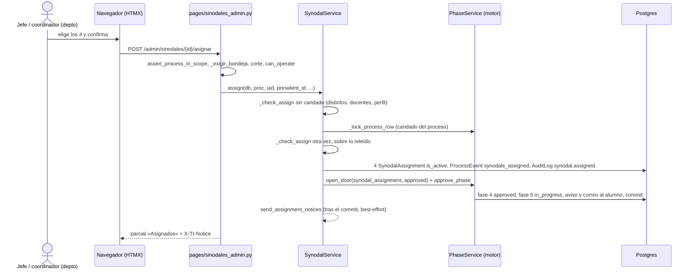

# El departamento académico asigna a los 4 sinodales (pestaña «Sinodales»)

> **Objetivo:** el departamento académico de la carrera del egresado registra a sus 4 sinodales (Presidente, Secretario, Vocal y Vocal Suplente); al registrarlos la fase 4 se aprueba sola, el proceso pasa a la 5, se descarga el oficio PDF y, mientras la fase 5 no termine, se puede sustituir a uno con motivo.

| | |
|---|---|
| **Actor(es)** | 🔗 Jefe de departamento o coordinador de vinculación del departamento de la carrera (`titulatec_vinculacion`); 🎓 la jefatura de la DEP (`titulatec_titulaciones`) y `admin` operan **cualquier** departamento mapeado (R-D) |
| **Permiso(s)** | abrir: `titulatec.synodal.page.list` · asignar: `titulatec.synodal.api.assign` · sustituir: `titulatec.synodal.api.replace` · oficio: `titulatec.synodal.api.read` (también `titulatec_titulacion` y `titulatec_titulaciones`) |
| **Trigger** | el proceso llega a la fase 4 (`synodal_assignment`) al aprobarse el Formato B ([fase 3](phase3_titulacion_review_formato_b.md)) |
| **Precondiciones** | corte `TITULATEC_HANDOFF_PHASE` > fase 4 (en producción vale 3: todo inerte, R-G) · la carrera mapeada a un departamento ([carreras por depto](xcut_program_departments.md)) · el departamento con docentes de perfil completo ([catálogo](xcut_teacher_catalog.md)) |
| **Sub-flujos** | ⤵ [motor de avance](engine_approve_advance_phase.md) (`approve_phase` con la puerta de la fase 4) · ⤵ [alcance](engine_officer_scope.md) (`assert_process_in_scope`) |
| **Estado final** | 4 filas vigentes en `titulatec_synodal_assignments`; fase 4 `approved`, fase 5 `in_progress`, `current_phase` = 5 |

## Ruta en la app (UI)

1. Menú admin «Sinodales» (`bi-people`) → `/titulatec/admin/sinodales`. El rol `titulatec_vinculacion` aterriza aquí si tiene `synodal.page.list` **y** la fase 4 se opera en la app (patrón condicional de `resolve_dashboard_url`, que recibe del landing `operable` = `PhaseService.operable_codes`; sin alguno de los dos conserva su página de siempre).
   **Guarda de fase del menú (ruling R5 de la revisión de rama):** `nav._NAV_PHASE_GATE` da la fase mínima de cada pantalla por CÓDIGO del catálogo (`format_b` para «Titulación»; `synodal_assignment` para «Sinodales», «Docentes» y «Carreras por depto») y `admin_nav_items` oculta el ítem si `PhaseService._handoff_phase() <= número de esa fase` (sin la fase en el catálogo, oculto). En producción el corte es 3 y el DML base ya da `synodal.page.list` a la vinculación: sin esta guarda verían una pestaña inerte. Una sola consulta al catálogo por menú, y ninguna si el usuario no tiene ítems con fase (`test_nav_phase_gate.py`).
2. Dos pestañas: **Por asignar** (procesos `active` en la fase 4 sin sinodales vigentes, FIFO por `ProcessPhase.started_at` de la fase 4, semáforo de días hábiles: ámbar ≥ 3, rojo ≥ 5) y **Asignados** (con sinodales vigentes y la fase 5 sin aprobar). Búsqueda, filtro de carrera y, si el usuario opera varios departamentos, selector de departamento. Maestro-detalle como la pestaña Titulación.
3. Detalle de «Por asignar»: alumno, nº de control, carrera, opción (`Modality.option_label`), título del trabajo y fecha de aprobación del Formato B; 4 selects con los docentes **del departamento de la carrera del proceso** con la **cuenta activa** y perfil completo (una cuenta desactivada no se ofrece, ni para sustituir), cada uno con su número de asignaciones vigentes (dato informativo). «Registrar sinodales» pide confirmación (`TitulaTecUtils.confirmDialog`).
4. Tras asignar, el proceso sale de «Por asignar» y la vista abre «Asignados»: la tabla de los 4, «Descargar oficio» (`target="_blank" rel="noopener"`) y «Sustituir» por fila (motivo obligatorio). Con el detalle angosto (< ~560 px, consulta de contenedor sobre `.tt-sin-detail-col`) la tabla se apila en tarjetas con la etiqueta de cada celda (`data-label`): a 360 px ya no quedan fuera Grado y Cédula ni se encima «Sustituir».
5. Con el corte ≤ fase 4 la pestaña es un estado vacío informativo y sin acciones.

## Secuencia

## Pasos detallados

| # | Actor | UI / dónde | Acción | Endpoint | Service · método | Efecto en BD | Eventos / Notif |
|---|---|---|---|---|---|---|---|
| 1 | 🔗 | Sinodales | Abre la bandeja | `GET /titulatec/admin/sinodales` y `/body` | `SynodalInboxService.list/contains`, `scope_service.manageable_departments` | — | — |
| 2 | 🔗 | Detalle | Registra a los 4 | `POST /titulatec/admin/sinodales/{id}/asignar` | `SynodalService.assign` | 4 × `titulatec_synodal_assignments` (`is_active`) | `ProcessEvent synodals_assigned` (payload `[{role, user_id}]`), bitácora `synodal.assigned` |
| 3 | 🤖 | motor | Aprueba la fase 4 y activa la 5 | (dentro de 2) | `PhaseService.open_door` + `approve_phase` | `ProcessPhase` 4 `approved`, 5 `in_progress`; `process.current_phase` = 5 | `phase_approved`, aviso in-app y correo «Avanzaste a …» al alumno |
| 4 | 🤖 | tras el commit | Avisa a cada sinodal | (dentro de 2) | `SynodalService.send_assignment_notices(kind="assigned")` | — | `NotificationService` `SYNODAL_ASSIGNED` + correo `email/synodal_assigned.html` (`deliver_detailed`, sin outbox); una falla queda en el log y en `synodal.mail_failed` |
| 5 | 🔗🎓 | Asignados / expediente / pestaña Titulación | Descarga el oficio | `GET /titulatec/admin/sinodales/{id}/oficio.pdf` | `OficioService.render_pdf` | — (se genera al vuelo, no se guarda) | — |
| 6 | 🔗 | Asignados | Sustituye a uno, con motivo | `POST /titulatec/admin/sinodales/{id}/sustituir` | `SynodalService.replace` | fila vigente → `is_active=false` + `replaced_at/by/reason`; fila nueva vigente | `ProcessEvent synodal_replaced`, bitácora `synodal.replaced`, aviso in-app al alumno (`SYNODAL_REPLACED`); tras el commit avisa al entrante (`replaced_in`) y al saliente (`replaced_out`, `SYNODAL_RELEASED`) |

### Guardas, en el orden en que corren (asignar y sustituir)

1. **Gate**: el permiso de la acción (`synodal.api.assign` / `.api.replace`).
2. `assert_process_in_scope` como primera sentencia del `try` (404 uniforme). `officer_programs` es la unión de las carreras por puesto de Servicios Escolares y las del departamento académico del usuario (`academic_programs`), así que la guarda de toda ruta con `{process_id}` funciona igual para el departamento.
3. `_exigir_bandeja`: hay que poder abrir la pestaña (`synodal.page.list`); el permiso de la acción solo no basta. `can_operate` mide **solo alcance** y cada ruta exige su permiso (R4).
4. Corte: `SynodalService.operable` → `INERT_MSG` (400 + `X-Tt-Error`).
5. `SynodalService.can_operate`: la carrera debe estar mapeada y el actor operar ese departamento. Con `process.api.read.all` (`admin`, jefatura de la DEP) opera cualquiera; los demás, solo los de `academic_departments` (puesto vigente `head_{depto}` o `coord_vinculacion_{depto}`). Se calcula al vuelo: remapear la carrera cambia quién la opera.
6. El servicio repite las verificaciones **bajo el candado del proceso** (`PhaseService._lock_process_row`) sobre lo releído: los 4 son personas distintas (D9; ninguna otra regla), cada uno es docente vigente **del departamento de la carrera** (`TeacherService.is_teacher_of(lock=True)`, que serializa con «Quitar» del catálogo), con la cuenta activa (`INACTIVE_TEACHER_MSG`: un sinodal entra a la app en la fase 5; se lee la columna `User.is_active`, no la identidad cargada), con perfil completo, y el proceso aún no tiene sinodales vigentes. Jefe y coordinador asignando a la vez: el segundo recibe «ya tiene sinodales» sin escribir. Un `IntegrityError` de los índices únicos parciales se traduce a `CONFLICT_MSG`.

### Una sola puerta para la fase 4

`PhaseService._DOOR_PHASES` es el registro de fases con puerta: `format_b` → `FormatBService`, `synodal_assignment` → `SynodalService`. `SynodalService.assign` deja los 4 sinodales en la sesión, llama `PhaseService.open_door(db, "synodal_assignment", process.id, "approved")` y, en el `finally`, `close_door`. `approve_phase` llama a `_door_guard`, que exige la marca `PhaseService.DOOR_KEY` **y** que `_door_state_ok` vea los 4 sinodales vigentes ya escritos. La fase 4 **no tiene rechazo**. Aprobarla o rechazarla por la vía genérica (los botones del expediente, un POST forzado) da `PhaseService.SYNODAL_ONLY_MSG`: «Los sinodales se registran desde la pestaña Sinodales.»; el expediente no ofrece botones de dictamen para la fase 4. Detalle del mecanismo: [motor](engine_approve_advance_phase.md).

### Sustituir (D8)

Solo con la fase 4 aprobada, la fase 5 **sin** aprobar y el proceso `active` (`REPLACE_WINDOW_MSG`). El motivo es obligatorio (hasta 500 caracteres). El docente entrante debe cumplir lo mismo que al asignar y no puede ser ya sinodal vigente en otra posición ni la misma persona de esa posición. Bajo el candado se desactiva la fila vigente y se hace `flush` **antes** de insertar la nueva (libera los índices únicos parciales `uq_titulatec_synodal_active_role` y `uq_titulatec_synodal_active_user`). La fila sustituida queda como historial (`SynodalService.history`, visible en el expediente: quién, cuándo, motivo).

## El oficio PDF

`GET /admin/sinodales/{id}/oficio.pdf`: ruta `def` (threadpool), permiso `synodal.api.read`, guarda de alcance, **sin** `_exigir_bandeja` (también lo enlazan el expediente y la pestaña Titulación, R-E, y el Departamento de Titulación no abre Sinodales). 404 sin sinodales vigentes, fuera de alcance o con el corte ≤ fase 4. Sirve `inline` con nombre `{control}_OFICIO_SINODALES.pdf`.

`OficioService.context` arma todo lo que pinta `templates/titulatec/oficios/asignacion_sinodales.html` (WeasyPrint, carta, al vuelo, **no se guarda**): encabezado del departamento (`DepartmentSettings.oficio_header`, R-F); fecha de Juárez del registro o de la última sustitución (`SynodalService.last_change_at`); destinatario y «At'n.» como ocupantes vigentes de los puestos configurados (por omisión `head_prof_studies_div` y `head_titulacion`; vacante = línea en blanco), con el título personalizado del departamento si existe (`DepartmentSettings.addressee_title`/`attn_title`, sembrados con los del oficio real: «JEFA DE LA DIVISIÓN DE ESTUDIOS PROFESIONALES» y «Coordinadora de Apoyo a Titulación») y, si no, el del puesto en el organigrama; nombre oficial de la carrera (`ProgramDepartment.official_name`, si no `Program.name`, R-C); opción (`Modality.option_label`, si no `name`); título del trabajo en mayúsculas; tabla de los 4 con grado y cédula **vigentes** del perfil; y el firmante, el jefe del departamento aunque capture el coordinador. El pie usa las constantes `FOOTER_ADDRESS` y `FOOTER_CONTACT` del módulo, con el dominio institucional `cdjuarez.tecnm.mx` (correo `direccion@cdjuarez.tecnm.mx`, sitio `www.cdjuarez.tecnm.mx`; la errata «cdjurez» del oficio real no se copia, ruling R7).

## Lo que ven los demás

- **Alumno**: `_PHASE_INFO["synodal_assignment"]` dice que su departamento académico asigna a los 4 (sin mencionar el chat: eso es de la fase 5); en la fase 5 el panel «Tus sinodales» muestra posición y nombre (sin cédula) vía `SynodalService.active_for_process`; el timeline usa las etiquetas de `synodals_assigned` y `synodal_replaced`.
- **Expediente** (tarjeta de la fase 4): los 4 vigentes con grado y cédula, «Descargar oficio» (pestaña nueva) si el usuario tiene `synodal.api.read` y el historial de sustituciones. Sin botones de dictamen.
- **Pestaña «Titulación»** (R-E): en el detalle de un Formato B aprobado, «Sinodales asignados» y «Descargar oficio» (pestaña nueva).
- **Sin sinodales vigentes**, el expediente y la pestaña Titulación dicen por qué (`SynodalService.empty_label`): «No aplica para esta modalidad.» si la modalidad salta la fase 4 (EGEL; gana sobre el corte), «Esta fase todavía no está en la app.» con el corte ≤ fase 4, y si no «Todavía no se asignan los sinodales.».
- **Catálogo de la fase 4**: `responsible = 'academic_department'` (DML `fase_2`), con su etiqueta en `_RESPONSIBLE_LABEL`.

## Estado resultante

- `titulatec_synodal_assignments`: 4 filas con `is_active = true` (una por posición), `assigned_by_id` = quien capturó (jefe o coordinador).
- Fase 4 `approved` → fase 5 (`synodal_review`) `in_progress`; `process.current_phase` = 5. No se puede sustituir desde que la fase 5 se apruebe.
- Con el corte en 3 nada de esto es alcanzable y no sale ningún aviso.

## Caminos alternos / errores ❗

- Faltan sinodales / repetidos / no docente del departamento / cuenta desactivada / sin grado o cédula / ya asignados / carrera sin departamento / fuera del departamento → `ValueError` con su `*_MSG` → 400 + `X-Tt-Error`, sin escribir nada.
- Fuera de alcance → 404 uniforme (`assert_process_in_scope`); sin poder abrir la pestaña → 403.
- Concurrencia (dos capturas a la vez, o «Quitar» al docente mientras se asigna) → el candado + relectura deja ganar a uno; el otro recibe el mensaje que corresponde o `CONFLICT_MSG`.
- Falla el aviso in-app o el correo a un sinodal → la asignación **no** se revierte; queda en el log y en la bitácora `synodal.mail_failed`.
- Aprobar o rechazar la fase 4 por la vía genérica → `SYNODAL_ONLY_MSG`.

## Flujos relacionados

- ← [Titulación revisa el Formato B](phase3_titulacion_review_formato_b.md)
- ⤵ [Catálogo de docentes](xcut_teacher_catalog.md) · [Carreras por departamento](xcut_program_departments.md)
- ⤵ [Motor de avance de fase](engine_approve_advance_phase.md) · [Máquina de estados](00_state_machine.md) · [Glosario](_glossary.md)
- → Fase 5 (revisión de sinodales): spec propio, aún sin construir.
