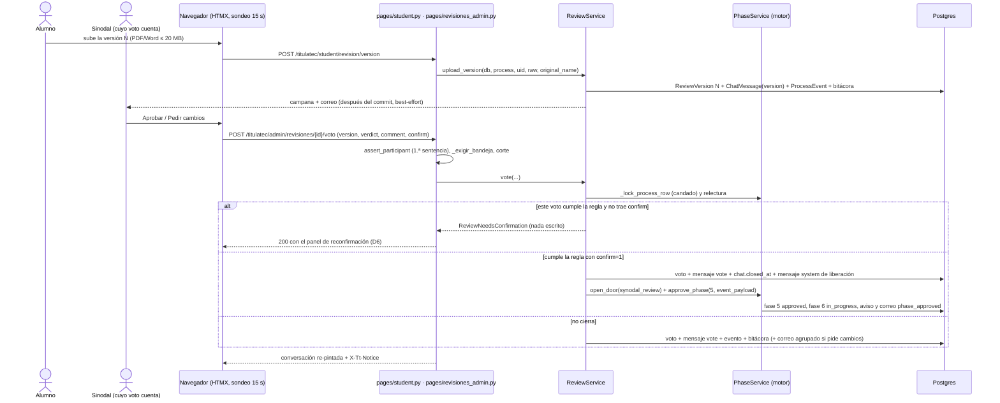

# Revisión de sinodales: conversación, versiones, votos y liberación (fase 5)

> **Objetivo:** el alumno y sus 4 sinodales vigentes revisan el proyecto en una conversación por proceso (versiones PDF/Word, observaciones, adjuntos y votos según la regla de firma de la modalidad); al cumplirse la regla la fase 5 se aprueba sola y el proceso pasa a la 6.

| | |
|---|---|
| **Actor(es)** | 👤 Alumno (`graduate`, dueño del proceso) · 🧑‍⚖️ Sinodales vigentes (`titulatec_sinodal`, por puesto `docente_{depto}`; solo **los 4 de la asignación vigente**) · 🤖 sistema (cierre, avisos, recordatorios). Nadie más entra: ni el jefe de departamento, ni Vinculación, ni el Departamento de Titulación, ni `admin` (D1) |
| **Permiso(s)** | alumno: `titulatec.chat.page.view` (página), `chat.api.read` (refresco y archivos), `chat.api.send` (mensaje), `chat.api.upload` (adjunto y versión) · sinodal: `synodal.page.my_reviews` (bandeja), `chat.api.read`, `chat.api.send`, `chat.api.upload` (adjuntar), `synodal.api.vote` (votar). Todos por `require_page_app("titulatec", perms=[...])`, sin bypass de admin. **No se usan** `synodal.api.release` (la liberación es automática) ni `chat.api.pin_document` (las versiones sustituyen al documento fijado) |
| **Trigger** | el proceso entra a la fase 5 (`synodal_review`): `SynodalService.assign` registra a los 4 sinodales ([fase 4](phase4_department_assign_synodals.md)) |
| **Precondiciones** | corte `TITULATEC_HANDOFF_PHASE` > 5 (en producción vale 3: nada alcanzable, ver «Producción») · los 4 sinodales vigentes · modalidad con `signature_rule` válida (la graba el Formato B aprobado) |
| **Sub-flujos** | ⤵ [motor de avance](engine_approve_advance_phase.md) (`approve_phase` con la puerta de la fase 5) · ⤵ [días inhábiles](xcut_non_working_days.md) (plazo) · ⤵ [correos del proceso](xcut_student_email_notifications.md) (`review_changes_requested`, `phase_approved`) |
| **Estado final** | conversación con `closed_at`, fase 5 `approved`, fase 6 (`anexo_iii`) `in_progress`, `current_phase` = 6; la conversación sigue visible, solo de lectura (D7) |

## Ruta en la app (UI)

1. **Alumno** (shell móvil del alumno): tablero → tarjeta de la fase 5 con el CTA «Abrir la conversación» (o «Consultar la conversación» ya liberada) y «N nuevos» → `/titulatec/student/revision`. Ahí: hilo, panel de estado (versión vigente, quién votó, regla en lenguaje llano, plazo), formulario de mensaje y «Subir nueva versión» (solo abierta).
2. **Docente** (shell admin): menú «Mis revisiones» (`bi-chat-square-text`, solo con `synodal.page.my_reviews` y la fase 5 operable) → `/titulatec/admin/revisiones`. Tres pestañas: **Por revisar** (hay versión vigente, su voto cuenta y no ha votado esa versión) · **En curso** (abiertas: esperando versión, ya votó, o su voto no cuenta) · **Completados** (conversación cerrada, o proceso revocado con la píldora «Revocada»). FIFO por fecha de la versión vigente, semáforo de plazo, «N nuevos», búsqueda por nombre o control y paginado (`utils/paging`). La fila abre `/titulatec/admin/revisiones/{process_id}`.
3. El rol `titulatec_sinodal` **aterriza** en «Mis revisiones» si tiene el permiso y la fase 5 es operable (`nav._CONDITIONAL_LANDING`); si no, conserva su placeholder.
4. **Quien no está en la conversación** (expediente, detalle de Sinodales, pestaña Titulación) ve solo el **estado** (D1, ver «Estado sin conversación»).

## Secuencia

## Pasos detallados

| # | Actor | UI / dónde | Acción | Endpoint | Service · método | Efecto en BD | Eventos / Notif |
|---|---|---|---|---|---|---|---|
| 1 | 🤖 | (dentro de la fase 4) | Abre la conversación al registrar a los 4 | — (dentro de `assign`) | `ReviewService.open_chat` (sin commit, antes de `approve_phase`; solo si `ReviewService.operable`) | `titulatec_chats` + mensaje `system` «Tus sinodales quedaron asignados…» | — |
| 1b | 🤖 | Mis revisiones | Respaldo idempotente para procesos ya en fase 5 sin conversación | (al abrir la conversación) | `ReviewService.chat_for(db, process, create=True)` (el docente): **solo crea con la revisión viva** (proceso `active` y fase 5 `in_progress`); si no, devuelve `None` sin escribir y la ruta pinta la vista de solo lectura «sin conversación» (encabezado de D13 y el porqué) | idem (o nada) | — |
| 2 | 👤 | Conversación | Sube una versión del proyecto | `POST /titulatec/student/revision/version` | `ReviewService.upload_version` (valida con `review_files.validate` ANTES de escribir) | `titulatec_review_versions` (`number` = máx+1) + `titulatec_chat_messages` `kind=version` + archivo `v{N}_{control}.{ext}` | `ProcessEvent review_version_uploaded {version}`, bitácora `review.version_uploaded`; después del commit: `ReviewNotices.send_version_notices` (campana `REVIEW_VERSION` + correo `review_new_version.html` a los 4) |
| 3 | 👤🧑‍⚖️ | Conversación | Escribe un mensaje (con o sin adjunto) | `POST /titulatec/student/revision/mensaje` · `POST /titulatec/admin/revisiones/{id}/mensaje` | `ReviewService.post_message` | `titulatec_chat_messages` `kind=message` (+ `m{id}_{control}.{ext}`) | `ReviewNotices.on_message`: a lo más un aviso `REVIEW_MESSAGE` sin leer por conversación y usuario; **sin correo** |
| 4 | 👤🧑‍⚖️ | Conversación | Refresco automático cada ~15 s | `GET /titulatec/student/revision/mensajes?after=` · `GET /titulatec/admin/revisiones/{id}/mensajes?after=` | `ReviewService.messages(db, chat_id, after_id=)`, `mark_read` | `titulatec_chat_reads` (upsert monótono) | — |
| 5 | 🧑‍⚖️ | Conversación | Vota «Aprobar» / «Pedir cambios» | `POST /titulatec/admin/revisiones/{id}/voto` | `ReviewService.vote` | `titulatec_review_votes` (uno por versión y asignación) + mensaje `vote` | `ProcessEvent review_vote_cast {version, role, verdict}`, bitácora `review.vote_cast`; campana `REVIEW_VOTE` al alumno; con `changes_requested`, `StudentMail.review_changes_requested` (agrupado por versión) |
| 6 | 🧑‍⚖️→🤖 | Panel de reconfirmación | Confirma el voto que cierra | `POST …/voto` con `confirm=1` | `ReviewService.vote` → `PhaseService.open_door` + `approve_phase` | `chat.closed_at`, mensaje `system` de liberación, fase 5 `approved`, fase 6 `in_progress` | `phase_approved` con `event_payload {version, rule, voters}`, aviso y correo `phase_approved` al alumno |
| 7 | 🧑‍⚖️👤 | Conversación | Descarga un archivo | `GET …/archivo/{message_id}` (ambos lados) | `ReviewService.attachment_for(db, process_id, message_id)` | — | — |
| 8 | 🤖 | Celery 9:15 | Recordatorios de plazo | tarea `titulatec.review_reminders` | `ReviewReminders.run` | `titulatec_review_reminders` (dedupe) | campana `REVIEW_REMINDER` + correo `review_reminder.html` a quien cuenta y no votó |

## Detalle por tema

### Versiones y archivos (D2, §7.2)

- El alumno sube cada **versión del proyecto** (informe técnico, tesis…): PDF, `.docx` o `.doc`. Todos pueden **adjuntar** PDF o Word en un mensaje (el sinodal devuelve el documento anotado).
- Validación en `utils/review_files.validate(raw, original_name)`: extensión **y** firma (`%PDF-`; `.docx` = `PK\x03\x04` + una entrada `word/`; `.doc` = firma OLE `D0CF11E0A1B11AE1`). Un `.docx` renombrado a `.pdf` se rechaza. No se importa nada de helpdesk. Error → `ReviewFileError` (subclase de `ValueError`) → 200 con el error pintado en el formulario.
- Tamaño máximo: setting `TITULATEC_REVIEW_MAX_FILE_MB` (default **20**, rango 1-50), leído por `review_files.max_bytes()`; sin compresión.
- **Nada se lee antes de las guardas** (revisión final, I2): las tres rutas que reciben archivo (`POST /student/revision/mensaje`, `/student/revision/version` y `/admin/revisiones/{id}/mensaje`) abren con la guarda solo-cabeceras `revisiones_admin._review_body_block` (`Content-Length` vía `public._declared_body_size`; ausente o inválido → **411**, por encima de `review_files.max_body_bytes()` = tope del archivo + 1 MB de margen multipart → **413**, ambos con `X-Tt-Error`) ANTES de `request.form()`. Las dos del alumno no declaran `File`/`Form` (FastAPI los leería antes de la ruta) y son de **dos saltos** (CLAUDE.md de la app §1, matiz (b)): el primero valida (proceso propio, `_phase_guard`, conversación existente y abierta) y devuelve la respuesta final o `None`; solo entonces se lee el form; el segundo repite todo sobre el estado de AHORA, revisa el permiso que pide la petición y escribe.
- Disco: `{UPLOAD}/{period}/{control}/revision/` con `safe_join`; el nombre lo genera el servidor (`review_files.version_filename` → `v{N}_{control}.{ext}`, `attachment_filename` → `m{message_id}_{control}.{ext}`); `original_name` es solo para mostrar y descargar.
- Descarga: `ReviewService.attachment_for` resuelve el mensaje **dentro de la conversación del proceso ya autorizado** (nunca `db.get` suelto); PDF `inline`, Word `attachment` (`review_files.disposition`), `X-Content-Type-Options: nosniff`, nombre saneado (`review_files.download_name`). Los archivos nunca se sirven por ruta estática.

### Mensajes y refresco (D10)

- Texto 1..4000 caracteres (`MAX_MESSAGE`), con o sin adjunto; un adjunto solo vale. Se pinta escapado (Jinja autoescape; sin HTML), con saltos de línea. Los mensajes son **inmutables**: no hay edición, borrado ni respuestas (`parent_id` sin uso).
- Tipos (`ChatMessage.kind`): `message`, `system`, `version`, `vote`; cada uno con su burbuja (`partials/review/_messages.html`, clases `tt-rv-msg--{kind}`).
- Refresco: el hilo pide `…/mensajes?after=<último id>` cada 15 s con `hx-trigger="every 15s [document.visibilityState=='visible']"`, agrega solo lo nuevo (`beforeend`, módulo `static/js/shared/review-thread.js`, `window.TitulaTecReviewThread`) y, si hubo mensajes nuevos, reemplaza fuera de banda el panel de estado (`#tt-rv-status`), la zona viva y el voto. Con la conversación ya **no abierta** (liberada, en pausa, revocada) el refresco manda ese bloque fuera de banda **siempre**, haya o no mensajes nuevos (una pausa o revocación no deja mensaje): el sondeo sale del DOM, se detiene y el formulario cambia por el aviso de consulta. **Sin Socket.IO** (D10).
- **Envíos con `after`** (I1): los formularios de mensaje y versión del alumno —como el del docente— llevan `data-tt-review-poll`, así que el JS les agrega `after` y la respuesta del POST trae lo propio **y** lo que otros escribieron entre refrescos (regla común: `after` solo si es menor que el id nuevo; sin él, solo lo propio). Sin eso, un mensaje ajeno de id menor nunca se pintaba y `mark_read` hasta el id propio lo daba por leído. La respuesta del alumno re-pinta además, fuera de banda, el panel de estado y el encabezado del formulario de versión (`_ver_head.html`: tras la primera subida ya no pide «la primera versión»).
- Leídos (`titulatec_chat_reads`): abrir la conversación o recibir mensajes con ella abierta llama `ReviewService.mark_read`; `unread_counts` alimenta «N nuevos» en «Mis revisiones» y en la tarjeta del alumno.

### Votos y regla de firma (D3, D4, §6.1)

- **Un solo traductor**: `ReviewService.counting_roles(signature_rule)`: `president_only` → `("president",)` (titulación integral: solo el Presidente vota; Secretario, Vocal y Suplente comentan y adjuntan); `all_synodals` → los 4 de `SynodalService.ROLES` (tesis y proyecto de investigación: **suplente incluido**). Valor desconocido o proceso sin modalidad → `ValueError(RULE_UNKNOWN_MSG)`: **falla cerrado** (la revisión no puede cerrarse y el panel lo dice). Nadie fuera de `review_service.py` compara `signature_rule` (AST en `test_review_service.py`) y no hay ningún `if modality.code == …`.
- El AST de `test_review_service.py` recorre TODO `itcj2/apps/titulatec/` (`rglob`, salvo `models/` y el propio `review_service.py`) y un regex revisa `templates/`: ni un util, ni un helper, ni una plantilla leen `signature_rule`.
- Solo quien su voto cuenta ve «Aprobar» / «Pedir cambios» (`partials/revisiones/_voto.html`); el servidor lo exige igual (`NOT_COUNTING_MSG`).
- `changes_requested` exige comentario (1..2000, `MAX_COMMENT`); `approved` lo admite opcional. El formulario manda la `version` que el sinodal tenía en pantalla: si bajo el candado la vigente es otra, **no se escribe nada** y la ruta responde 200 con la conversación re-pintada y `X-Tt-Notice` (warning) «El alumno subió una versión nueva: revísala antes de votar.» (`ReviewVersionChanged`).
- **Reinicio por versión (D4)**: cuenta solo la versión vigente (la de mayor `number`, `ReviewService.current_version`) y solo los votos de asignaciones vigentes. Los votos de versiones anteriores no se borran: quedan como historia. Se puede cambiar el voto mientras la revisión siga abierta (una fila por `(version_id, assignment_id)`; cada cambio deja otro mensaje `vote`).
- Todo bajo `PhaseService._lock_process_row` con relectura; cualquier error bajo el candado hace `rollback`.

### Reconfirmación y cierre (D5, D6, §6.4)

- Si con este voto se cumple la regla (`ReviewService._satisfied`: todos los roles que cuentan con asignación vigente tienen `approved` en la versión vigente): **sin `confirm`** → `ReviewNeedsConfirmation` ANTES de escribir; la ruta responde 200 con el panel de reconfirmación (`#tt-rev-confirm`) que lleva `CONFIRM_CLOSE_MSG`: «Al aprobar se cerrará la revisión: la conversación quedará solo para consulta y ya no habrá más cambios ni versiones. ¿Confirmas?». La decisión se toma bajo el candado: dos sinodales de tesis aprobando a la vez no cierran sin confirmación. La UI anticipa el texto con `ReviewService.would_close` (`hx-confirm` + `data-tt-confirm-ok="Aprobar y cerrar"` en el botón «Aprobar» del que cerraría); el servidor lo exige igual.
- **Con `confirm=1`** cierra: `chat.closed_at = ahora` y mensaje `system` de liberación (antes del commit), luego `PhaseService.open_door(db, "synodal_review", process.id, "approved")` + `approve_phase(db, process, n5, actor_id, event_payload={"version", "rule", "voters"})` y `close_door` en el `finally`. `approve_phase` activa la fase 6, avisa al alumno y encola `StudentMail.phase_approved`.
- **Puerta única**: `synodal_review` está en `PhaseService._DOOR_PHASES` con `REVIEW_ONLY_MSG`; `_door_state_ok` = `ReviewService.rule_satisfied` (la regla se cumple de verdad en la versión vigente). `approve_phase` por cualquier otra vía (botones del expediente, POST forzado, marca sin regla cumplida) → `REVIEW_ONLY_MSG`. **La fase 5 no tiene rechazo.**
- Texto de liberación (`ReviewService._release_text`): con la fase 6 operable en la app (`PhaseService.operable_codes`) → «Proyecto liberado. Ya puedes pasar por tu Anexo III para que lo firmen tus sinodales: {basta la firma del Presidente | se necesitan las firmas de tus 4 sinodales}.» (la línea sale de `ReviewService.signature_text`); con el corte en 6 → `RELEASED_HANDOFF_TEXT` (el Departamento de Titulación continúa por T-soft), sin prometer el Anexo III.

### Conversación de solo lectura (D7)

`ReviewService.is_open(process, chat)` = `closed_at` nulo **y** proceso `active` **y** fase 5 `in_progress`. Fuera de eso nadie escribe, adjunta, sube versión ni vota (`CLOSED_MSG`); los GET de consulta siguen. Un proceso `cancelled` sale de «Por revisar» y «En curso» y queda en «Completados» con la píldora «Revocada»; un `on_hold` (dato viejo) tampoco entra a «Por revisar», al semáforo ni a los recordatorios (con D12 un proceso en fase 5 no queda pausado por una convocatoria; ver [`phase0_school_services_cohort_detail.md`](phase0_school_services_cohort_detail.md)).

### «Mis revisiones» (§8.2)

- Servicio: `ReviewInboxService.list(db, user_id, *, tab, q, page)` (clasificación pura `_classify`; presupuesto fijo de 4 consultas, igual con 2 que con 6 procesos). El universo son las **asignaciones vigentes** del docente: un sustituido deja de ver el proceso.
- Rutas (`pages/revisiones_admin.py`, prefijo `/titulatec/admin/revisiones`, nombres `titulatec.pages.revisiones.*`): `GET ""` (`home`) y `GET /body` (`body`) con `synodal.page.my_reviews` (404 con el corte ≤ 5); `GET /{process_id}` (`conversation`), `GET /{process_id}/mensajes` (`messages`), `GET /{process_id}/archivo/{message_id}` (`file`) con `chat.api.read`; `POST /{process_id}/mensaje` (`message`, `chat.api.send`; adjuntar exige además `chat.api.upload`, si no 403; tope solo-cabeceras 411/413 antes de leer el form); `POST /{process_id}/voto` (`vote`, `synodal.api.vote`).
- Una fila cuyo proceso **no tiene conversación** y ya no está en revisión viva (en pausa, revocado, fase 5 fuera de curso) abre la vista de solo lectura «sin conversación»: encabezado de D13, hilo vacío y el porqué en `#tt-rev-readonly` («El proceso está en pausa…», «La inscripción fue revocada…» o «Esta revisión no tiene conversación en la app…»); no se crea el chat ni su mensaje de apertura (I4).
- Encabezado de la conversación (D13): nombre, nº de control, carrera, modalidad, título del proyecto (`FormatB.project_name`, «—» si no hay) y los otros sinodales con su rol. **Nada** de teléfono, domicilio, CURP ni documentos de las fases 1-3 (hay una prueba sobre el HTML).

### Lo que ve el alumno (§8.1)

- Rutas en `pages/student.py`: `GET /student/revision` (`titulatec.pages.student.revision`), `GET /student/revision/mensajes`, `POST /student/revision/mensaje`, `POST /student/revision/version`, `GET /student/revision/archivo/{message_id}`.
- Las dos mutaciones llevan `_phase_guard(db, process, n_fase5)` (solo la fase en curso y proceso `active`) y `_review_open_guard` (404 sin conversación, 400 + `CLOSED_MSG` de solo lectura) en los DOS saltos, con el tope solo-cabeceras antes (ver «Versiones y archivos»). Los tres GET están en `RUTAS_SIN_FASE` (`test_student_phase_guard.py`) con su propia guarda `_review_read_guard`: el proceso del alumno alcanzó la fase 5 (en curso o aprobada), `ReviewService.operable(db)` y existe la conversación; si no, 302 al tablero (página) o 404 sin header (parcial y archivo). Así sigue visible después de liberarse y es inerte con el corte en 3.
- Tarjeta del tablero (`_review_card` / `_review_state`): «Sube tu primera versión» · «En revisión: N de M aprobaciones» · «Te pidieron cambios» · «Liberado», más «N nuevos». El panel «Tus sinodales» de la fase 4 sigue. Etiquetas del timeline sin número de versión («Subiste una versión de tu proyecto», «Un sinodal votó una versión de tu proyecto»).
- **El alumno no tiene plazo** (el semáforo es del docente).

### Estado sin conversación (D1, §8.3)

`ReviewService.status_for_process(db, process_id, *, holidays=None) -> dict | None` (`None` sin conversación): `version`, `uploaded_label`, `due`/`due_label`, `semaphore` (`ok|warn|late`; `None` sin versión, cerrada o proceso fuera de `active`), `votes` (por rol vigente, con `counts` y `verdict`), `rule_label`, `approvals`/`required`, `closed`. Se pinta **sin mensajes, archivos ni ligas** (`partials/review/_status.html`) en: la tarjeta de la fase 5 del **expediente** (`pages/admin.py::_detail_ctx`), el detalle de **Sinodales** (`pages/sinodales_admin.py`, para decidir sustituciones) y la pestaña **Titulación** cuando muestra los sinodales (`pages/titulacion_admin.py`). Cada una solo con la fase 5 alcanzada y `ReviewService.operable(db)`; el expediente y Titulación además solo si la modalidad no salta la fase.

Cuando el expediente NO pinta el estado, la tarjeta dice el porqué con `ReviewService.empty_label(db, process)` (patrón de `SynodalService.empty_label`, fase 4): **«No aplica para esta modalidad.»** si la modalidad salta la fase 5 (`skips_phases`, p. ej. EGEL) o su `ProcessPhase` está `skipped` (gana sobre el corte); **«Esta fase todavía no está en la app: la revisión de sinodales se lleva en T-soft. Lo que se ve aquí es su estado, no su contenido.»** sin la fase operable (el sentido de lo que decía antes de la fase 5; es lo que ve producción con el corte en 3); **«El proceso todavía no llega a la revisión de sinodales.»** si aún no llega. Devuelve `None` cuando el estado aplica.

### Plazo y semáforo (D9)

`TITULATEC_REVIEW_DAYS` (default 10, rango 1-60; `review_files.review_days()`). Vence = `ReviewService.due_date(version, holidays=)` = `add_business_days(fecha de la versión vigente, 10, holidays=)`: **no se guarda**, se calcula con el calendario vigente, así que registrar días inhábiles después recorre el plazo solo ([calendario](xcut_non_working_days.md)). `ReviewService.semaphore`: `ok`; `warn` a `WARN_BUSINESS_DAYS` (2) o menos días hábiles (el día que vence incluido); `late` vencido. Sin versión no corre plazo.

### Avisos, correos y recordatorios (D8, §10)

Módulo `services/review_notices.py` (`ReviewNotices`), no `ReviewService`:

| Evento | Campana (`NotificationService`, `app_name="titulatec"`) | Correo |
|---|---|---|
| Versión nueva | `REVIEW_VERSION` a los 4 sinodales vigentes | **Sí**: `email/review_new_version.html` por `deliver_detailed` directo, DESPUÉS del commit, best-effort; una falla queda en log y bitácora `review.mail_failed`, nunca revierte |
| Mensaje | `REVIEW_MESSAGE` a los demás participantes, a lo más un aviso sin leer por conversación y usuario | No |
| Voto | `REVIEW_VOTE` al alumno | Solo `changes_requested`: kind `review_changes_requested` por la **bandeja** del alumno (`StudentMail.review_changes_requested`; `group_key = review:{process_id}:{version}`, así varios votos de una ronda salen en un solo correo con las observaciones; obsoleto si ya hay versión más nueva o la fase 5 se aprobó) |
| Liberado | (el de `approve_phase`) | `phase_approved` existente; `_compose_phase_approved` agrega la línea del Anexo III solo cuando la fase aprobada es `synodal_review` (EGEL no la recibe) y la fase 6 es operable |
| Liberación (cierre de la fase 5) | `ANEXO_READY` «Proyecto liberado: Anexo III» a los ocupantes vigentes de `coord_vinculacion_{depto}` (o, vacante, de `head_{depto}`), con liga a `/titulatec/admin/sinodales?tab=anexo&selected={id}` | No. `AnexoService.notify_release`, DESPUÉS del commit del voto, en su propia sesión y best-effort (una falla se loguea y no afecta la liberación); inerte si la fase 6 no es operable. Ver [fase 6](phase6_anexo_iii.md) |
| Asignación o sustitución (fase 4) | `SYNODAL_ASSIGNED` / `SYNODAL_RELEASED` (fase 4) | el correo de la fase 4 (`email/synodal_assigned.html`) invita a «Mis revisiones» cuando la fase 5 es operable (`SynodalService.send_assignment_notices` pasa `revision`/`review_link`) |

**Recordatorios**: tarea Celery `titulatec.review_reminders` (diaria, **9:15**; la programa solo `database/DML/titulatec/fase_2/03_revision_sinodales.sql`, en producción no existe la fila), `ReviewReminders.run(db)`: por cada versión vigente de una conversación abierta de un proceso `active` y cada sinodal vigente cuyo voto cuenta y no ha votado: `due_soon` con 2 o menos días hábiles y sin vencer, `due_today` el día que vence o el primer barrido después. Dedupe con `INSERT … ON CONFLICT DO NOTHING RETURNING` en `titulatec_review_reminders` (PK versión + asignación + tipo): solo quien insertó recibe campana (`REVIEW_REMINDER`) y correo (`review_reminder.html`). Un barrido en lote; el calendario se lee una vez.

### Sustitución durante la revisión (fase 4)

`SynodalService.replace` (permitido mientras la fase 5 no esté aprobada) llama `ReviewService.on_replaced` en su misma transacción: deja un mensaje `system` «X sustituye a Y como Secretario.». El voto de la asignación desactivada deja de contar; el entrante ve todo el historial y vota sobre la versión vigente; el sustituido pierde el acceso (`assert_participant` → 404). **Sustituir nunca cierra la revisión.**

## Seguridad y guardas

- **`ReviewService.assert_participant(db, user_id, process_id)`** es la primera sentencia del `try` de toda ruta del docente con `{process_id}`: 404 **sin header** si no hay asignación vigente (un sustituido, un extraño, un jefe, un `admin` o el alumno de otro proceso no saben ni que existe). Devuelve el proceso. `test_scope_guard.py` acepta dos guardas (`assert_process_in_scope` o `assert_participant`) con la misma regla de primera sentencia incondicional; las rutas del alumno no llevan `{process_id}` (usan su propio proceso).
- Orden en las rutas del docente: `assert_participant` → `_exigir_bandeja` (403 sin `my_reviews`) → `_operable` (404 en GET, 400 + `INERT_MSG` en POST).
- `ReviewService._assert_author`: el alumno dueño o un sinodal vigente; si no, `NOT_PARTICIPANT_MSG`. `upload_version` solo el alumno (`ONLY_STUDENT_MSG`).
- Contrato HTMX: validación → 200 con el parcial re-pintado (`X-Tt-Review-Keep: 1` para no limpiar el formulario); guardas → 400 + `X-Tt-Error` (`_hdr`); éxito → `X-Tt-Notice`. Rutas `def` o `async` canónicas con `_cuerpo_*`. Sin `<script>` inline; confirmaciones por `data-tt-confirm-ok`.

## Eventos y bitácora

- `EVENT_TYPES`: `review_version_uploaded {version}`, `review_vote_cast {version, role, verdict}` (el rol viaja como **valor**, nunca como llave: `secretary` contiene «secret» y la bitácora lo enmascara). Etiquetas en `pages/student.py::_EVENT_LABELS` y `pages/admin.py::_EVENT_UI`. Los mensajes **no** generan `ProcessEvent`. La liberación es el `phase_approved` de siempre con `event_payload`.
- `AUDIT_ACTIONS` (módulo `review`, «Revisión de sinodales»): `review.version_uploaded`, `review.vote_cast`, `review.mail_failed`. El espejo de `ProcessEvent` clasifica `review_*` en ese módulo (`_EVENT_PREFIX_MODULES`).
- Red ORM: `titulatec_review_versions`, `titulatec_review_votes`, `titulatec_review_reminders` están en `TABLE_MODULES` (módulo `review`; ojo: por eso el **comentario del voto** queda copiado en la bitácora inmutable por la red, además del mensaje `vote` del hilo); `titulatec_chat_messages` y `titulatec_chat_reads` en `NET_EXCLUDED_TABLES` (los mensajes son su propio registro inmutable y el contenido no se duplica en la bitácora; las lecturas son ruido); `titulatec_chats` sigue en la red. Ver [bitácora](xcut_audit_log.md).

## Datos

Migración `tt20261022c` (a mano, `down_revision = tt20261022b`): `titulatec_chats.closed_at`; `titulatec_chat_messages` (`author_id` NULL-able, `kind`, `version_id`, `attachment_mime/size`, índice `(chat_id, id)`); tablas nuevas `titulatec_review_versions` (`UNIQUE(process_id, number)`), `titulatec_review_votes` (`UNIQUE(version_id, assignment_id)`, CHECK del veredicto `approved|changes_requested`), `titulatec_review_reminders`, `titulatec_chat_reads`, `titulatec_non_working_days`. `ProcessChat.pinned_document_id` y `SynodalAssignment.vote/vote_at/vote_note` quedan como **legado sin uso**.

## Estado resultante

- `titulatec_review_versions`: una fila por versión (la vigente = mayor `number`); `titulatec_review_votes`: el veredicto de cada asignación por versión.
- Cierre: `titulatec_chats.closed_at` ≠ NULL; fase 5 `approved`; fase 6 `in_progress`; `process.current_phase` = 6 (o la siguiente aplicable). La conversación queda de solo lectura para el alumno y los sinodales («Completados»).
- Con el corte en 3 nada de esto es alcanzable (ver «Producción»).

## Caminos alternos / errores ❗

- Archivo vacío, extensión o firma inválida, o más de 20 MB → 200 con el error en el formulario, nada escrito en BD ni disco.
- Cuerpo declarado por encima de 20 MB + 1 MB de margen → 413 + `X-Tt-Error` sin leerlo; sin `Content-Length` (cuerpo `chunked`) → 411 (el tope no se podría aplicar antes de leer).
- Docente abre un proceso sin conversación fuera de una revisión viva → 200 con la vista de solo lectura «sin conversación»; nada escrito.
- Mensaje vacío o de más de 4000 caracteres → 200 con el error (`X-Tt-Review-Keep`).
- «Pedir cambios» sin comentario (o >2000) → 200 con el error; nada escrito.
- Voto de quien no cuenta → 400 + `X-Tt-Error` (`NOT_COUNTING_MSG`); sin versión → `NO_VERSION_MSG`.
- Voto sobre una versión que ya no es la vigente → 200 re-pintado + aviso warning; nada escrito.
- Voto que cierra sin confirmación → 200 con el panel de reconfirmación; nada escrito.
- Conversación cerrada, proceso no `active` o fase 5 no `in_progress` → 400 + `CLOSED_MSG`.
- No participante → 404 sin header; sin el permiso de la bandeja → 403; corte ≤ 5 → 404 (GET) / 400 `INERT_MSG` (POST).
- Regla de firma desconocida → la revisión no cierra y el panel dice «Regla de firma desconocida; avisa al Departamento de Titulación.».
- Falla un correo a un sinodal → se registra y no se revierte nada (`review.mail_failed`).

## Producción y despliegue

- **Inerte con `TITULATEC_HANDOFF_PHASE=3`** (producción y CI): el alumno nunca llega a la fase 5, «Mis revisiones» no aparece (guarda `_NAV_PHASE_GATE["/titulatec/admin/revisiones"] = "synodal_review"` y aterrizaje condicional), los permisos nuevos y la tarea solo existen tras `init-titulatec-fase-2`, y las rutas responden 400/404. La migración sí se aplica al fusionar (tablas vacías).
- **Único cambio visible en producción** del spec: D12 (cerrar una convocatoria ya no pausa a quien pasó el primer *checkpoint*), ver [Detalle de convocatoria](phase0_school_services_cohort_detail.md); se confirma con el usuario antes del merge.
- Orden (cuando llegue): `alembic upgrade head` (→ `tt20261022c`) **antes** de que el código sirva tráfico (columna `kind` y `author_id` NULL) → `titulatec init-titulatec-fase-2` (el `03_revision_sinodales.sql` concede `synodal.page.my_reviews`, `synodal.api.vote` y los `chat.*` a `titulatec_sinodal`, los 2 permisos del calendario, la tarea periódica —con la descripción copiada EXACTA de `TASK_DEFINITIONS`— y `responsible='synodals'` de la fase 5; después de los SQL el comando hace la corrección D12 en Python, `fase2._reactivar_d12`: por ORM, con un `process_resumed` `{reason: "checkpoint", source: "init-titulatec-fase-2"}` y `actor_id` NULL por proceso, espejado en la bitácora, e imprime «D12: N proceso(s) reactivado(s).»; el `--dry-run` solo cuenta) → recrear **worker y beat** de Celery (tarea nueva). La verificación exige que la tarea periódica EXISTA; si alguien la pausó desde /config/system/tasks sale como AVISO y el re-run no aborta.
- Settings: `TITULATEC_REVIEW_MAX_FILE_MB` (20), `TITULATEC_REVIEW_DAYS` (10); cambiar cualquiera exige variable de entorno y reiniciar todos los procesos.

## Pruebas

`test_review_models.py`, `test_review_files.py`, `test_review_service.py` (regla integral/tesis, reinicio, confirmación, carrera, puerta, sustitución, solo lectura, AST de `signature_rule`), `test_review_notices.py`, `test_review_reminders.py`, `test_review_inbox.py`, `test_revisiones_admin.py` (matriz de 404), `test_student_revision.py`, más los censos (`test_scope_guard.py`, `test_student_phase_guard.py`, `test_route_threadpool_convention.py`, `test_event_labels.py`, `test_audit_actions_*`, `test_permissions_contract.py`, `test_models_registry.py`, `test_email_outbox_model.py`, `test_cli_fase_2.py`). Correr local con `-e TITULATEC_HANDOFF_PHASE=3`; las que operan la fase 5 fijan el corte con `monkeypatch.setattr(PhaseService, "_handoff_phase", staticmethod(lambda: 9))`.

## Flujos relacionados

- ← [El departamento asigna a los 4 sinodales](phase4_department_assign_synodals.md)
- ⤵ [Días inhábiles](xcut_non_working_days.md) · [Motor de avance de fase](engine_approve_advance_phase.md) · [Correos del proceso](xcut_student_email_notifications.md) · [Bitácora](xcut_audit_log.md)
- → [Anexo III (fase 6)](phase6_anexo_iii.md). [Máquina de estados](00_state_machine.md) · [Glosario](_glossary.md)
