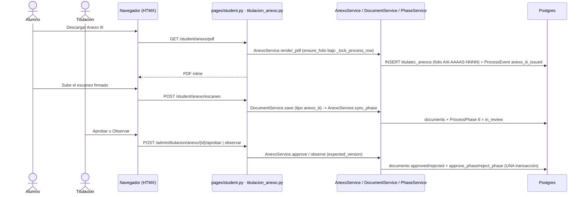

# Anexo III: descarga, firma, escaneo y dictamen de Titulación (fase 6)

> **Objetivo:** el alumno descarga su Anexo III (liberación del proyecto, con folio), lo hace firmar fuera de la app, sube el escaneo y el Departamento de Titulación lo aprueba u observa; al aprobar, el proceso pasa a la fase 7.

| | |
|---|---|
| **Actor(es)** | 👤 Alumno (`graduate`, dueño del proceso) · 🎓 Departamento de Titulación (`titulatec_titulacion`, `titulatec_titulaciones`) · 🧑‍💼 Vinculación del departamento académico (jefe o coordinador: descarga el PDF para gestionar la firma del jefe) · 🤖 sistema (folio, sincronía de la fase, aviso) |
| **Permiso(s)** | alumno: `titulatec.anexo_iii.api.generate.own` (descarga) + los `document.*.own` de siempre (subir/borrar el escaneo) · Departamento (Sinodales): `titulatec.anexo_iii.api.generate` + `synodal.api.read` + alcance · Titulación: `titulatec.titulacion.page.list` + `titulatec.anexo_iii.api.review` (abrir la vista, ver el escaneo y el PDF, aprobar, observar). Todos por `require_page_app("titulatec", perms=[...])`, sin bypass de admin |
| **Trigger** | la fase 5 se cierra ([votos](phase5_synodal_review.md)) y el proceso entra a la fase 6 (`anexo_iii`) |
| **Precondiciones** | corte `TITULATEC_HANDOFF_PHASE` > 6 (en producción vale 3: nada alcanzable) · modalidad que no salta la fase 6 (EGEL la salta: `skips_phases=[4,5,6]`) · los 4 sinodales vigentes, carrera ligada a un departamento y modalidad con `product_label` (si falta algo, el PDF no se genera y no se quema folio) |
| **Sub-flujos** | ⤵ [motor de avance](engine_approve_advance_phase.md) (`approve_phase` / `reject_phase` con la puerta `anexo_iii`) · ⤵ [documentos](phase1_student_upload_initial_docs.md) (`DocumentService.save`/`delete` del escaneo) · ⤵ [correos del proceso](xcut_student_email_notifications.md) |
| **Estado final** | escaneo `anexo_iii` `approved`, fase 6 `approved`, fase 7 `in_progress`, `current_phase` = 7 |

## Ruta en la app (UI)

1. **Alumno** (shell móvil): tablero → tarjeta de la fase 6 con el CTA hacia `/titulatec/student/anexo`. Ahí: estado de la fase (en curso, por revisar, con observaciones y motivo, aprobada), folio, **Descargar Anexo III**, «Quién firma» (`AnexoService.signers_text`: el jefe del departamento más el Presidente, o más los 4 sinodales según la regla de firma de la modalidad), slot de subida del escaneo y la ayuda de formato.
2. **Titulación** (`/titulatec/admin/titulacion`): selector de vista «Formato B» · «Anexo III» (solo si `anexo_iii` es operable y el actor tiene el permiso de revisar) → `/titulatec/admin/titulacion/anexo`. Pestañas **Por revisar** (fase 6 `in_review`) · **Observados** (`rejected` sin resubir) · **Aprobados** · **Sin enviar** (`in_progress` sin escaneo); FIFO con semáforo en días hábiles, búsqueda, filtro de carrera y paginado. El detalle trae datos del alumno, modalidad, folio, fecha de liberación, sinodales vigentes, firmas requeridas, visor del escaneo, liga al Anexo generado y **Aprobar** / **Observar** (motivo obligatorio).
3. **Departamento académico** (`/titulatec/admin/sinodales`): pestaña **«En Anexo III»** (procesos en la fase 6) y, en el detalle, el botón «Anexo III (PDF)» junto al del oficio → `GET /titulatec/admin/sinodales/{id}/anexo.pdf`. Es el MISMO documento y el mismo folio que baja el alumno.
4. **Expediente** (`/titulatec/admin/processes/{id}`): la tarjeta de la fase 6 muestra estado, folio, fecha de liberación y, según permisos, «Anexo III (PDF)», «Ver escaneo» y «Abrir en Titulación». Sin estado dice el porqué (`AnexoService.empty_label`, ver «Estado sin pantalla»).

## Secuencia

## Pasos detallados

| # | Actor | UI / dónde | Acción | Endpoint | Service · método | Efecto en BD | Eventos / Notif |
|---|---|---|---|---|---|---|---|
| 1 | 🤖 | (cierre de la fase 5) | `ReviewService.vote` cierra y libera | `POST /admin/revisiones/{id}/voto` | `approve_phase` (fase 5) → `AnexoService.notify_release` | fase 6 `in_progress` | campana `ANEXO_READY` a vinculación (best-effort, tras el commit) |
| 2 | 👤 / 🧑‍💼 | `/student/anexo` · Sinodales | Descargar el PDF | `GET /student/anexo/pdf` · `GET /admin/sinodales/{id}/anexo.pdf` | `AnexoService.render_pdf` → `ensure_folio` | `titulatec_anexos` (una fila por proceso), `titulatec_anexo_counters` | `anexo_iii_issued` (solo la primera vez), bitácora `anexo_iii.issued` |
| 3 | 👤 | `/student/anexo` | Subir el escaneo (PDF, imagen) | `POST /student/anexo/escaneo` | `DocumentService.save` → `AnexoService.sync_phase` | `titulatec_documents` tipo `anexo_iii`; fase 6 → `in_review`, `updated_at` = ahora (clave FIFO) | `document_uploaded` |
| 4 | 🎓 | `/admin/titulacion/anexo` | Aprobar | `POST /admin/titulacion/anexo/{id}/aprobar` | `AnexoService.approve` | escaneo `approved`; `approve_phase` (fase 7 `in_progress`) | `phase_approved` con `{"anexo_iii": {folio, round}}`, bitácora `anexo_iii.reviewed`, correo del motor |
| 4b | 🎓 | `/admin/titulacion/anexo` | Observar (motivo ≤ 500) | `POST /admin/titulacion/anexo/{id}/observar` | `AnexoService.observe` | escaneo `rejected` + `review_note`; `reject_phase` | `phase_rejected`, bitácora, correo del motor |
| 5 | 👤 | `/student/anexo` | Resubir tras la observación | `POST /student/anexo/escaneo` | igual que 3 | fase 6 `rejected` → `in_review` | `document_uploaded` |

## Detalle por tema

### Quién firma (C7)

`AnexoService.required_signers(process)` = `["department_head", *ReviewService.counting_roles(regla)]`: el jefe del departamento más los sinodales que cuentan en la modalidad. Es la ÚNICA lectura de la regla de firma en este flujo: nadie fuera de `review_service.py` compara `signature_rule` (AST en `test_review_service.py`). Regla desconocida → `ValueError` (falla cerrado). El PDF lleva siempre los 4 espacios de sinodales; la firma del jefe la gestiona vinculación.

### Folio

`AIII-{AAAAS}-{NNNN}` (p. ej. `AIII-2026B-0001`; semestre A = ene-jun, B = jul-dic) con contador atómico por semestre (`titulatec_anexo_counters`, `INSERT … ON CONFLICT … RETURNING`). `ensure_folio` valida el contexto (4 sinodales, departamento, modalidad con producto) ANTES de numerar y trabaja bajo `PhaseService._lock_process_row`: a lo más un folio por proceso (UNIQUE de `process_id`), dos descargas simultáneas dan el mismo. La fecha del documento es la de liberación (fin de la fase 5), congelada en `released_at`. Solo se emite con la fase 6 alcanzada y operable; **leer el expediente nunca emite folio**.

### Puerta única

`anexo_iii` está en `PhaseService._DOOR_PHASES` con `ANEXO_ONLY_MSG`: la fase 6 solo se aprueba u observa por `AnexoService.approve`/`observe`, que bloquean el proceso, re-verifican (fase 6 `in_review`, escaneo presente y `pending`) y escriben escaneo + fase en una transacción. `expected_version` es la versión del escaneo que Titulación tenía en pantalla: si cambió, `AnexoVersionChanged` y la ruta re-pinta con aviso warning sin escribir. Invariante: fase 6 `approved` ⇔ escaneo `approved`.

### Sincronía del escaneo (C6)

`DocumentService.save`/`delete`/`review` llaman `AnexoService.sync_phase` (bajo el bloqueo del proceso): escaneo presente → fase 6 `in_review`; ausente → `in_progress`; nunca toca `approved`, `skipped` ni `pending`. Cada subida manda el escaneo al final de la cola.

### Estado sin pantalla (expediente)

`AnexoService.empty_label(db, process)` decide si la tarjeta de la fase 6 lleva el estado (`None`) o el porqué: «No aplica para esta modalidad.» (la modalidad salta la fase o su `ProcessPhase` está `skipped`; gana sobre el corte), «Esta fase todavía no está en la app: el Anexo III se lleva en T-soft. …» (no operable; lo que ve producción) o «El proceso todavía no llega al Anexo III.».

### Aviso de liberación a vinculación (C5)

Al cerrarse la fase 5, `AnexoService.notify_release` crea la campana `ANEXO_READY` («Proyecto liberado: Anexo III») para los ocupantes vigentes de `coord_vinculacion_{depto}` o, si está vacante, de `head_{depto}`, con liga a `/titulatec/admin/sinodales?tab=anexo&selected={id}`. Se llama DESPUÉS del commit del voto, abre su propia sesión, es best-effort y no manda correo. Inerte si el Anexo no es operable.

### EGEL (D5, C10)

`egel.skips_phases = [4, 5, 6]` (DML `04_anexo_iii.sql`). `init-titulatec-fase-2` corrige además los procesos EGEL que ya estaban en la fase 6 (6 → `skipped`, la siguiente aplicable → `in_progress`, `current_phase`), sin `event_type` nuevo, e imprime el conteo.

## Seguridad y guardas

- Rutas del alumno: `_phase_guard` con la fase por código `anexo_iii` (fuera de fase → 302 al tablero en páginas, 400 + `X-Tt-Error` en mutaciones); los GET sin fase están en `RUTAS_SIN_FASE`.
- Rutas con `{process_id}` (Titulación, Sinodales): `assert_process_in_scope` primera sentencia del `try`, luego la guarda de la vista (`titulacion.page.list` + `anexo_iii.api.review`, o `anexo_iii.api.generate` + `synodal.api.read`).
- Validación → 200 con el parcial re-pintado; guardas → 400 + `X-Tt-Error` (`_hdr`, sin acentos); éxito → `X-Tt-Notice`. La ruta genérica `DELETE /student/documents/{type_code}` y `DELETE /student/anexo/escaneo` atrapan el `ValueError` del servicio (carrera borrar-vs-aprobar) → 400.
- **Inerte con el corte ≤ 6**: vista, pestaña, botones, avisos y folio no existen; toda ruta responde 400/redirect.

## Eventos y bitácora

`EVENT_TYPES`: `anexo_iii_issued {folio, semester}` (etiquetas en `_EVENT_LABELS` y `_EVENT_UI`). La subida es el `document_uploaded` existente y el dictamen, `phase_approved`/`phase_rejected` con `event_payload`. `AUDIT_ACTIONS`: `anexo_iii.issued` y `anexo_iii.reviewed`. Tablas `titulatec_anexos` y `titulatec_anexo_counters` en `TABLE_MODULES`.

## Datos

Migración `tt20261022d` (a mano, `down_revision = tt20261022c`): `titulatec_anexos` (PK propia, `process_id` UNIQUE, `folio` UNIQUE, `semester`, `released_at`, `issued_at`, `issued_by_id`), `titulatec_anexo_counters` (PK `semester`) y `titulatec_modalities.product_label`. DML `database/DML/titulatec/fase_2/04_anexo_iii.sql`: 3 permisos, grants, `product_label` por modalidad y `egel.skips_phases`.

## Estado resultante

- `titulatec_anexos`: una fila por proceso desde la primera descarga. Escaneo `anexo_iii` `approved`; fase 6 `approved` con `reviewed_by_id`; fase 7 `in_progress`; `current_phase` = 7.
- Observado: fase 6 `rejected`, escaneo `rejected` con el motivo; el alumno vuelve a subir y la fase regresa a `in_review`.

## Caminos alternos / errores ❗

- Datos incompletos (sin 4 sinodales, sin departamento, sin modalidad con producto) → el PDF responde 400 + `X-Tt-Error` y no se numera nada.
- Aprobar u observar algo que no está «Por revisar» → 400 + `NOT_IN_REVIEW_MSG`.
- Observar sin motivo o con más de 500 caracteres → 200 con el error en el formulario; nada escrito.
- El alumno cambió el escaneo mientras Titulación revisaba → 200 re-pintado + aviso warning; nada escrito.
- Corte ≤ 6, proceso que no llega a la fase 6 o EGEL → 400 + `X-Tt-Error` (y en el expediente, la leyenda del porqué).
- Otro alumno o fuera de alcance → 404 sin header.

## Producción y despliegue

Nada de esto es alcanzable con `TITULATEC_HANDOFF_PHASE=3`. Cuando llegue: `alembic upgrade head` (→ `tt20261022d`) → copiar `database/DML/titulatec/fase_2/` → `titulatec init-titulatec-fase-2` (4 archivos; verifica permisos, `product_label` y EGEL, y corrige los procesos EGEL en la fase 6). Misma trampa de orden que §24 de la guía: `init-titulatec` e `init-ajustes-2026-10` quitan grants y hay que volver a correr el comando.

## Pruebas

`test_anexo_models.py`, `test_anexo_service.py`, `test_anexo_door.py`, `test_anexo_inbox.py`, `test_student_anexo.py`, `test_titulacion_anexo.py`, `test_sinodales_anexo.py`, `test_anexo_expediente.py`, más los censos (`test_scope_guard.py`, `test_student_phase_guard.py`, `test_route_threadpool_convention.py`, `test_event_labels.py`, `test_audit_actions_*`, `test_permissions_contract.py` 115, `test_cli_fase_2.py`, `test_nav_phase_gate.py`). Correr local con `-e TITULATEC_HANDOFF_PHASE=3`; las que operan la fase 6 fijan el corte con `monkeypatch.setattr(PhaseService, "_handoff_phase", staticmethod(lambda: 9))`.

## Flujos relacionados

- ← [Revisión de sinodales (fase 5)](phase5_synodal_review.md)
- ⤵ [Motor de avance de fase](engine_approve_advance_phase.md) · [Correos del proceso](xcut_student_email_notifications.md) · [Bitácora](xcut_audit_log.md)
- → Fase 7 (entrega final): spec propio, aún sin construir. [Máquina de estados](00_state_machine.md) · [Glosario](_glossary.md)
