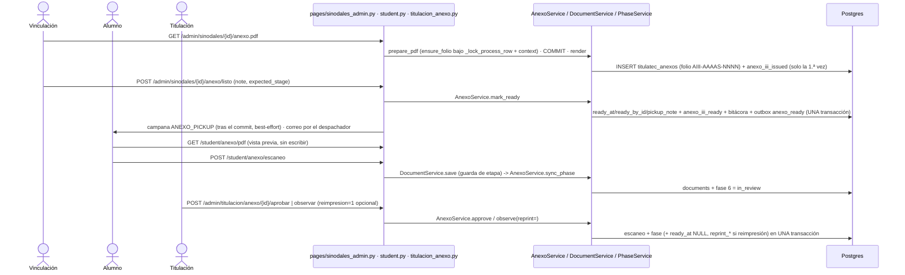

# Anexo III: lo prepara vinculación, lo recoge el alumno, Titulación dictamina (fase 6, v2)

> **Objetivo:** un solo original en papel con todas las firmas autógrafas. Vinculación del departamento académico imprime el Anexo III (con folio), recaba la firma y el sello del jefe y lo marca «Listo para recoger» con lugar y horario; el alumno lo recoge, junta en esa misma hoja las firmas de sus sinodales, lo escanea y lo sube; el Departamento de Titulación lo aprueba u observa (y, si el problema está en el documento mismo, lo regresa a vinculación para reimprimirlo conservando el folio). Al aprobar, el proceso pasa a la fase 7.

| | |
|---|---|
| **Actor(es)** | 🧑‍💼 Vinculación del departamento académico (`titulatec_vinculacion`: jefe o coordinador; prepara, imprime y marca listo) · 👤 Alumno (`graduate`, dueño del proceso: vista previa, recoger, firmas de sinodales, subir el escaneo) · 🎓 Departamento de Titulación (`titulatec_titulacion`, `titulatec_titulaciones`: dictamen y reimpresión) · 🤖 sistema (folio, sincronía de la fase, etapa, avisos, correo) |
| **Permiso(s)** | alumno: `titulatec.anexo_iii.api.preview.own` (vista previa) + los `document.*.own` de siempre (subir/borrar el escaneo) · vinculación: imprimir el oficial = `titulatec.anexo_iii.api.generate` + `synodal.api.read` + alcance; marcar listo = `generate` **y** `titulatec.anexo_iii.api.prepare` (+ los mismos de lectura y alcance); `titulatec_vinculacion` y `admin` tienen ambos · Titulación: `titulatec.titulacion.page.list` + `titulatec.anexo_iii.api.review` (abrir la vista, ver escaneo y PDF, aprobar, observar, pedir reimpresión: no hay permiso aparte). Todos por `require_page_app("titulatec", perms=[...])`, sin bypass de admin. **`graduate` no puede tener ningún permiso que emita folio** (`generate`, `generate.own`): lo verifica `init-titulatec-fase-2` |
| **Trigger** | la fase 5 se cierra ([votos](phase5_synodal_review.md)) y el proceso entra a la fase 6 (`anexo_iii`) |
| **Precondiciones** | corte `TITULATEC_HANDOFF_PHASE` > 6 (en producción vale 3: nada alcanzable) · modalidad que no salta la fase 6 (EGEL la salta: `skips_phases=[4,5,6]`) · los 4 sinodales vigentes, carrera ligada a un departamento y modalidad con `product_label` (si falta algo, ni el PDF oficial ni «marcar listo» proceden y no se quema folio) |
| **Sub-flujos** | ⤵ [motor de avance](engine_approve_advance_phase.md) (`approve_phase` / `reject_phase` con la puerta `anexo_iii`) · ⤵ [documentos](phase1_student_upload_initial_docs.md) (`DocumentService.save`/`delete` del escaneo) · ⤵ [correos del proceso](xcut_student_email_notifications.md) (kind `anexo_ready`) |
| **Estado final** | escaneo `anexo_iii` `approved`, fase 6 `approved`, fase 7 `in_progress`, `current_phase` = 7 |

Cambios frente al v1 (`2026-10-22`): el alumno **ya no descarga ni emite** el oficial (solo ve una vista previa con marca de agua); el aviso de liberación a vinculación pasa de «descárgalo» a «prepáralo»; subir el escaneo exige que vinculación lo haya marcado listo; Titulación puede devolverlo a vinculación. Siguen igual: folio, puerta única, regla de firma, EGEL, inerte con el corte en 3.

## Etapas (`AnexoService.stage`)

`ProcessPhase.status` de la fase 6 **no cambia de dominio**. La **etapa** es una lectura derivada con UNA dueña: `AnexoService.stage(db, process)` y su versión en lote `stage_map(db, process_ids)` (3 consultas fijas; sin N+1). Nadie más lee `ready_at`/`reprint_*` para decidirla (devuelve `None` si el Anexo no es operable o el proceso no alcanzó la fase, igual que `reached`). El orden de evaluación vive en `_stage_of` y **gana la primera regla que aplica**:

| # | Condición | Etapa | Etiqueta (`STAGE_LABELS`) | Quién tiene la pelota |
|---|---|---|---|---|
| 1 | fase 6 `approved` | `approved` | Aprobado | — |
| 2 | Anexo con `reprint_requested_at` no NULL | `reprint` | Reimpresión | vinculación (aunque la fase esté `rejected` y el escaneo `rejected`) |
| 3 | fase 6 `in_review` | `in_review` | En revisión | Titulación |
| 4 | fase 6 `rejected` | `observed` | Con observaciones | alumno (corregir y resubir) |
| 5 | Anexo con `ready_at` no NULL | `ready` | Por recoger | alumno (recoger y firmar) |
| 6 | si no | `preparing` | En preparación | vinculación |

```mermaid
stateDiagram-v2
    [*] --> preparing: 🤖 cierra la fase 5 (sin fila de Anexo)
    preparing --> ready: 🧑‍💼 mark_ready (nota; emite folio si falta)
    ready --> ready: 🧑‍💼 mark_ready con otra nota (solo nota; sin correo)
    ready --> in_review: 👤 sube el escaneo
    in_review --> ready: 👤 borra el escaneo pending
    in_review --> approved: 🎓 approve
    in_review --> observed: 🎓 observe (normal)
    in_review --> reprint: 🎓 observe con reimpresión
    observed --> in_review: 👤 resube
    reprint --> ready: 🧑‍💼 mark_ready (mismo folio y fecha; limpia reprint_*; fase rejected → in_progress)
    approved --> [*]
```

## Ruta en la app (UI)

1. **Vinculación** (`/titulatec/admin/sinodales`, pestaña **«En Anexo III»**, solo con el Anexo operable). Sub-filtros con conteo (`?etapa=`): **Por preparar** (`preparar`: etapas `preparing` + `reprint`, con píldora «Reimpresión» y el motivo), **Por recoger** (`recoger`: `ready`, semáforo desde `ready_at` para perseguir a quien no pasa) y **En Titulación** (`titulacion`: `in_review`/`observed`, solo lectura, sin semáforo). FIFO por el inicio de la espera de cada etapa (reimpresión pedida o inicio de la fase 6 → `preparar`; `ready_at` → `recoger`), semáforo en días hábiles. El detalle trae etapa, folio, firmantes requeridos y tres pasos numerados: **1. Imprimir Anexo III** (`GET /admin/sinodales/{id}/anexo.pdf`: el oficial, emite folio si falta) · **2. Firma y sello del jefe** (texto, fuera de la app) · **3. Marcar listo para recoger** (formulario con la nota precargada, 1-300 caracteres; en `ready` dice «Cambiar lugar u horario»). En `reprint`, el motivo de Titulación se muestra arriba de los pasos.
2. **Alumno** (shell móvil): tablero → tarjeta de la fase 6 → `/titulatec/student/anexo`. Un bloque de estado por etapa, «Quién firma» (`AnexoService.signers_text`: solo los sinodales que cuentan según la regla de la modalidad; la firma del jefe ya viene en el original) y **Ver vista previa** siempre a mano (`GET /student/anexo/pdf`, inline, marca de agua «VISTA PREVIA — SIN VALIDEZ»). `preparing`: vinculación lo está preparando, revisa tus datos en la vista previa. `reprint`: Titulación pidió reimprimirlo, motivo, nada que subir. `ready`: «Recógelo en: {nota}» + pasos (recoger el original, firmas de los sinodales en esa hoja, escanear y subir) + slot de subida + «conserva el original: lo entregarás en el cotejo». `in_review` / `observed` / `approved`: como en el v1 (observado: motivo + resubir), con el mismo recordatorio.
3. **Titulación** (`/titulatec/admin/titulacion`): selector de vista «Formato B» · «Anexo III» → `/titulatec/admin/titulacion/anexo`. Pestañas **Por revisar** · **Observados** · **Aprobados** · **Sin enviar**; en «Sin enviar» y en «Con observaciones» cada fila lleva la píldora de etapa (`preparing` / `reprint` / `ready` con «desde …»; en observados, la píldora distingue «regresó a vinculación» de «regresó al alumno»). El detalle trae datos del alumno, modalidad, etapa, folio, nota de recogida, última reimpresión, sinodales vigentes, firmas requeridas, visor del escaneo, **«Observación anterior»** tras una resubida y **Aprobar** / **Observar** (motivo obligatorio) con la casilla **«Requiere reimpresión (regresa a vinculación)»** y su ayuda («úsala si el problema está en el documento impreso: datos, firma del jefe o sello; si solo falta una firma de sinodal o el escaneo no se lee, déjala sin marcar»).
4. **Expediente** (`/titulatec/admin/processes/{id}`): tarjeta de la fase 6 con la etapa, folio, «Listo para recoger desde {fecha} · {nota}» cuando aplique y la reimpresión pendiente si existe; `AnexoService.empty_label` decide el texto cuando no hay estado (ver «Estado sin pantalla»).

## Secuencia

## Pasos detallados

| # | Actor | UI / dónde | Acción | Endpoint | Service · método | Efecto en BD | Eventos / Notif |
|---|---|---|---|---|---|---|---|
| 1 | 🤖 | (cierre de la fase 5) | `ReviewService.vote` cierra y libera | `POST /admin/revisiones/{id}/voto` | `approve_phase` (fase 5) → `AnexoService.notify_release` | fase 6 `in_progress`; etapa `preparing` | campana `ANEXO_READY` «Prepara el Anexo III» a vinculación (best-effort, tras el commit) |
| 2 | 👤 | `/student/anexo` | Ver la vista previa | `GET /student/anexo/pdf` | `AnexoService.preview_pdf` → `render` | **nada** (sin bloqueo, sin commit, sin folio) | — |
| 3 | 🧑‍💼 | Sinodales · «En Anexo III» | Imprimir el oficial | `GET /admin/sinodales/{id}/anexo.pdf` | `AnexoService.prepare_pdf` (→ `ensure_folio` + `context`) · commit · `render` | `titulatec_anexos` (una fila por proceso), `titulatec_anexo_counters` | `anexo_iii_issued` (solo la primera vez), bitácora `anexo_iii.issued` |
| 4 | 🧑‍💼 | Sinodales · detalle | Marcar listo (nota de lugar y horario) | `POST /admin/sinodales/{id}/anexo/listo` | `AnexoService.mark_ready` | `ready_at`, `ready_by_id`, `pickup_note`; limpia `reprint_*`; emite el folio si faltaba; tras una reimpresión la fase 6 vuelve de `rejected` a `in_progress` | `anexo_iii_ready` `{folio, note, first}`, bitácora `anexo_iii.ready`, fila de outbox `anexo_ready` (solo la primera vez), campana `ANEXO_PICKUP` al alumno |
| 4b | 🧑‍💼 | idem | Corregir la nota estando `ready` | idem | `AnexoService.mark_ready` (`first=False`) | solo `pickup_note` (con la misma nota no escribe nada: `changed=False`) | evento + bitácora si cambió; campana `ANEXO_PICKUP` otra vez; **sin correo** |
| 5 | 👤 | `/student/anexo` | Subir el escaneo (solo en `ready`/`observed`/`in_review`) | `POST /student/anexo/escaneo` (o la genérica `/student/documents/anexo_iii`) | `DocumentService.save` → `AnexoService.sync_phase` | `titulatec_documents` tipo `anexo_iii`; fase 6 → `in_review`, `updated_at` = ahora (clave FIFO) | `document_uploaded` |
| 6 | 🎓 | `/admin/titulacion/anexo` | Aprobar | `POST /admin/titulacion/anexo/{id}/aprobar` | `AnexoService.approve` | escaneo `approved`; `approve_phase` (fase 7 `in_progress`) | `phase_approved` con `{"anexo_iii": {folio, round}}`, bitácora `anexo_iii.reviewed`, correo del motor |
| 6b | 🎓 | idem | Observar (motivo ≤ 500) | `POST /admin/titulacion/anexo/{id}/observar` | `AnexoService.observe` | escaneo `rejected` + `review_note`; `reject_phase` | `phase_rejected`, bitácora, correo del motor |
| 6c | 🎓 | idem | Observar con «Requiere reimpresión» (`reimpresion=1`) | idem | `AnexoService.observe(reprint=True)` | lo de 6b **y** en el Anexo: `ready_at`/`ready_by_id` NULL, `reprint_reason` = motivo, `reprint_requested_at`; folio, semestre y fecha congelada intactos | `phase_rejected` con `reprint: true`, `anexo_iii_reprint_requested` `{folio, reason}`, bitácora `anexo_iii.reprint_requested`, campana `ANEXO_REPRINT` a vinculación (`AnexoService.notify_reprint`, tras el commit, best-effort) |
| 7 | 👤 | `/student/anexo` | Resubir tras una observación normal | `POST /student/anexo/escaneo` | igual que 5 | fase 6 `rejected` → `in_review` | `document_uploaded` |

## Detalle por tema

### Quién firma (C7)

`AnexoService.required_signers(process)` = `["department_head", *ReviewService.counting_roles(regla)]`: el jefe del departamento más los sinodales que cuentan en la modalidad. Es la ÚNICA lectura de la regla de firma en este flujo: nadie fuera de `review_service.py` compara `signature_rule` (AST en `test_review_service.py`). Regla desconocida → `ValueError` (falla cerrado). El PDF lleva siempre los 4 espacios de sinodales. En el v2 la firma y el sello del jefe los recaba vinculación **antes** de marcar listo; `signers_text` (lo que lee el alumno) solo lista los sinodales, y sin modalidad o con una regla ilegible el alumno ve `SIGNERS_FALLBACK_TEXT` (nunca 500).

### Folio

`AIII-{AAAAS}-{NNNN}` (p. ej. `AIII-2026B-0001`; A = ene-jun, B = jul-dic) con contador atómico por semestre (`titulatec_anexo_counters`). `ensure_folio` valida el contexto (4 sinodales, departamento, modalidad con producto) ANTES de numerar y trabaja bajo `PhaseService._lock_process_row`: a lo más un folio por proceso (UNIQUE de `process_id`). La fecha del documento es la de liberación (fin de la fase 5), congelada en `released_at`. **Lo emite vinculación** (imprimir el oficial o marcar listo, lo que ocurra primero); `mark_ready` también emite el folio si falta para no dejar un Anexo «listo» sin folio, y por eso falla cerrado con el mismo mensaje que el PDF ante datos incompletos. **Una reimpresión conserva folio, semestre y fecha.** Ninguna acción del alumno emite folio; leer el expediente tampoco.

**Descarga en dos pasos:** `AnexoService.prepare_pdf(db, process, actor_id) -> dict` emite el folio si hace falta y arma `context` una vez; la ruta hace `commit` (suelta los bloqueos) y solo después `AnexoService.render(ctx) -> bytes` pinta con WeasyPrint, sin sesión. Un fallo de WeasyPrint tras el commit deja el folio ya emitido (se reutiliza); nunca se quema por datos inválidos.

### Vista previa del alumno (E2)

`AnexoService.preview_pdf(db, process)` arma el mismo `context` con `preview=True` (la plantilla `oficios/anexo_iii.html` pinta la marca de agua diagonal en cada página y, sin folio aún, «Se asigna al imprimirse» en el renglón del folio). Nunca toma bloqueo, nunca hace commit, nunca emite folio; la fecha es la congelada o la de liberación calculada al vuelo. Falla cerrado como el oficial (`ValueError` → 400 + `X-Tt-Error`). Nombre `{control}_ANEXO_III_VISTA_PREVIA.pdf` (`preview_filename`), `inline`. Disponible mientras la fase 6 sea consultable (`anexo_consultable`), en cualquier etapa. La URL `GET /student/anexo/pdf` se conservó (ahora sirve SOLO la vista previa).

### Marcar listo (`AnexoService.mark_ready`)

`mark_ready(db, process, actor_id, note, *, expected_stage=None) -> {"anexo", "first", "changed"}`. La nota se valida antes del bloqueo (`strip()`, 1 a `NOTE_MAX` = 300; `NOTE_REQUIRED_MSG` / `NOTE_TOO_LONG_MSG`); bajo `_lock_process_row`: Anexo alcanzado, etapa `preparing`/`reprint`/`ready` (`NOT_PREPARABLE_MSG` si ya hay escaneo o está aprobado) y `PhaseService.assert_can_transition` (activo, fase en curso, corte). `expected_stage` es la etapa que vinculación tenía en pantalla: si cambió, `AnexoStageChanged` y la ruta re-pinta con aviso warning sin escribir. Desde `preparing`/`reprint` (`first=True`) encola el correo y limpia `reprint_*`; en `ready` solo cambia la nota. Error bajo el bloqueo: rollback y se re-lanza. Sin commit (lo hace la ruta). La campana al alumno (`AnexoService.notify_ready`) se manda tras el commit, con sesión propia, solo si `first or changed`, e inerte si la etapa ya no es `ready`; si falla, el marcado queda guardado y la ruta responde con aviso warning.

**Precarga de la nota (E3):** `AnexoService.default_pickup_note(db, process)` = la `pickup_note` propia del Anexo si ya hay (se conserva al pedir reimpresión) o, si no, la del Anexo listo más reciente (`ready_at`) de una carrera del MISMO departamento académico (`department_of_program`, el mapeo del oficio). Sin antecedente: campo vacío con `placeholder`.

### Guarda de subida (el alumno no sube antes de «listo»)

`DocumentService.save` para el tipo `anexo_iii` toma el bloqueo del proceso y relee la etapa **antes de tocar el disco**; solo permite `AnexoService.UPLOAD_STAGES` = `ready`, `observed`, `in_review` (esta última = reemplazar el escaneo sin dictamen, C6 del v1; va al final de la cola FIFO). En `preparing`, `reprint` o `approved` → `ANEXO_NOT_READY_MSG` (ASCII, para `X-Tt-Error`). Las dos rutas del alumno (la dedicada y la genérica `/student/documents/anexo_iii`) pasan por ahí. En `reprint` Titulación tampoco puede dictaminar (no hay escaneo `pending`: `_assert_in_review`).

### Reimpresión (E4)

`AnexoService.observe(db, process, reviewer_id, *, reason, expected_version=None, reprint=False)`. Con `reprint=True`, en la MISMA transacción y misma puerta que la observación normal: escaneo `rejected`, `reject_phase`, y en el Anexo `ready_at`/`ready_by_id` = NULL, `reprint_reason` = motivo, `reprint_requested_at` = ahora (sin Anexo/folio → `NO_FOLIO_REPRINT_MSG`). La etapa pasa a `reprint` (regla 2 del orden) aunque la fase esté `rejected`; el evento del motor lleva `reprint: true` y el correo de fase observada (`mail_compose`) dice que vinculación reimprime y que no hay nada que subir. La campana del alumno al observar conserva el título genérico de `PhaseService.reject_phase` («Una fase necesita correcciones», cuerpo = motivo); la pantalla y el correo sí aclaran «reimpresión» (limitación aceptada para no tocar el motor genérico). Salida: vinculación vuelve a marcar listo → `ready`, y la fase 6 regresa de `rejected` a `in_progress` (sin eso el orden daría `observed`).

### Puerta única

`anexo_iii` está en `PhaseService._DOOR_PHASES` con `ANEXO_ONLY_MSG`: la fase 6 solo se aprueba u observa por `AnexoService.approve`/`observe`, que bloquean el proceso, re-verifican (fase 6 `in_review`, escaneo presente y `pending`) y escriben escaneo + fase en una transacción. `expected_version` es la versión del escaneo que Titulación tenía en pantalla: si cambió, `AnexoVersionChanged` y la ruta re-pinta con aviso warning sin escribir. Invariante: fase 6 `approved` ⇔ escaneo `approved`. La fase 6 no se mueve por otra puerta (`mark_ready` solo la regresa de `rejected` a `in_progress` tras una reimpresión, dentro de `AnexoService`).

### Sincronía del escaneo (C6)

`DocumentService.save`/`delete` llaman `AnexoService.sync_phase` (bajo el bloqueo del proceso): escaneo presente → fase 6 `in_review`; ausente → `in_progress`; nunca toca `approved`, `skipped` ni `pending`. Borrar el escaneo `pending` regresa la etapa a `ready` (porque `ready_at` sigue). `DocumentService.review` NO la llama: rechaza el tipo `anexo_iii` (`ANEXO_REVIEW_MSG`). Borrar solo vale mientras espera dictamen (`ANEXO_SCAN_REVIEWED_MSG` / `REPLACEMENT_CLOSED_MSG`); un escaneo observado se reemplaza subiendo otro.

### Estado sin pantalla (expediente)

`AnexoService.empty_label(db, process)`: «No aplica para esta modalidad.» (la modalidad salta la fase o su `ProcessPhase` está `skipped`; gana sobre el corte), «Esta fase todavía no está en la app: el Anexo III se lleva en T-soft. …» (no operable; lo que ve producción) o «El proceso todavía no llega al Anexo III.».

### Avisos (campanas)

Todas best-effort, DESPUÉS del commit, con sesión propia, e inertes si el Anexo no es operable; el cuerpo de las de vinculación es «nombre · control» (nombre por `pages/_titulacion_shared.nombre`). Destinatarios de vinculación (`_vinculacion_recipients`): ocupantes vigentes de `coord_vinculacion_{depto}` o, si está vacante, de `head_{depto}`.

| Campana | Tipo | A quién | Cuándo | Liga |
|---|---|---|---|---|
| «Prepara el Anexo III» | `ANEXO_READY` | vinculación | cierre de la fase 5 (`notify_release`) | `/titulatec/admin/sinodales?tab=anexo&selected={id}` |
| «Reimprimir Anexo III» | `ANEXO_REPRINT` | vinculación | Titulación observa con reimpresión (`notify_reprint`) | `…?tab=anexo&etapa=preparar&selected={id}` |
| «Tu Anexo III está listo para recoger» | `ANEXO_PICKUP` | alumno | `mark_ready` con `first` o `changed` (`notify_ready`; cuerpo = nota vigente) | `/titulatec/student/anexo` |

### Correo `anexo_ready`

Kind nuevo de la bandeja (`OUTBOX_KINDS` → **25**), individual (sin `group_key`). `StudentMail.anexo_ready(db, process, folio=, note=)` se encola DENTRO de la transacción de `mark_ready` y SOLO con `first=True` (primera vez y tras una reimpresión; corregir la nota no manda correo). Destinatario y ligas: los de los demás correos del proceso (correo personal). Asunto «Tu Anexo III está listo para recoger»; plantilla `anexo_ready.html`; composición `MailComposer` (`_compose_anexo_ready`). **Obsoleto al despachar** si `AnexoService.stage(...) != "ready"` (el alumno ya subió el escaneo, o se pidió reimpresión antes de que saliera). La nota que lleva es la VIGENTE de `titulatec_anexos.pickup_note` al componer, no la congelada en el payload (si vinculación corrigió el lugar durante la espera, sale la corregida). Sin secretos en el payload (`folio`, `note`).

### Texto de liberación de la fase 5

Al cerrar la fase 5, `ReviewService.RELEASED_TEXT` ya no manda al alumno «a pasar por su Anexo»: dice que su jefe de proyecto de vinculación lo preparará (imprime y recaba firma y sello del jefe) y que se le avisará cuando pueda recogerlo para juntar las firmas de sus sinodales (`{firmas}` de `signature_text`). Ver [fase 5](phase5_synodal_review.md).

### EGEL (D5, C10)

`egel.skips_phases = [4, 5, 6]` (DML `04_anexo_iii.sql`). `init-titulatec-fase-2` corrige además los procesos EGEL que ya estaban en la fase 6 (6 → `skipped`, la siguiente aplicable → `in_progress`, `current_phase`), sin `event_type` nuevo.

## Seguridad y guardas

- Rutas del alumno: `_phase_guard` con la fase por código `anexo_iii` (fuera de fase → 302 al tablero en páginas, 400 + `X-Tt-Error` en mutaciones); los GET sin fase están en `RUTAS_SIN_FASE`; la vista previa usa `_anexo_read_guard` (`anexo_consultable`).
- Rutas con `{process_id}` (Sinodales, Titulación): `assert_process_in_scope` primera sentencia del `try`, luego la guarda de la vista. `POST …/anexo/listo` pasa por el gate `prepare` y, dentro, exige `synodal.api.read` + `generate` + `prepare` + alcance + bandeja (otro departamento → 404 sin header; sin los permisos → `PageForbidden`).
- Validación (nota vacía/larga, motivo vacío/largo) → 200 con el parcial re-pintado; guardas → 400 + `X-Tt-Error` (`_hdr`, ASCII); formulario viejo (`AnexoStageChanged`, `AnexoVersionChanged`) → 200 re-pintado + `X-Tt-Notice` warning, nada escrito; éxito → `X-Tt-Notice`. Rutas `async` solo para leer el form y luego `run_in_threadpool(_cuerpo_x, ...)`.
- **Inerte con el corte ≤ 6**: vista, pestaña, botones, avisos, correo y folio no existen; toda ruta responde 400/redirect.

## Eventos y bitácora

`EVENT_TYPES`: `anexo_iii_issued {folio, semester}`, `anexo_iii_ready {folio, note, first}` y `anexo_iii_reprint_requested {folio, reason}` (etiquetas en `pages/student.py::_EVENT_LABELS` y `pages/admin.py::_EVENT_UI`). La subida es el `document_uploaded` existente y el dictamen, `phase_approved`/`phase_rejected` con `event_payload` (`{"anexo_iii": {folio, round[, reprint]}}`). `AUDIT_ACTIONS`: `anexo_iii.issued`, `anexo_iii.ready`, `anexo_iii.reprint_requested` y `anexo_iii.reviewed`. Tablas `titulatec_anexos` y `titulatec_anexo_counters` en `TABLE_MODULES`.

## Datos

- Migración `tt20261022d` (v1, a mano): `titulatec_anexos` (PK propia, `process_id` UNIQUE, `folio` UNIQUE, `semester`, `released_at`, `issued_at`, `issued_by_id`), `titulatec_anexo_counters` y `titulatec_modalities.product_label`.
- **Migración `tt20261029a`** (v2, a mano, `down_revision = tt20261022d`): `titulatec_anexos` + `ready_at` (DateTime NULL), `ready_by_id` (BigInteger FK `core_users` NULL), `pickup_note` (String 300 NULL; se conserva al pedir reimpresión), `reprint_reason` (String 500 NULL), `reprint_requested_at` (DateTime NULL). Sin backfill: un proceso en la fase 6 sin escaneo queda en `preparing`; uno con escaneo sigue en su estado. Downgrade (con pérdida): borra las cinco columnas.
- DML `database/DML/titulatec/fase_2/04_anexo_iii.sql` (editado en sitio, sin archivo `05`: `fase_2` nunca corrió en producción): contrato de **116 permisos** (115 → 116: −1 `generate.own`, +2). Deja de declarar y conceder `titulatec.anexo_iii.api.generate.own` y hace limpieza idempotente (borra concesión y permiso) para bases que ya corrieron el `04` viejo; agrega `titulatec.anexo_iii.api.preview.own` → `graduate` y `titulatec.anexo_iii.api.prepare` → `titulatec_vinculacion`, `admin`; conserva `generate` (`titulatec_vinculacion`, `titulatec_titulacion`, `titulatec_titulaciones`, `admin`) y `review`; `product_label` por modalidad y `egel.skips_phases`. `_DML_FASE_2_FILES` sigue con 4 archivos. `_FASE_2_EXPECTED` suma los nuevos y la verificación comprueba que `graduate` no tenga permisos que emitan folio (`_FASE_2_GRADUATE_FORBIDDEN`).

## Estado resultante

- `titulatec_anexos`: una fila por proceso desde el primer folio. Listo: `ready_at`/`ready_by_id`/`pickup_note` con valor. Reimpresión pendiente: `ready_at` NULL y `reprint_requested_at` con valor.
- Aprobado: escaneo `approved`; fase 6 `approved` con `reviewed_by_id`; fase 7 `in_progress`; `current_phase` = 7.
- Observado normal: fase 6 `rejected`, escaneo `rejected` con el motivo, `ready_at` intacto (etapa `observed`); el alumno resube y la fase regresa a `in_review`.
- Observado con reimpresión: igual, pero `ready_at` NULL y `reprint_*` con valor (etapa `reprint`); vinculación re-marca listo (misma fila, mismo folio) y la fase 6 vuelve a `in_progress`.

## Caminos alternos / errores ❗

- Datos incompletos (sin 4 sinodales, sin departamento, sin modalidad con producto) → el PDF oficial y «marcar listo» responden con error + mensaje y no se numera nada.
- Nota de recogida vacía o de más de 300 caracteres → 200 con el error en el formulario (conserva lo tecleado); nada escrito.
- Marcar listo con escaneo por revisar o fase aprobada → error con `NOT_PREPARABLE_MSG`. Con el formulario viejo (la etapa cambió) → 200 + panel vigente + aviso warning.
- Subir el escaneo en `preparing`/`reprint`/`approved`, por cualquiera de las dos rutas → `ANEXO_NOT_READY_MSG` en `X-Tt-Error` y nada escrito (la ruta dedicada responde 400; la genérica conserva su patrón de 200 + `X-Tt-Error` ante cualquier `ValueError`).
- Aprobar u observar algo que no está «Por revisar» → 400 + `NOT_IN_REVIEW_MSG`. Observar sin motivo o con más de 500 caracteres → 200 con el error; nada escrito.
- Quitar un escaneo ya dictaminado → 400 + `X-Tt-Error`; nada borrado.
- El alumno cambió el escaneo mientras Titulación revisaba → 200 re-pintado + aviso warning; nada escrito.
- Corte ≤ 6, proceso que no llega a la fase 6 o EGEL → 400 + `X-Tt-Error` (y en el expediente, la leyenda del porqué).
- Otro alumno o fuera de alcance → 404 sin header.

## Producción y despliegue

Nada de esto es alcanzable con `TITULATEC_HANDOFF_PHASE=3`. Cuando llegue: `alembic upgrade head` (→ `tt20261029a`, pasando por `tt20261022d`) → copiar `database/DML/titulatec/fase_2/` → `titulatec init-titulatec-fase-2` (4 archivos; verifica los permisos esperados, que `graduate` no emita folio, `product_label` y EGEL, y corrige los procesos EGEL en la fase 6) → reiniciar backend y celery (kind nuevo `anexo_ready`: un despachador viejo no sabría componerlo). Dev: lo mismo con el `04` editado. Misma trampa de orden que §24 de la guía: `init-titulatec` e `init-ajustes-2026-10` quitan grants y hay que volver a correr el comando.

## Pruebas

`test_anexo_models.py`, `test_anexo_service.py`, `test_anexo_entrega.py`, `test_anexo_door.py`, `test_anexo_inbox.py`, `test_student_anexo.py`, `test_titulacion_anexo.py`, `test_sinodales_anexo.py`, `test_anexo_expediente.py`, `test_mail_anexo_ready.py`, más los censos (`test_scope_guard.py`, `test_student_phase_guard.py`, `test_route_threadpool_convention.py`, `test_event_labels.py`, `test_audit_actions_*`, `test_permissions_contract.py` 116, `test_cli_fase_2.py`, `test_nav_phase_gate.py`). Correr local con `-e TITULATEC_HANDOFF_PHASE=3`; las que operan la fase 6 fijan el corte con `monkeypatch.setattr(PhaseService, "_handoff_phase", staticmethod(lambda: 9))`.

## Flujos relacionados

- ← [Revisión de sinodales (fase 5)](phase5_synodal_review.md)
- ⤵ [Motor de avance de fase](engine_approve_advance_phase.md) · [Correos del proceso](xcut_student_email_notifications.md) · [Bitácora](xcut_audit_log.md)
- → Fase 7 (entrega final): spec propio, aún sin construir; coteja el original en papel que el alumno conserva. [Máquina de estados](00_state_machine.md) · [Glosario](_glossary.md)
