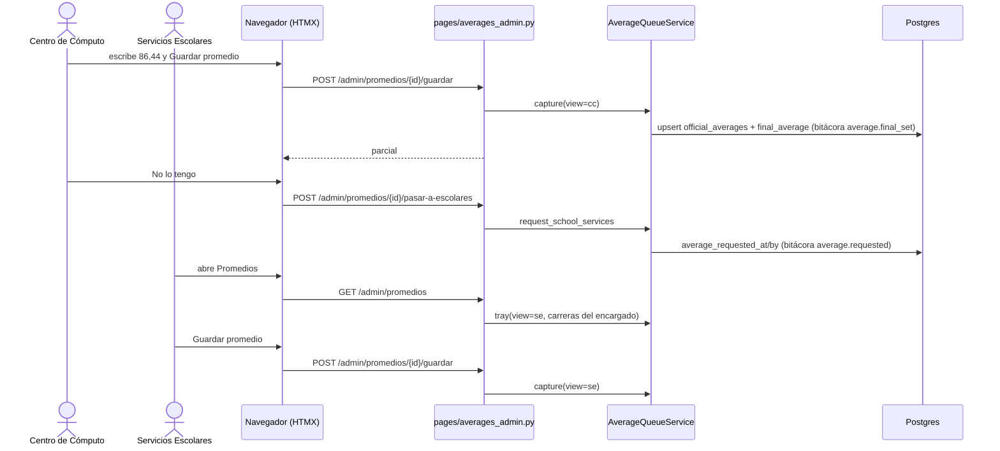

# Bandeja «Promedios» (promedio oficial de los expedientes que no salieron del SII, 2026-11-26)

> **Objetivo:** que el promedio de un expediente que `titulatec cargar-promedios` no pudo llenar
> (no sale en el SII, o sale sin promedio) lo capture a mano Centro de Cómputo (CC) y, si CC no lo
> encuentra, Servicios Escolares (SE) desde el expediente físico, sin usar la CLI.

| | |
|---|---|
| **Actor(es)** | 💻 Centro de Cómputo y `admin` (etapa 1, **vista CC**) · 🏛️ Servicios Escolares (etapa 2, **vista SE**) |
| **Permiso(s)** | Un código por ruta (la lista es OR): `titulatec.average.page.list` (ver la bandeja) · `titulatec.average.api.capture` (guardar uno y cargar archivo) · `titulatec.average.api.request` (pasar a Escolares / regresar; tenerlo **es** la vista CC). Los dos primeros: `admin`, `titulatec_computer_center`, `titulatec_school_services`, `titulatec_school_services_head`; el tercero solo `admin` y `titulatec_computer_center`. DML en `database/DML/titulatec/promedios_2026_11/`, comando `titulatec init-promedios-pendientes`. |
| **Trigger** | Un expediente (proceso no cancelado, alumno con número de control) con `final_average IS NULL`. |
| **Precondiciones** | Ninguna del proceso: no depende de la fase. Los que ya están en Liberados salen primero y llevan la píldora «En Liberados». |
| **Sub-flujos** | ⤵ `OfficialAverageService` (`parse_average`, rango 70-100, `upsert` en `titulatec_official_averages`, `apply_to_processes`; bitácora `average.final_set`) · ← la carga masiva del SII por CLI (`titulatec cargar-promedios`), que sigue siendo la única que reemplaza un promedio existente |
| **Estado final** | `titulatec_processes.final_average` lleno (el expediente sale de la bandeja). Historia en `average_requested_at` / `average_requested_by_id` y en la bitácora (`average.requested`, `average.request_withdrawn`). |

## Estado de un expediente (derivado, sin enum)

| Estado | Condición | Lo ve |
|---|---|---|
| **Por capturar** | sin promedio y `average_requested_at IS NULL` | CC |
| **Con Escolares** | sin promedio y `average_requested_at IS NOT NULL` | CC (pestaña «Con Escolares») y SE (de sus carreras) |
| **Resuelto** | con promedio | nadie: sale de la bandeja |

CC y `admin` no tienen alcance por carrera. SE se acota con `scope_service.officer_programs` (la
jefa = todas; un set vacío no ve nada y la página lo dice: «No tienes carreras asignadas»).
La vista sale de `AverageQueueService.view_for`, de la misma fuente que el gate (`cached_perms`).

## Ruta en la app (UI)

1. 💻 Menú admin **Promedios** (`/titulatec/admin/promedios`, `bi-123`, justo después de Accesos),
   pestaña **Por capturar (N)**; orden: liberados primero, luego FIFO por alta del proceso.
2. 💻 Fila → campo de promedio (punto o coma, 70 a 100) → **Guardar promedio**. La fila sale y un
   toast dice «Promedio 86.44 guardado · {control}».
3. 💻 Si no lo encuentra → **No lo tengo**: el expediente pasa a **Con Escolares** (sin correo ni
   aviso a SE). Desde ahí CC puede seguir capturándolo o **Regresar a Por capturar**.
4. 🏛️ SE entra a la misma página, sin pestañas: solo lo que CC pasó y de sus carreras; captura
   del expediente físico con **Guardar promedio**.
5. 💻🏛️ **Cargar varios desde un archivo** (`
` plegado): CSV/TXT con `control` y
   `promedio` (separador `;` o tabulador; con `,` el decimal va con punto), máximo 1 MB, UTF-8 o
   latin-1. Solo aplica a filas de la bandeja del actor y **nunca pisa** un promedio existente. El
   resultado, por grupo, queda arriba de la tabla: Aplicados · No está en tu bandeja · Fuera de
   rango · Formato inválido · Duplicados.

## Secuencia

## Pasos detallados

| # | Actor | Endpoint | Service · método | Efecto en BD |
|---|---|---|---|---|
| 1 | 💻🏛️ | `GET /titulatec/admin/promedios` y `/body` (`page.list`) | `view_for`, `tab_counts`, `tray` | ninguno |
| 2 | 💻🏛️ | `POST /{process_id}/guardar` (`api.capture`) | `capture` | `titulatec_official_averages` (upsert), `final_average`, bitácora `average.final_set` |
| 3 | 💻 | `POST /{process_id}/pasar-a-escolares` (`api.request`) | `request_school_services` | `average_requested_at/by_id`, bitácora `average.requested` |
| 4 | 💻 | `POST /{process_id}/regresar` (`api.request`) | `withdraw_request` | limpia las dos columnas, bitácora `average.request_withdrawn` |
| 5 | 💻🏛️ | `POST /archivo` (`api.capture`) | `load_rows` | como el paso 2, por fila (savepoint por fila, un commit) |

Todas devuelven el parcial completo `#tt-avg-body` (`outerHTML`). Las tres rutas con
`{process_id}` no llaman `assert_process_in_scope` (guarda de encargados: dejaría fuera a CC); su
guarda es la bandeja, `_lock_in_tray` dentro de cada mutador (404 si no está en la bandeja del
actor). El censo de `test_scope_guard.py` las declara como excepción por ruta exacta.

## Caminos alternos / errores ❗

- Valor ilegible o fuera de 70-100 → 400 + `X-Tt-Error` con el texto del servicio; HTMX no hace
  swap en 4xx y el toast lo muestra (lo tecleado queda en el campo).
- Expediente fuera de la bandeja del actor (p. ej. SE sobre uno que CC no pasó) → 404 liso.
- Ya tiene promedio (lo capturó otra persona o la CLI) → 400 «Ya tiene promedio.»; pasar/regresar
  igual.
- Pasar o regresar es idempotente: repetirlo no cambia quién ni cuándo.
- Archivo: sin archivo, más de 1 MB, sin columnas `control`/`promedio` o sin filas → 400; una fila
  mala no frena a las demás (buckets del resumen).

## Flujos relacionados

- ← [Liberados / Titulación](xcut_titulacion_handoff.md): el promedio final es una columna de esa bandeja.
- ← [Accesos de Centro de Cómputo](xcut_computer_center_access.md): misma bandeja HTMX y mismo rol.
