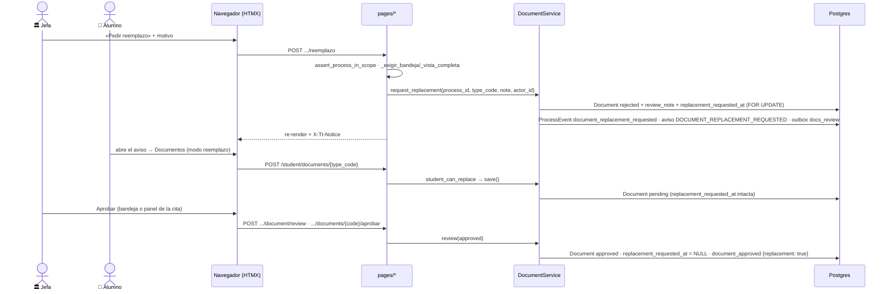

# Reemplazo de un documento en la cita de cotejo

> **Objetivo:** cuando el egresado presenta en la cita de cotejo (fase 2) un documento DISTINTO del que subió
> en la fase 1, la jefatura de Servicios Escolares pide el reemplazo, el egresado lo sube y se aprueba — **sin
> regresar el proceso de fase** y sin romper el congelado del dictamen de la fase 1.

| | |
|---|---|
| **Actor(es)** | 🏛️ Jefatura de Servicios Escolares (pide) · 🏛️ jefa o encargado con `document.api.approve` (aprueba) · 👤 Alumno (sube) |
| **Permiso(s)** | pedir: `titulatec.document.api.request_replacement` (solo `titulatec_school_services_head` y `admin`, D1) · aprobar: `titulatec.document.api.approve` · alumno: `document.api.upload.own` |
| **Trigger** | En la cita, el egresado trae en físico otro documento válido que el subido en la fase 1 |
| **Precondiciones** | Proceso `active`, `current_phase` == fase `review_appointment` del catálogo y esa `ProcessPhase` **no** `approved`; el tipo es de la fase `initial_docs` y está en el set del perfil; el documento tiene fila |
| **Sub-flujos** | ⤵ [bandeja de Documentos](phase1_school_services_review_docs.md) · ⤵ [panel de la cita](phase2_appointment_loop.md) · ⤵ [expediente](xcut_admin_process_expediente.md) · ⤵ [el alumno sube](phase1_student_upload_initial_docs.md) · ⤵ [correos](xcut_student_email_notifications.md) |
| **Estado final** | Documento `approved` con `replacement_requested_at = NULL`; la fase 2 puede liberarse otra vez |

Spec: `docs/superpowers/specs/2026-10-15-titulatec-reemplazo-cotejo-design.md`. Estados: [máquina de
estados](00_state_machine.md#reemplazo-abierto-en-el-cotejo-2026-10-15).

## Por qué existe

`DocumentService.review` congela el dictamen en cuanto el proceso pasó la fase del documento
(`PHASE_CLOSED_MSG`, decisión 2026-10-04: rechazar tarde dejaba al alumno trabado) y la guarda del alumno
cierra Documentos fuera de la fase 1. Sin una vía aparte, el documento físico distinto no podía volverse el
«oficial». **La regla de congelado no cambió**; esta es una vía aparte con permiso propio.

## Modelo: «reemplazo abierto»

`titulatec_documents.replacement_requested_at` (`DateTime`, NULL; `models/document.py:41`; migración
`tt20261015a`). **No NULL = reemplazo abierto.** La escribe solo `DocumentService.request_replacement` (la
primera vez: pedirlo otra vez conserva la fecha) y la limpia solo `DocumentService.review(status="approved")`.
`save()` (la resubida) no la toca. No guarda «quién»: lo guardan el `ProcessEvent` y la bitácora.
`review_status` no cambia de dominio: pedir = `rejected` + `review_note` = motivo + `reviewed_by_id` = la jefa;
el alumno sube → `pending`; se aprueba → `approved` y el reemplazo se cierra.

## Ruta en la app (UI)

Tres sitios para **pedir** (D5), uno para **subir**, dos para **aprobar**:

1. 🏛️ **Bandeja Documentos** (`/titulatec/admin/documents`): con la fase 1 ya cerrada y el proceso en cotejo,
   botón «Pedir reemplazo» junto al dictamen; usa el motivo del formulario. La fila lleva la píldora
   «Reemplazo en cotejo».
2. 🏛️ **Panel «Atender» de la cita** (`/titulatec/admin/appointments`): bajo el visor del documento abierto,
   «Pedir reemplazo» (abre un textarea por `&reemplazo=<code>`) y, si el alumno ya subió, «Aprobar reemplazo».
3. 🏛️ **Expediente** (`/titulatec/admin/processes/{id}`): en la lista de documentos de la fase 1, `
`
   «Pedir reemplazo» con motivo obligatorio y la píldora «Reemplazo pedido en cotejo».
4. 👤 **Alumno**: aviso con botón «Subir reemplazo» en el tablero (tarjeta de la fase de cotejo) y en «Mi
   cita»; lleva a `/titulatec/student/documents`, que se pinta en **modo reemplazo** (solo el documento
   pedido es subible, el resto de solo lectura, sin borrar).
5. 🏛️ **Aprobar**: el Aprobar de siempre de la bandeja Documentos (el reemplazo subido entra a «Por evaluar») o
   «Aprobar reemplazo» del panel de la cita.

## Secuencia

## Pasos detallados

| # | Actor | UI / dónde | Acción | Endpoint | Service · método | Efecto en BD | Eventos / Notif |
|---|---|---|---|---|---|---|---|
| 1a | 🏛️ | Bandeja Documentos | pedir reemplazo | `POST /titulatec/admin/documents/{pid}/document/reemplazo` (form `type_code`, `note`) — `pages/documents.py:496` | `DocumentService.request_replacement` (`services/document_service.py:824`) | `titulatec_documents`: `rejected`, `review_note`, `reviewed_by_id`, `replacement_requested_at` | `document_replacement_requested` (fase de cotejo, `{type_code, note}`) · notif `DOCUMENT_REPLACEMENT_REQUESTED` · correo `docs_review` (rechazo) |
| 1b | 🏛️ | Panel de Citas | ídem | `POST /titulatec/admin/appointments/{pid}/documents/{type_code}/reemplazo` (`note`) — `pages/appointments.py:2204` | ídem | ídem | ídem |
| 1c | 🏛️ | Expediente | ídem | `POST /titulatec/admin/processes/{pid}/documents/{type_code}/reemplazo` (`note`) — `pages/admin.py:2607` | ídem | ídem | ídem |
| 2 | 👤 | `/student/documents` (modo reemplazo) | sube el reemplazo | `POST /student/documents/{type_code}` — `pages/student.py:1254` | `DocumentService.student_can_replace` → `save()` | `pending`, nota y revisor limpios; `version` suma 1; **la bandera sigue abierta** | `document_uploaded` |
| 3a | 🏛️ | Bandeja Documentos | aprobar (Aprobar de siempre) | `POST /titulatec/admin/documents/{pid}/document/review` | `DocumentService.review(approved)` (`:699`) | `approved`, `replacement_requested_at = NULL` | `document_approved` con `replacement: true` · correo `docs_review` |
| 3b | 🏛️ | Panel de Citas | «Aprobar reemplazo» | `POST /titulatec/admin/appointments/{pid}/documents/{type_code}/aprobar` — `pages/appointments.py:2257` | `open_replacements` (exige abierto, si no 400) → `review(approved)` | ídem | ídem |
| 4 | 🏛️ | Cita / expediente | liberar la fase 02 | `POST /{pid}/fase2/aprobar` · `POST .../phase/{n}/approve` | `PhaseService.approve_phase` → `_cotejo_gate_error` (`services/phase_service.py:327`) | — | se **niega** con un reemplazo abierto (ver abajo) |

Reglas de `request_replacement` (en este orden, todas `ValueError` ASCII sin escribir nada): motivo no vacío
tras `strip()` y ≤ `REPLACEMENT_NOTE_MAX` = 1000; el proceso existe y está `active`; `current_phase` == fase de
cotejo (sin esa fase en el catálogo falla CERRADO) y esa `ProcessPhase` no está `approved`; el tipo es de la
fase `initial_docs`, está activo y en el set del perfil (`initial_doc_types_for`); el documento existe (se
bloquea con `with_for_update`). Pedirlo desde `pending` + abierto vale (archivo equivocado) y conserva la fecha.
Aprobar un `rejected` + abierto sin resubida es «el original sí sirve» y cierra el reemplazo. Las rutas de
admin traducen el `ValueError` a `400` + `X-Tt-Error`; el éxito re-renderiza el contenedor de la vista +
`X-Tt-Notice`. Las tres rutas de «pedir» son `async def` solo para leer el form y terminan en
`run_in_threadpool(_cuerpo_…)`, con `assert_process_in_scope` primera sentencia del `try`.

## Lo que bloquea y lo que no

- **Bloquea liberar la fase 2 (D4).** `DocumentService.replacement_gate_error` (`:976`) lo consulta
  `PhaseService._cotejo_gate_error` (`services/phase_service.py:356-358`) **antes** que los requisitos de
  cotejo: «No se puede liberar la fase 02: falta aprobar el reemplazo de: {nombres}.». Aplica a las dos vías
  de aprobar la fase 2 (la cita y el expediente, que es también «Mover de fase»); el mensaje lleva acentos, así
  que las rutas lo pasan por `_hdr()`.
- **No bloquea agendar (D2).** La cola del encargado cuenta un documento con reemplazo abierto como «ok»
  (`initial_docs_approved_map(..., replacement_ok=True)`, `services/appointment_service.py:411`); el
  auto-avance 1→2 de la bandeja sigue con la regla estricta. `AppointmentService.create` nunca miró documentos.
- **No se puede borrar** el documento fuera de la fase 1 (sin excepción); solo subir.

## Estado resultante

- Tras pedir: documento `rejected` + abierto; el alumno recibe aviso, correo y el aviso del tablero/«Mi cita».
- Tras subir: `pending` + abierto («Reemplazo subido · por aprobar» al personal; «Tu reemplazo está en
  revisión» al alumno). El motivo ya no está en la fila (`save()` limpia el dictamen); sigue en el evento.
- Tras aprobar: `approved`, `replacement_requested_at = NULL`; si era el último abierto, la fase 2 se puede
  liberar.

## Eventos, avisos y correos

- `ProcessEvent` `document_replacement_requested` (`models/process_event.py:39`), `phase_number` = fase de
  cotejo, payload `{type_code, note}`. Etiqueta del alumno en `_EVENT_LABELS` («Servicios Escolares te pidió
  reemplazar un documento», `pages/student.py:290`) y del personal en `_EVENT_UI` («Reemplazo de documento
  solicitado», `arrow-repeat`, `amber`, `pages/admin.py:1328`). El espejo de la bitácora lo cubre el prefijo
  `document_` (`services/audit_actions.py:158`).
- Aviso in-app `DOCUMENT_REPLACEMENT_REQUESTED` («{nombre}: {motivo}»), cuya liga `/student/fase/2` redirige al
  tablero: el aviso `partials/student/_replacement_notice.html` es el destino real.
- Correo: el de dictamen de siempre, `StudentMail.doc_reviewed(status="rejected", note=motivo)`, grupo
  `docs:{pid}`, que lleva a Documentos (ahora en modo reemplazo). Sin `kind` nuevo.

## Caminos alternos / errores ❗

- Motivo vacío → 400 `X-Tt-Error` (en el panel de Citas, antes de abrir sesión). Proceso fuera de alcance → 404.
  Sin permiso → 403. Vista resumida del Departamento de Titulación (expediente) → 403.
- Proceso no en cotejo / fase 2 ya liberada / tipo fuera del set / sin documento → 400 con el
  `REPLACEMENT_*_MSG` correspondiente.
- «Aprobar reemplazo» del panel sobre un documento sin reemplazo abierto → 400 «Ese documento no tiene un
  reemplazo pendiente.».
- El alumno intenta subir un documento sin reemplazo abierto (o `approved`) estando en la fase 2 → el 400 de
  la guarda de fase de siempre.

## Despliegue y reversa

1. Fusionar → `deploy.sh` aplica `tt20261015a` (columna NULL —el código viejo la ignora— y corrige
   `version`).
2. Copiar `database/DML/titulatec/reemplazo_2026_10/` (gitignored) al servidor →
   `titulatec init-reemplazo-docs --dry-run` → real. Corre SOLO el `27_insert_doc_replacement_perm.sql` (nunca
   el 15), invalida solo titulatec y verifica los dos roles. Hasta este paso nadie ve «Pedir reemplazo».
3. `STATIC_VERSION` sube (cambia `doc-viewer.js`).

**Reversa:** `rollback.sh` primero. El downgrade a `tt20261013b` es opcional y PIERDE los reemplazos abiertos;
antes, aprobarlos o listarlos con `SELECT process_id, type_code FROM titulatec_documents WHERE
replacement_requested_at IS NOT NULL;`. Con el código viejo, un documento `rejected` en fase 2 deja otra vez al
alumno sin poder subirlo.

## Fuera de alcance

Recordatorios por reemplazo abierto; el motivo en el Tablero de la jefa; el botón dentro del modal grande del
visor de la bandeja; reemplazar documentos de fases ≥ 3; que Servicios Escolares suba el archivo por el alumno.

## Qué lo cubre

`tests/fastapi/titulatec/`: `test_document_replacement.py` (service), `test_document_version.py` (versión +
SQL de la migración), `test_documents_replacement.py` (bandeja), `test_appt_doc_replacement.py` (panel de la
cita), `test_expediente_replacement.py`, `test_student_replacement.py` (modo reemplazo, tablero y «Mi cita»),
`test_cli_init_reemplazo_docs.py`; los censos `test_scope_guard.py` (29 rutas con `{process_id}`) y
`test_permissions_contract.py` (103 permisos).

## Flujos relacionados

- ← [El alumno sube sus documentos iniciales](phase1_student_upload_initial_docs.md) (fase 1; aquí se reabre).
- ↔ [Revisión de documentos](phase1_school_services_review_docs.md) (el congelado y su excepción).
- ↔ [Cita de cotejo](phase2_appointment_loop.md) · [Expediente](xcut_admin_process_expediente.md).
- ⤵ [Correos del proceso](xcut_student_email_notifications.md).
