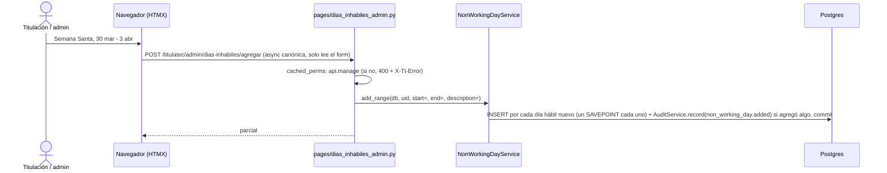

# Calendario único de días inhábiles (pantalla «Días inhábiles»)

> **Objetivo:** que admin y el Departamento de Titulación registren los días inhábiles (Semana Santa, puentes, vacaciones) en UN calendario de TitulaTec que usan **todos** los conteos de días hábiles de la app: plazo de la revisión de sinodales, semáforos de las bandejas FIFO, recordatorios y Tablero de la jefa.

| | |
|---|---|
| **Actor(es)** | 🎓 Departamento de Titulación (`titulatec_titulacion`) y jefatura de la DEP (`titulatec_titulaciones`), y `admin` |
| **Permiso(s)** | ver: `titulatec.non_working_day.page.list` · alta y baja: `titulatec.non_working_day.api.manage` (verificado **dentro** del cuerpo con `cached_perms`: quien ve pero no gestiona recibe 400 + `X-Tt-Error`). Se conceden con grants **explícitos** (nunca el SELECT dinámico del `15`) en `database/DML/titulatec/fase_2/03_revision_sinodales.sql`, es decir, solo tras `titulatec init-titulatec-fase-2` |
| **Trigger** | clic en «Días inhábiles» (`bi-calendar-x`) del menú admin |
| **Precondiciones** | ninguna de fase: **sin guarda de fase** (es de toda la app, no de la fase 5); queda invisible en producción porque el permiso solo lo concede `init-titulatec-fase-2` |
| **Sub-flujos** | ⤵ lo leen [revisión de sinodales](phase5_synodal_review.md), [Tablero](xcut_reports_dashboard.md), [Formato B](phase3_titulacion_review_formato_b.md) y [Sinodales](phase4_department_assign_synodals.md) (semáforos) |
| **Estado final** | filas en `titulatec_non_working_days` (`day` único, `description`, `created_by_id`); bitácora `non_working_day.added` / `non_working_day.removed` (solo cuando algo cambió) |

## Ruta en la app (UI)

1. Menú admin «Días inhábiles» → `/titulatec/admin/dias-inhabiles` (`pages/dias_inhabiles_admin.py`, nombres `titulatec.pages.dias_inhabiles.{home,body,add,remove}`). Fila de `_ADMIN_NAV` con el permiso `non_working_day.page.list` y **sin** entrada en `_NAV_PHASE_GATE`.
2. Lista **por año** (el año por omisión es el de `db_now().date().year`; `?anio=` fuera de 2000-2100 o basura cae al actual) con navegación al año anterior y siguiente por `hx-get` a `/body`.
3. Con `api.manage` ve los formularios: **agregar** (fecha de inicio, fecha de fin opcional, descripción) y **quitar** por día (la X de cada fila) o por rango (con confirmación `hx-confirm` + `data-tt-confirm-ok`). El formulario «Quitar un rango» manda `mode=range` y el servidor exige las DOS fechas: con «Al» vacío responde 200 con el error y no borra nada (antes tomaba `end = start` y quitaba un solo día tras una confirmación que hablaba de un rango). Sin `api.manage`, solo lectura.
   **Periodos (2026-10-27):** la lista no pinta un renglón por día sino por PERIODO: días registrados seguidos con la misma descripción (los fines de semana no cortan, no se guardan), `pages/dias_inhabiles_admin.py::_agrupar`. El renglón dice el rango («lun 6 – vie 31 jul 2026»), la descripción y «N días hábiles»; su X quita el periodo entero (`mode=range` con sus dos fechas) y «Ver los N días» (`
`) despliega cada día con su propia X. 38 días de un año típico quedan en ~9 renglones.

## Secuencia

## Pasos detallados

| # | Actor | UI / dónde | Acción | Endpoint | Service · método | Efecto en BD | Eventos / Notif |
|---|---|---|---|---|---|---|---|
| 1 | 🎓 | Días inhábiles | Abre el calendario | `GET /titulatec/admin/dias-inhabiles` y `/body?anio=` | `NonWorkingDayService.list_year(db, year)` | — | — |
| 2 | 🎓 | Agregar | Registra un día o un rango | `POST /titulatec/admin/dias-inhabiles/agregar` | `NonWorkingDayService.add_range(db, actor_id, start=, end=, description=)` | `titulatec_non_working_days` (una fila por día hábil nuevo) | bitácora `non_working_day.added` (una fila: `{start, end, added, description}`, **solo si `added > 0`**); `X-Tt-Notice` «Se registraron N días inhábiles» (con paréntesis si se omitieron fines de semana o repetidos; `warning` si N = 0) |
| 3 | 🎓 | Quitar | Quita un día (X de la fila) o un rango (`mode=range`, exige «Al») | `POST /titulatec/admin/dias-inhabiles/quitar` | `NonWorkingDayService.remove_range(db, actor_id, *, start, end)` | DELETE de esos días | bitácora `non_working_day.removed` (`{start, end, removed}`, **solo si quitó algo**); `X-Tt-Notice` «Se quitaron N días inhábiles» (o `warning` «No había días inhábiles en ese rango.») |

## Reglas del servicio (`services/non_working_day_service.py`)

- `holidays(db) -> frozenset[date]`: **una consulta**, todas las fechas registradas; es lo que cada pantalla lee una sola vez por petición.
- `add_range`: sábados y domingos **no se guardan** (se cuentan como «fines de semana omitidos»); los días ya registrados se saltan; rango máximo `MAX_RANGE_DAYS = 120`, descripción 1..`MAX_DESCRIPTION = 150`; `ValueError` con texto para el usuario **antes** de escribir (inicio > fin, fechas vacías, descripción vacía o larga). **Fechas pasadas se pueden capturar** (corrigen conteos viejos). `end` vacío = `start` (en el alta; ver «Quitar un rango» arriba para la baja).
- **Dos altas simultáneas del mismo día** (revisión final, M6): cada día nuevo se inserta en su propio SAVEPOINT (`db.begin_nested()`); el que choca con `UNIQUE(day)` porque la otra petición ya lo escribió cuenta como `existing` en vez de tumbar el alta con un 500, y su descripción no se pisa. Por ORM (no `INSERT … ON CONFLICT`) para que la red de la bitácora siga viendo cada fila. La lectura previa de los existentes es `_existing_days`.
- `remove_range` valida el mismo rango y borra lo que haya entre las dos fechas.
- **Una alta o baja que no cambió nada no escribe bitácora**: ni `non_working_day.added` con `added = 0` ni `non_working_day.removed` con `removed = 0`.
- Errores de validación → **200** con el parcial re-pintado y `#tt-dias-error` (lo tecleado se conserva; htmx no hace swap en 4xx); sin permiso de gestionar → 400 + `X-Tt-Error`.

## `utils/business_days.py` con calendario

Módulo puro, sin BD. Las cuatro funciones reciben `holidays: frozenset[date] = frozenset()` **como keyword**:

| Función | Qué hace |
|---|---|
| `is_business_day(d, *, holidays)` | lunes a viernes **y** `d not in holidays` |
| `add_business_days(d, n, *, holidays)` | el n-ésimo día hábil **estrictamente posterior** a `d` (n ≥ 1; `n == 0` = `d` si es hábil, si no el siguiente) |
| `business_days_between(start, end, *, holidays)` | días hábiles estrictamente posteriores a `start` hasta `end` inclusive (el semáforo de espera); `end < start` → 0 |
| `last_business_days(today, n, *, holidays)` | los `n` días hábiles que terminan en `today` (o el hábil anterior) |

**Regla «calendario vacío = idéntico»**: con el conjunto vacío (el valor por omisión) el resultado es exactamente el de antes del calendario. Lo fija `test_business_days.py` con un oráculo sobre 366 fechas contra copias congeladas del algoritmo viejo. Es lo que hace seguro desplegar la migración en producción: las tablas nacen vacías y todo da lo mismo que hoy.

## Consumidores (todos pasan `holidays=`)

Quien tiene `db` carga el calendario y lo pasa; las funciones puras lo reciben como parámetro. Un AST (`test_business_days.py::test_toda_llamada_a_las_cuatro_funciones_pasa_holidays`) falla si una llamada a las cuatro funciones omite `holidays=`.

| Consumidor | Dónde | Cuándo lee el calendario |
|---|---|---|
| Bandeja de Formato B (semáforo de espera) | `FormatBInboxService` (`format_b_inbox_service.py`) | solo en la pestaña `pending` (la única que calcula días de espera) |
| Bandeja de Sinodales (semáforo de espera) | `SynodalInboxService` (`synodal_inbox_service.py`) | solo en la pestaña `pending` |
| «Mis revisiones» (semáforo del plazo) | `ReviewInboxService` (`review_inbox_service.py`) | una vez, solo si alguna fila lo necesita |
| Plazo de la revisión | `ReviewService.due_date`, `ReviewService.semaphore`, `ReviewService.status_for_process` | recibe `holidays=` (o lo lee una vez si es `None`) |
| Recordatorios | `ReviewReminders.run` y `ReviewNotices.send_version_notices` (fecha de vencimiento en el correo) | una vez por barrido / por envío |
| Estado en expediente, Sinodales y Titulación | `pages/admin.py::_detail_ctx`, `pages/sinodales_admin.py`, `pages/titulacion_admin.py` | una vez por vista |
| **Tablero de la jefa** | `ReportService._load` → `_Data.holidays` (una vez por `build`, +1 consulta por pestaña) y de ahí `report_flow.pace/forecast`, `report_officers.capacity`/`_upcoming_business_days`, `report_service._projection`, `_pace_days`, `_officer_pace` y el filtro de días hábiles | una vez por pestaña |

## Notas del Tablero

Las dos notas de proyección que dicen «sin feriados» **no cambian con el calendario vacío**:

- Pronóstico: «a este ritmo, sin contar feriados ni nuevas solicitudes» (`_FORECAST_NOTE`).
- Proyecciones: «a este ritmo, sin feriados ni nuevas entradas» (`_PROJECTION_NOTE`).

Con al menos un día inhábil registrado las propiedades `_Data.forecast_note` / `_Data.projection_note` eligen `_FORECAST_NOTE_HOLIDAYS` («a este ritmo, descontando los días inhábiles registrados y sin nuevas solicitudes») y `_PROJECTION_NOTE_HOLIDAYS` («…y sin nuevas entradas»). La plantilla `_carreras.html` ya pinta `c.projection_note`; el literal solo es el `default()`. Ver [Tablero](xcut_reports_dashboard.md).

## Estado resultante

- `titulatec_non_working_days`: un día = una fila (`UNIQUE(day)`); sin sábados ni domingos.
- Todo plazo y semáforo se recalcula con el calendario vigente en cada lectura: **no se guarda ningún vencimiento**, así que registrar días después recorre los plazos solo.
- Bitácora: módulo `calendar` («Días inhábiles»); la tabla está en la red ORM (`TABLE_MODULES`).

## Caminos alternos / errores ❗

- Fechas vacías o ilegibles, inicio posterior al fin, rango > 120 días, descripción vacía o > 150 → 200 con el error y lo tecleado conservado; nada escrito.
- Rango compuesto solo de fines de semana o de días ya registrados → «Se registraron 0 días…» con `X-Tt-Notice-Kind: warning` y sin fila de bitácora.
- «Quitar un rango» con «Al» vacío → 200 con «Indica la fecha de inicio y la de fin del rango.»; nada borrado.
- Otra persona registró el mismo día al mismo tiempo → ese día cuenta como «ya estaba registrado»; los demás entran.
- Sin `api.manage` → 400 + `X-Tt-Error` («No tienes permiso para modificar el calendario.»); sin `page.list` → 403.
- Con el permiso aún no concedido (producción antes de `init-titulatec-fase-2`) la pantalla no existe en el menú.

## Pruebas

`test_business_days.py` (oráculo del vacío, festivos, AST), `test_non_working_days.py` (servicio; carrera simulada del mismo día y sin bitácora cuando nada cambia), `test_dias_inhabiles_admin.py` (pantalla; año sintético 2091; `mode=range` exige «Al»), `test_format_b_inbox.py` (festivo en la bandeja de Formato B), `test_report_service.py` (calendario vacío = literales y pronóstico idéntico; día cercano recorre el pronóstico), `test_permissions_contract.py` (total declarado 112), más `test_audit_actions_*`.

## Flujos relacionados

- ⤵ [Revisión de sinodales](phase5_synodal_review.md) (plazo de 10 días hábiles) · [Tablero de la jefa](xcut_reports_dashboard.md) · [Bitácora](xcut_audit_log.md)
- [Glosario](_glossary.md) · [Máquina de estados](00_state_machine.md)
