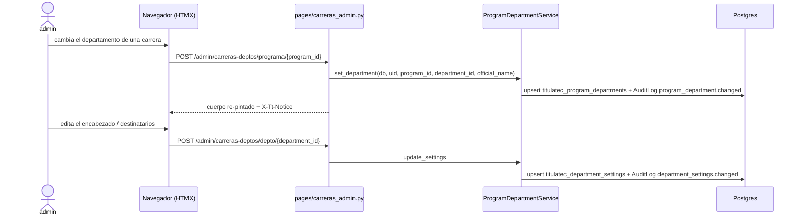

# Carreras por departamento y ajustes del oficio (pantalla «Carreras por depto»)

> **Objetivo:** que `admin` mantenga a qué departamento académico pertenece cada carrera (de eso depende quién asigna los sinodales de cada egresado) y cómo sale el encabezado y los destinatarios del oficio de cada departamento, sin tocar código.

| | |
|---|---|
| **Actor(es)** | `admin` (rol global de la app; únicos con `program_department.api.manage`) |
| **Permiso(s)** | abrir: `titulatec.program_department.page.list` · guardar: `titulatec.program_department.api.manage` |
| **Trigger** | menú «Carreras por depto» (`bi-diagram-3`) → `/titulatec/admin/carreras-deptos` |
| **Precondiciones** | corte `TITULATEC_HANDOFF_PHASE` > fase 4 (con 3: estado vacío informativo y acciones 400, R-G) · mapeo y ajustes sembrados por `init-titulatec-fase-2` |
| **Sub-flujos** | ⤵ alimenta [asignación de sinodales](phase4_department_assign_synodals.md) (alcance y oficio) y [catálogo de docentes](xcut_teacher_catalog.md) |
| **Estado final** | `titulatec_program_departments` / `titulatec_department_settings` actualizadas y una fila de bitácora por cambio |

## Ruta en la app (UI)

1. `/titulatec/admin/carreras-deptos`. Dos bloques en la misma pantalla:
   - **Carreras**: cada carrera de `core_programs` con un select del departamento académico y el nombre oficial (el que usa el oficio; vacío = `Program.name`), guardado fila por fila.
   - **Ajustes del oficio por departamento** (R-F): encabezado («Departamento de Sistemas y Computación», «Coordinación General Campus II», …), código del puesto del destinatario y código del puesto de «At'n.» y, opcionales, el **título** con que el oficio nombra a cada uno (`addressee_title`/`attn_title`, migración `tt20261022b`; vacío = el título del puesto en el organigrama, que usa nombres neutros como «Jefe(a) del Departamento de Titulación»).
2. El select (y el bloque de ajustes) solo ofrece los departamentos **operables**: los que tienen su puesto `docente_{code}` activo (hoy los 8 de la siembra; revisión de rama, hallazgo 11). Uno sin docentes (Ciencias Básicas, Desarrollo Académico, la propia División) no aparece. Una fila ya mapeada a un departamento fuera del catálogo se pinta con su valor deshabilitado, «(sin docentes)» y la píldora «Departamento sin docentes»: no se puede volver a guardar sin elegir uno operable.
3. Arriba de las carreras, un aviso (`#tt-carr-unassignable`) cuenta los procesos **activos** en la fase 4 o 5 de carreras sin departamento operable (sin mapear o mapeadas a uno sin docentes): nadie puede asignarles ni sustituirles sinodales hasta corregir la carrera (`ProgramDepartmentService.unassignable_in_flight`).
4. Las carreras de posgrado llevan su perfil («Maestría», «Doctorado»), que da `TrackService.profile_labels`: ni el servicio ni la plantilla leen `Program.level` (invariante 2 del posgrado).

## Secuencia

## Pasos detallados

| # | Actor | UI / dónde | Acción | Endpoint | Service · método | Efecto en BD | Eventos / Notif |
|---|---|---|---|---|---|---|---|
| 1 | admin | Carreras por depto | Abre la pantalla | `GET /titulatec/admin/carreras-deptos` | `list_mapping`, `academic_departments_catalog`, `list_settings` | — | — |
| 2 | admin | Fila de carrera | Cambia departamento y/o nombre oficial | `POST /titulatec/admin/carreras-deptos/programa/{program_id}` | `ProgramDepartmentService.set_department` | `titulatec_program_departments` (`department_id`, `official_name`, `updated_at/by`) | bitácora `program_department.changed` (con `processes_in_phase_4_5` si movió procesos) |
| 3 | admin | Fila de departamento | Edita encabezado y puestos del oficio | `POST /titulatec/admin/carreras-deptos/depto/{department_id}` | `ProgramDepartmentService.update_settings` | `titulatec_department_settings` | bitácora `department_settings.changed` |

## Reglas

- **Sin cambios reales no se escribe nada** (el servicio devuelve `False`: «Sin cambios.»).
- El departamento debe ser del catálogo operable (`DEPARTMENT_NOT_ACADEMIC_MSG`); el nombre oficial admite hasta 200 caracteres; el encabezado es obligatorio (hasta 200); los títulos del destinatario y del «At'n.» son opcionales (hasta 200, `TITLE_TOO_LONG_MSG`); los códigos de puesto del destinatario y de «At'n.» deben existir en `core_positions` (el oficio los resuelve a quien los ocupa al generarse; vacante = línea en blanco, aunque haya título personalizado). Los errores se validan **antes** de escribir (400 + `X-Tt-Error`).
- **Cambiar el departamento de una carrera con procesos en fase 4 o 5 está permitido**: el alcance (`academic_programs`, `SynodalService.can_operate`) se recalcula al vuelo, así que la carrera cambia de bandeja al instante; la bitácora cuenta cuántos procesos estaban en fase 4 o 5 (números de fase del catálogo por código, `synodal_assignment`/`synodal_review`, nunca literales). Las asignaciones vigentes no se tocan: quien ya era sinodal sigue siéndolo; el siguiente cambio lo hace el departamento nuevo.
- **Una corrección aquí no rompe el despliegue**: `init-titulatec-fase-2` ya no exige que cada carrera siga en su departamento sembrado, solo que esté mapeada a uno con puesto `docente_*` (o de los 8); la diferencia con la siembra se imprime como `AVISO` y el comando sigue (`_avisos_fase_2`).
- Una carrera sin departamento no sale en ninguna bandeja de Sinodales; las rutas de asignar y sustituir responden `NOT_MAPPED_MSG` («corrígelo en «Carreras por departamento»»).
- Ninguna ruta lleva `{process_id}`: no hay guarda de alcance por proceso (el permiso `manage` es solo de `admin`).

## Estado resultante

- `titulatec_program_departments`: una fila por carrera mapeada (PK = `program_id`); `titulatec_department_settings`: una fila por departamento (PK = `department_id`).
- Con el corte ≤ fase 4: la pantalla pinta un estado vacío informativo y las acciones responden 400 con `INERT_MSG`.

## Caminos alternos / errores ❗

- Carrera o departamento inexistente, nombre o encabezado demasiado largo, puesto inexistente → `ValueError` → 400 + `X-Tt-Error`, sin escribir.
- Corte ≤ fase 4 → `INERT_MSG`.

## Despliegue

Todo el DML de la fase 4 entra **solo** por `titulatec init-titulatec-fase-2 [--dry-run]` (`itcj2/cli/titulatec/fase2.py`; `_DML_FASE_2_FILES` = `01_titulacion_formato_b.sql` y `02_sinodales.sql` de `database/DML/titulatec/fase_2/`, gitignored; copiarlos al servidor como el resto del DML). Orden: `alembic upgrade head` (migración `tt20261022a`, a mano, `down_revision = tt20261021a`: `titulatec_program_departments`, `titulatec_teacher_profiles`, `titulatec_department_settings`, columnas de `titulatec_synodal_assignments` con sus índices únicos parciales y `titulatec_modalities.option_label`) → copiar el DML → `init-titulatec-fase-2`. El comando corre **los 2 archivos**, invalida solo el caché de authz de titulatec y **verifica** (`_verify_fase_2`, aborta si algo no aterrizó):

- los grants de `_FASE_2_EXPECTED` (`titulatec_titulacion` y `titulatec_titulaciones` con `synodal.api.read`; `titulatec_titulaciones` y `titulatec_vinculacion` con los de Docentes y Sinodales; `admin` con los 5 nuevos explícitos, nunca el SELECT dinámico del `15`);
- los 5 permisos nuevos (`teacher.page.list`, `teacher.api.manage`, `synodal.api.replace`, `program_department.page.list`, `program_department.api.manage`);
- **R-A**: el rol `titulatec_sinodal` NO conserva ningún permiso `*.read.all` (el DML se los revoca);
- los puestos `docente_{depto}` → `titulatec_sinodal` y `head_{depto}` → `titulatec_vinculacion` de los 8 departamentos (`sys_computing`, `industrial_eng`, `eco_admin_sci`, `elec_electronics`, `metal_mechanics`, `coord_campus_2`, `ead`, `postgrad_research`);
- el mapeo de las 29 carreras (por nombre exacto: si una no existe la verificación falla; cada una debe estar mapeada a un departamento con puesto `docente_*` o de los 8, y si difiere de la siembra es solo un `AVISO`), los ajustes del oficio de los 8 departamentos con sus títulos (el `02` siembra los del oficio real —destinatario «JEFA DE LA DIVISIÓN DE ESTUDIOS PROFESIONALES», «At'n.» «Coordinadora de Apoyo a Titulación»— SOLO donde la columna sigue NULL; vaciarlos en la pantalla y re-correr el comando los vuelve a sembrar), el `option_label` de las 4 modalidades y `responsible = 'academic_department'` en la fase 4.

La migración `tt20261022b` (a mano, `down_revision = tt20261022a`) agrega `addressee_title` y `attn_title` (String(200) NULL) a `titulatec_department_settings`; va ANTES de `init-titulatec-fase-2` (el `02` las escribe). Reversa: `rollback.sh` basta (columnas NULL); el downgrade las quita y se pierden los títulos editados (la bitácora conserva el antes/después).

**Trampa de orden (R-A y fase 3):** `init-titulatec` (el `03`) e `init-ajustes-2026-10` QUITAN los grants de fase 2 (y `init-titulatec` le vuelve a dar a `titulatec_sinodal` los `read.all`): tras cualquiera de los dos hay que **volver a correr `init-titulatec-fase-2`**; su verificación lo detecta y aborta. Con `TITULATEC_HANDOFF_PHASE=3` (producción) todo queda inerte aunque el DML esté sembrado.

## Flujos relacionados

- ⤵ [Asignación de sinodales](phase4_department_assign_synodals.md) · [Catálogo de docentes](xcut_teacher_catalog.md)
- ↔ [Alcance por carrera](engine_officer_scope.md) · [Glosario](_glossary.md)
