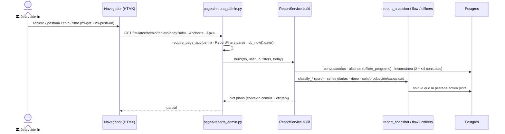

# Tablero de la jefa de Servicios Escolares: avance, atorados, carga y ritmo (solo lectura)

> **Objetivo:** que la jefa de Servicios Escolares (SE) vea **por capas** cuánto avanza el proceso de
> cotejo, **quién tiene la pelota** en cada pendiente, qué está atorado, cuánto carga y produce cada
> encargado y qué días y carreras se liberaron — sin escribir nada en la BD.

| | |
|---|---|
| **Actor(es)** | 🏛️ jefa de Servicios Escolares (`titulatec_school_services_head`) y el rol `admin` |
| **Permiso(s)** | `titulatec.reports.page.view` (nuevo 2026-10-14; formato `page`). Lo exigen las dos rutas (`require_page_app`, sin bypass de admin global) |
| **Trigger** | Entrar al menú «Tablero» (primer ítem de `_ADMIN_NAV`) o aterrizar: `_ROLE_DASHBOARD` manda a la jefa a `/titulatec/admin/tablero` (D9) |
| **Precondiciones** | El permiso sembrado (`titulatec init-reportes`, ver «Despliegue») |
| **Sub-flujos** | ← lee lo que dejan [solicitudes](xcut_public_enrollment.md), [accesos](xcut_computer_center_access.md), [documentos](phase1_school_services_review_docs.md), [cita de cotejo](phase2_appointment_loop.md), [liberación GTV](phase2_tech_management_survey_release.md), [no adeudo](phase2_library_clearance.md) y el [corte/Liberados](xcut_titulacion_handoff.md) |
| **Estado final** | Ninguno: **no hay modelos, migraciones ni escrituras nuevas**. Sin caché (v1) |

Spec (untracked): `docs/superpowers/specs/2026-10-14-titulatec-tablero-design.md`. **El código manda**: si
esta página y la spec difieren, vale lo de aquí (la spec se corrigió con las desviaciones aceptadas).

## Ruta en la app (UI)

1. Sidebar admin → **Tablero** (`bi-speedometer2`, primer ítem) → `/titulatec/admin/tablero`.
2. Arriba, una fila de filtros única: **rango** (`7 | 14 | 30 días | toda la convocatoria`), **convocatoria**,
   «Carreras · N ocultas» (`
` con chips) y el botón **Imprimir** a la derecha. Debajo, las 5 pestañas.
3. Cada número o barra **lleva a la lista** de personas detrás (pestaña Atorados prefiltrada o el expediente).
4. Los chips (carreras, encargados, convocatoria, rango, pestañas) son **enlaces** con la URL ya calculada por
   el servidor: sin estado en JS; el estado vive en la URL (morph-safe, se puede copiar y compartir).

### Las 5 pestañas (qué muestra cada una)

| Pestaña (`tab`) | Qué responde |
|---|---|
| **Panorama** (default) | 4 KPI: **Liberados** (total + en el rango + sparkline), **Ritmo** (por día hábil + pronóstico), **Solicitudes por revisar** (n + la más vieja en días), **Atorados** (rojo n · ámbar n). «**Dónde están hoy**»: una barra por etapa (clic → Atorados filtrado). «**¿Quién tiene la pelota?**»: una barra por actor con su sub-conteo de atorados. **Alertas** (máx. 5, ver abajo) |
| **Ritmo** | Línea diaria Solicitudes nuevas vs Liberados en el rango; línea acumulada Inscritos vs Liberados; **calendario de liberaciones** (lun–vie × semanas, clic en un día = lista de liberados de ese día con carrera y quién dictaminó); barras «Liberados por carrera» |
| **Encargados** | Chips para ocultar encargados. Una fila por encargado: carreras, cola por tipo, producción, % de rechazo, liberados, **días para vaciar** y lugares de cita. Gráficas: días para vaciar la cola (umbral visible) y «Dictámenes por día» (small multiples, misma escala) |
| **Carreras** | Una fila por carrera visible: barra apilada por etapa + inscritos · liberados · % liberado · atorados · encargados. Orden: más atorados primero |
| **Atorados** | Tabla paginada (50, `utils/paging` + macro `pager`) filtrable por pelota, nivel y etapa: alumno · carrera · etapa · motivo (pelota) · días (pill de nivel con icono + texto) · encargado(s) de la carrera · enlace al expediente o a la bandeja de Solicitudes. Orden: días desc |

Cada gráfica tiene su «Ver tabla» (los mismos números) y el tablero se **imprime para juntas** (D4): sin CSV
ni Excel (fuera de alcance v1).

### Parámetros de URL

Todos `str` (HTMX manda vacíos). `ReportFilters.parse` (`services/report_service.py`) **nunca levanta**:
un valor inválido cae a su default y no viaja en ninguna liga (ni 422 ni 500).

| Param | Valores | Default |
|---|---|---|
| `tab` | `panorama\|ritmo\|encargados\|carreras\|atorados` | `panorama` (siempre presente en las ligas) |
| `cohort` | id de convocatoria o `all` | la `open` más reciente; si no hay abierta, la más reciente (por id). Un id inexistente vuelve al default |
| `range` | `7\|14\|30\|all` (días naturales hacia atrás desde hoy, hoy incluido; `all` = desde que abrió la convocatoria) | `14`; otro número → 14 |
| `px` | ids de carrera OCULTAS, csv; `0` = «Sin carrera» | vacío |
| `ox` | user ids de encargados OCULTOS, csv (solo pestaña Encargados) | vacío |
| `ball` | `escolares\|alumno\|gtv\|biblioteca\|computo` (Atorados) | vacío |
| `motive` | código de `report_snapshot.MOTIVES` (Atorados; Ronda 2). Basura o de otra área que `ball` → se ignora | vacío |
| `level` | `warn\|crit\|all` (Atorados): `warn` = Lento o peor, `crit` = solo Atorado | `warn` |
| `stage` | código de etapa (Atorados) | vacío |
| `page` | paginación de Atorados | `1` |
| `day` | `AAAA-MM-DD`, día del calendario de Ritmo | vacío |

**La basura se ignora.** Un id/página solo vale si es ASCII `\d` de **1 a 18 dígitos** (`_MAX_DIGITS`): más largo
es basura, porque `int()` de más de 4300 dígitos levanta en CPython y daba 500. `px`/`ox` aceptan hasta 200 ids
y descartan repetidos, negativos y no numéricos. Además se **normalizan contra la BD**: una carrera inexistente o
fuera del alcance del usuario, «Sin carrera» sin `can_see_unmapped` y un encargado inexistente se descartan y
no viajan en las ligas; nunca se carga el nombre de una carrera fuera del alcance.

## Secuencia

## Pasos detallados

| # | Actor | UI / dónde | Acción | Endpoint | Service · método | Efecto en BD | Eventos / Notif |
|---|---|---|---|---|---|---|---|
| 1 | 🏛️ | `/titulatec/admin/tablero` | Abre el tablero (página completa) | `GET /titulatec/admin/tablero` (`reports_admin.home`, `def`) | `ReportFilters.parse` → `ReportService.build` | solo lecturas | — |
| 2 | 🏛️ | pestañas, chips, rango, convocatoria, pager | Navega dentro del tablero | `GET /titulatec/admin/tablero/body` (`reports_admin.body`, `def`) | `ReportService.build` | solo lecturas | — |
| 3 | 🏛️ | clic en una barra / número | Va a la lista detrás (Atorados prefiltrada) o al expediente / bandeja de Solicitudes | las anteriores o `/titulatec/admin/processes/{id}` · `/solicitudes?status=<pestaña>&q=<control>` | — | — | — |

Reglas de las rutas (convención R7, `CLAUDE.md` de la app §1): las dos son `def`, abren su `SessionLocal()` con
import local, usan `db_now()` (nunca `date.today()`) y agregan `generated_at`/`generated_at_text` para la
cabecera de impresión. Navegación interna: `hx-get=".../body?..."`, `hx-target="#tt-report-body"`,
`hx-select="#tt-report-body"`, `hx-swap="morph:outerHTML"`, `hx-push-url` con la URL de la **página** (no
`/body`) — invariante de `test_admin_nav_swap.py`.

## Definiciones (el contrato de los números)

«Hoy» = `db_now().date()` (hora de Juárez del servidor). **Día hábil = lunes a viernes, sin feriados**
(`utils/business_days.py`).

### Universo

- **Solicitudes vivas**: `EnrollmentRequest.status IN OPEN_STATUSES` de las convocatorias filtradas.
  `converted` y `rejected` no son pendientes.
- **Procesos**: se leen `active`, `on_hold` y `completed` (`cancelled` queda fuera). Un proceso `on_hold` sin
  liberar NO entra a las etapas: se cuenta aparte como **«En pausa»**. Un liberado entra como `liberado` aunque
  esté pausado o terminado (la liberación ocurrió; alinea con `HandoffService`).
- **Inscritos** (`Snapshot.enrolled_by_program`, la serie `enrolled` del acumulado de Ritmo y la columna de
  Carreras: **una sola definición**) = procesos creados **no revocados**: activos, **en pausa**, terminados y
  liberados.
- **Liberado a Titulación = `ProcessPhase(2).status = 'approved'`**, su fecha es el `completed_at` de esa fase y
  quien dictaminó es su `reviewed_by_id` — la misma definición que `HandoffService`.
- Carrera: `program_id` de la solicitud/proceso; `NULL` = cubo «Sin carrera».

### Etapas (una por pendiente; `STAGES` en `services/report_snapshot.py`)

| Código | Etapa | Regla |
|---|---|---|
| `req_unverified` | Solicitud anterior (por revisar) | solicitud `unverified` (**estado legado**, ya no se escribe) |
| `req_review` | Solicitud por revisar | solicitud `verified` o `pending_review` |
| `req_access` | Esperando NIP | solicitud `awaiting_access` |
| `req_approved` | Aprobada, sin activar | solicitud `approved` |
| `docs` | Documentos iniciales | proceso con `current_phase < 2` |
| `requisitos` | Requisitos de cotejo | fase 2, **sin** cita vigente en `scheduled\|confirmed\|in_progress\|attended\|no_show` |
| `cita` | En cita de cotejo | fase 2 con cita vigente (`is_current`) en esos estados |
| `liberado` | Liberado a Titulación | fase 2 `approved` |

Para el color, las 8 etapas se agrupan en 5 grupos (Solicitud · Documentos · Requisitos · Cita · Liberado), una
rampa ordinal de 5 pasos (una de 8 falla la separación adyacente).

### ¿Quién tiene la pelota? (`balls`: una entrada por actor; un pendiente puede tener 1 o 2)

| Situación | Actor | Motivo (texto UI) |
|---|---|---|
| `req_unverified` (legado) | Escolares | Revisar solicitud (legado) |
| `req_review` | Escolares | Revisar solicitud |
| `req_access` | Cómputo | Dar NIP |
| `req_approved`, liga vigente | Alumno | Activar su cuenta |
| `req_approved`, **liga vencida** (`verify_expires_at` de un día anterior a hoy o sin vigencia) | Escolares | Reenviar liga |
| `docs` con algún `Document.review_status = 'pending'` | Escolares | Dictaminar documentos |
| `docs` sin documentos pendientes | Alumno | Subir o corregir documentos |
| `requisitos`: encuesta sin enviar | Alumno | Llenar encuesta de egresados |
| `requisitos`: encuesta `in_review` | GTV | Liberar encuesta |
| `requisitos`: encuesta `rejected` | Alumno | Corregir encuesta |
| `requisitos`: no adeudo `pending` | Biblioteca/Caja | Registrar no adeudo |
| `requisitos`: no adeudo `awaiting_payment` | Alumno | Pagar en Caja |
| `requisitos`: no adeudo **`observed`** | **Alumno** | Atender observación de Biblioteca (el correo `library_observed` le pide aclararla; ambos `observation_kind`) |
| `requisitos` sin ningún requisito abierto y sin cita | Alumno | Agendar cita |
| `cita` **futura o de hoy**, `scheduled\|confirmed` | — (en agenda: **no** es atorado) | «Cita el {fecha}» |
| `cita` **`in_progress` de hoy** (atendiendo ahora, p. ej. «Atender ahora») | Escolares | **En atención** (no dispara «citas sin cerrar») |
| `cita` viva con fecha **anterior a hoy** | Escolares | **Cerrar cita** (solo días anteriores) |
| `cita` `attended` sin dictamen de fase 2 | Escolares | Dictaminar fase 2 (se suman las liberaciones abiertas) |
| `cita` `no_show` | Alumno | Reagendar |
| fase 2 `rejected` | Alumno | Corregir lo señalado |

- Las liberaciones abiertas **no se leen a mano**: las responde `ClearanceGate.status_map/blockers`
  (invariante 2 de §17: nadie fuera de los dueños y del gate compara `.status`), y `report_snapshot` solo
  traduce sus códigos (`_BLOCKER_BALLS`). Hereda el candado condicional por convocatoria (sin el requisito de
  no adeudo activo, biblioteca pendiente no detiene a nadie). Con una cita **viva** las liberaciones no se
  suman (D17: la cita agendada no vuelve a preguntar).
- Las filas de `requisitos` **se acumulan** (encuesta en GTV + pago pendiente = 2 actores, en el orden fijo
  Escolares · Alumno · GTV · Biblioteca/Caja · Cómputo; dos motivos del mismo actor van unidos con « · »). El
  gráfico cuenta **procesos únicos por actor** y la nota «N pendientes esperan a dos áreas» sale de
  `multi_ball`.
- **`ready_to_book`** («listo para agendar») = sin liberaciones abiertas y sin una cita que ocupe el cotejo
  (viva, o `attended` sin rechazo de fase 2). Puede agendar, o ya le agendan. **No** aplica el bloqueo D9 por
  cancelaciones.

### Días sin movimiento y atorado (D8)

- **Proceso**: `hoy − max(último ProcessEvent, process.created_at)` en días naturales. Un liberado vale 0.
- **Solicitud**: `req_review`/`req_unverified` → desde `created_at` (tiempo de espera); `req_access` → desde
  `reviewed_at`; `req_approved` → desde lo último entre `reviewed_at` y `access_granted_at` (en una D10 la liga
  sale cuando Cómputo da acceso); si faltan, `updated_at`.
- **Nivel**: `>= TITULATEC_IDLE_CRIT_DAYS` (14) rojo **«Atorado»**; `>= TITULATEC_IDLE_WARN_DAYS` (7) ámbar
  **«Lento»**; si no «Al día». Sin config nueva (`itcj2/config.py`). Una cita **agendada** (en agenda) nunca es
  atorado. Siempre icono + texto, no solo color.

### Ritmo y pronóstico (`services/report_flow.py`)

- **Ritmo** = liberados en los últimos **10 días hábiles** (los que terminan hoy, o el hábil anterior si hoy es
  fin de semana) ÷ 10. Es **independiente del rango** elegido.
- **Pendientes en tubería** = todo pendiente vivo con etapa ≠ `liberado`.
- **Pronóstico** = `add_business_days(hoy, ⌈pendientes ÷ ritmo⌉)`. **`add_business_days(d, n ≥ 1)` es el n-ésimo
  día hábil estrictamente posterior a `d`** (sábado + 1 = lunes; `n = 0` = `d` si es hábil, si no el siguiente).
  El cociente usa `Fraction` para que el `ceil` no se corra por coma flotante. Ritmo 0 → «sin ritmo medible»;
  sin pendientes → «sin pendientes». Siempre con la nota «a este ritmo, sin contar feriados ni nuevas
  solicitudes».
- **Entradas vs salidas** (en el rango): solicitudes nuevas vs liberados; si entran más de las que salen, la
  cola crece → alerta.

### Capacidad de citas (`report_officers.capacity`)

Lugares libres en los próximos **5 días hábiles** (desde hoy inclusive) = capacidad de las `ReviewWindow` con
`status = 'open'` de días de cotejo **no cerrados** (`CohortReviewDay.is_closed = False`) − ocupación de
`SlotService.window_occupancy_map` (la regla única «¿esta cita ocupa lugar?» de §15; no hay cuenta propia).
Se compara contra los «listos para agendar»: si **listos > libres**, el cuello es la capacidad de citas
(Escolares), no el alumno. No filtra por convocatoria ni carrera (hoy hay una).

### Encargados (D2)

- Lista: `OfficerService.list_officers` del depto `school_services` (puestos `se_officer_*`), volteada a
  **personas** (quien ocupa varios puestos sale una vez, con la unión de sus carreras). Más una fila «**Otros**»
  con lo producido por quien no es encargado (la jefa, `admin`).
- **Cola con traslape (D2)**: cada encargado carga la cola **completa** de sus carreras, aunque otro encargado
  tenga las mismas — «cuánto pueden revisar aunque otros también puedan»; **la suma por encargado rebasa los
  pendientes reales a propósito**. Se compone de: solicitudes por revisar (`req_review` + `req_unverified`) ·
  **documentos** por dictaminar (documentos, no procesos) · citas por cerrar/dictaminar/en atención **de SUS
  ventanas** (`ReviewWindow.owner_user_id`, sea de la carrera que sea) · y, informativo, listos sin cita. La
  cola de Escolares (`total_escolares`) = las tres primeras; «listos» no suma. Un pendiente sin carrera no cae
  en la cola de nadie. Ocultar un encargado (`ox`) quita su fila y su serie, **no** cambia los pendientes
  globales, y su color no cambia (el color sigue a la entidad).
- **Producción por actor** en el rango (por `actor_id` del evento / `reviewed_by_id`, **NO por alcance de
  carrera**): solicitudes revisadas (`EnrollmentRequest.reviewed_by_id` + `reviewed_at`, que guarda la última
  revisión) · documentos aprobados y rechazados (`ProcessEvent` `document_approved/rejected`) y su **% de
  rechazo** (`rechazados ÷ dictámenes`) · citas atendidas (`appointment_attended`; incluye las marcadas
  automáticamente) · faltas (`appointment_no_show`) · **liberados** (`phase_approved` con `phase_number = 2`).
  Eventos sin actor (sistema) no cuentan.
- **«Dictámenes por día»** (sparks) = dictámenes de documentos **+ revisiones de solicitud**, solo días hábiles.
- **Días para vaciar la cola** = `total_escolares ÷ ritmo`, donde ritmo = dictámenes + revisiones por día hábil
  de los **últimos 10 días hábiles** (independiente del rango; desde la Ronda 2 es el MISMO ritmo de la
  proyección de la tarjeta, `report_service._officer_pace`). La producción que se muestra sigue siendo la del
  rango. `—` si no produjo nada en esos 10 días. Umbral visible = `round(CRIT × 5/7)` días hábiles (14 → 10).
- **Lugares**: capacidad abierta vs ocupada de sus ventanas en los próximos 5 días hábiles. Un encargado sin
  carreras sale con «Sin carreras asignadas» y cola 0.

### Alertas de Panorama (máx. 5, orden fijo, solo las que disparan; ninguna = «Sin alertas»)

1. `requests_crit` — solicitudes por revisar (la legada sumada) con ≥ CRIT días esperando.
2. `docs_warn` — expedientes con documentos por dictaminar sin movimiento ≥ WARN días.
3. `capacity` — listos para agendar > lugares libres en los próximos 5 días hábiles.
4. `inflow` — entraron más solicitudes que liberados en el rango (la cola crece).
5. `appts_unclosed` — citas pasadas sin cerrar, contadas por **motivo** «Cerrar cita» (fecha < hoy), nunca por
   nivel; la `in_progress` de hoy («En atención») no cuenta. Enlaza a Atorados con escolares + etapa cita.

## Alcance (defensa en profundidad)

Aunque solo la jefa y `admin` tienen el permiso, el servicio filtra igual:

- Carreras = `scope_service.officer_programs(db, user_id)` (`"ALL"` con `process.api.read.all`, o el set de sus
  puestos) **menos las ocultas** (`px`). El cubo «Sin carrera» (`program_id NULL`) entra **solo con
  `can_see_unmapped`** y sin `px=0`; `read.all` no lo abre (como el resto de la app).
- **Helper único `services/report_scope.py::scope_predicates(column, programs, include_unmapped)`** (más
  `cohort_predicates`): lo usan `report_snapshot.load_snapshot` y `report_flow.daily_counts`. Antes cada módulo
  tenía su copia (`_scope_filters` y `_filtros`). Nunca reimplementar esa regla: set vacío sin
  `include_unmapped` → `false()` (no trae nada). Si mañana se da el permiso a un encargado, ve solo sus carreras.

## Presupuesto de consultas

Cada pestaña (`/body`, caché de authz tibia) tiene techo de **24 sentencias SQL** (subió de 20 en la Ronda 2 por
las salidas por motivo), fijado por
`tests/fastapi/titulatec/test_reports_pages.py::test_presupuesto_de_consultas_por_pestana` (con 4 y con 16
procesos: **no crece con el número de procesos**). Medido el 2026-10-14 (Ronda 2) en el **peor camino** (con
`px` y `ox`; Atorados además con `motive`):

| Pestaña | Panorama | Ritmo | Encargados | Carreras | Atorados |
|---|---|---|---|---|---|
| Consultas | 19 | 16 | 16 | 12 | 12 |

(un usuario acotado por carrera suma 1). Piezas: convocatorias 1 · catálogo de carreras 0-1 (solo con `px`) ·
encargados 0-4 (4 si hay `ox` o la pestaña los usa) · instantánea 2 + ≤4 (`ClearanceGate.status_map`, solo para
procesos en fase 2) · series diarias 3 · salidas por motivo 2 (`report_flow.exit_counts`, Panorama) · capacidad
0-2 · producción 2 (con la serie alargada a 10 días hábiles, mismas 2). Todo se calcula en Python desde filas
cargadas en lote (cero N+1). Al tocar el servicio, vuelve a medir.

## Ronda 2 (servicios, 2026-10-14)

- **Motivos con código** (`report_snapshot.MOTIVES`, en orden del proceso; `first_motives`): «¿Quién tiene la
  pelota?» parte cada área por motivo y **cada pendiente cuenta una sola vez por área, en su PRIMER motivo**, así
  que los motivos suman exactamente el total del área (Escolares 246 = 219 solicitudes + 26 expedientes con 42
  documentos + 1 cita, en la copia de prod).
- **Atorados `?motive=<código>`**: la lista de ese primer motivo (cuadra con la cifra de Panorama); los chips se
  agrupan por área; un código basura o de otra área que `ball` se ignora.
- **Proyecciones** (`report_service._projection`, siempre «a este ritmo, sin feriados ni nuevas entradas», ritmo
  de los últimos 10 días hábiles, ritmo 0 → «Sin ritmo medible»): **por motivo** con salida clara (revisiones,
  dictámenes de documento, dictámenes de encuesta de GTV, registros de Biblioteca, accesos de Cómputo:
  `report_flow.exit_counts`), **por carrera** (pendientes ÷ liberados por día de la carrera) y **por encargado**
  (cola de Escolares ÷ su ritmo; mismo número que «Días para vaciar»). El alumno no lleva proyección.
- **Encargados**: tarjetas (el más cargado primero) con barras de cola y producción a escala COMÚN (ocultos
  incluidos: `ox` no reescala) y **mapa de calor** encargado × día hábil del rango (5 cubetas + vacío; fila
  «Otros» al final; con más de 22 columnas, `wide`).

## Estado resultante

Ninguno (solo lectura). Sin tablas, columnas, eventos, notificaciones ni bitácora de auditoría propias.

## Caminos alternos / errores ❗

- Sin permiso → `require_page_app` (403 / redirección de página). `titulatec_school_services` (encargado) y
  `titulatec_titulaciones` **no** lo tienen.
- Sin convocatorias → estado vacío «Aún no hay convocatorias» (`no_cohorts`).
- Todas las carreras ocultas → aviso con enlace «Mostrar todas».
- Ritmo 0 → «sin ritmo medible». Encargado sin carreras → «Sin carreras asignadas».
- Parámetros basura → se ignoran (ver «Parámetros de URL»); nunca 422/500.
- Un id de `cohort` inexistente cae a la convocatoria por omisión y deja de viajar en las ligas.

## Plantillas, estáticos e impresión (resumen; la implementación visual vive en su código)

Rutas de archivo (otra tarea las completa; no se describen aquí):
`templates/titulatec/admin/reports.html` · `templates/titulatec/admin/partials/reports/*` (cuerpo, una parcial
por pestaña y macros de gráficas) · `static/css/admin/reports.css` (incluye `@media print`) ·
`static/js/admin/reports.js` (tooltip e imprimir; cargado una vez en el bloque `scripts` de `base_admin.html`).
Las gráficas son **SVG renderizadas en servidor** (geometría en `utils/charts.py`, sin Chart.js ni CDN); las
plantillas no consultan ni hacen aritmética de escala: todo llega ya hecho en el `dict` de la fachada
(contrato de llaves en el docstring de cada `_ctx_<tab>` de `report_service.py`). Colores de actor (identidad,
con etiqueta directa + tabla gemela porque 3 quedan bajo 3:1): Escolares `#2a78d6` · Alumno `#eb6834` · GTV
`#1baf7a` · Biblioteca/Caja `#eda100` · Cómputo `#e87ba4`.

## Despliegue (orden obligatorio)

**Sin migración.** Solo un permiso, por DML en subcarpeta propia (gitignored, viaja a mano) que se carga con su comando CLI. El 26 concede el
permiso a `titulatec_school_services_head` **y a `admin`** de forma explícita: `init-reportes` corre SOLO el 26 y
**nunca re-corre el 15** (reparte todo titulatec a `admin`, y por D2 la jefatura de Centro de Cómputo trae `admin`).

1. Copiar `database/DML/titulatec/reportes_2026_10/` al servidor (gitignored, a mano).
2. Fusionar el PR → deploy. **No hay paso previo con `core execute-sql`**: el aterrizaje es tolerante (ver abajo).
3. Después del deploy: `python -m itcj2.cli.main titulatec init-reportes` (`--dry-run` lista solo el 26). Es
   idempotente: carga el 26 (permiso a la jefa y a `admin`), invalida el caché de authz **solo de titulatec** y
   comprueba en BD (`_verify_reportes`, los dos roles); sale con exit ≠ 0 si algo no aterrizó.
4. Sin reinicio de celery: el tablero no toca tareas.

**Aterrizaje tolerante.** `/titulatec/` manda a la jefa al Tablero SOLO si sus permisos efectivos
(`cached_perms`, la misma fuente que el gate) incluyen `titulatec.reports.page.view`
(`nav.resolve_dashboard_url(roles, jwt_role, perms)`; `landing.py` se los pasa). Hasta que corra
`init-reportes` la jefa aterriza en la Bandeja (`/titulatec/admin/`) en vez de recibir un 403; no hay ventana
de riesgo entre deploy y comando. `admin` (JWT) y los demás roles no cambian.

**Reversa:** `rollback.sh` basta (no hay esquema nuevo). El permiso queda declarado sin uso en el código viejo;
la jefa vuelve a aterrizar en la Bandeja por el `_ROLE_DASHBOARD` viejo.

## Pruebas

`tests/fastapi/titulatec/`: `test_report_snapshot.py` (cada fila de pelota y días, doble pelota, cita futura no
atorada), `test_report_flow.py`, `test_report_officers.py` (cola con traslape, producción por actor,
capacidad), `test_cli_init_reportes.py` (el comando corre solo el 26, nunca el 15), `test_report_scope.py`, `test_report_service.py` (filtros, alertas, pestañas), `test_reports_charts.py`
(geometría de `utils/charts`; `business_days` se prueba en `test_report_flow.py`), `test_reports_authz.py` (jefa y rol `admin` con el permiso 200; encargado y el rol REAL `titulatec_titulaciones` (sus permisos de la BD, sin `reports.page.view`) 403;
menú y aterrizaje), `test_reports_pages.py` (cada `tab` renderiza, basura no truena, `/body`, **presupuesto de
consultas**), `test_reports_render.py` (el HTML de cada pestaña). Estructurales que deben seguir verdes: `test_route_threadpool_convention`,
`test_admin_nav_swap`, `test_authz_cache_menu`, `test_scope_guard`. Fechas con `db_now()`, nunca `date.today()`.

## Flujos relacionados

- ← [Bandeja administrativa de procesos](xcut_admin_process_inbox.md) (`idle_days` y atorados de la tabla de Procesos; el tablero usa los mismos umbrales `TITULATEC_IDLE_*`)
- ← [Alcance por carrera](engine_officer_scope.md) · [Cita de cotejo](phase2_appointment_loop.md) (ocupación de lugares) · [Corte y Liberados](xcut_titulacion_handoff.md) (definición de «liberado»)
- ← [No adeudo / Biblioteca → Caja](phase2_library_clearance.md) y [Liberación GTV](phase2_tech_management_survey_release.md) (las liberaciones que `ClearanceGate` reporta como pelotas)

## Nota: filtro `stage=req_review` en Atorados

La KPI «Solicitudes por revisar» y la alerta de solicitudes suman `req_review` + `req_unverified` (legado). Ambas
ligan a Atorados con `stage=req_review`, y ese filtro incluye también `req_unverified` (`_matches`), de modo que la
cifra y la lista cuadran. El chip de etapa `req_unverified` sigue filtrando solo el legado.
