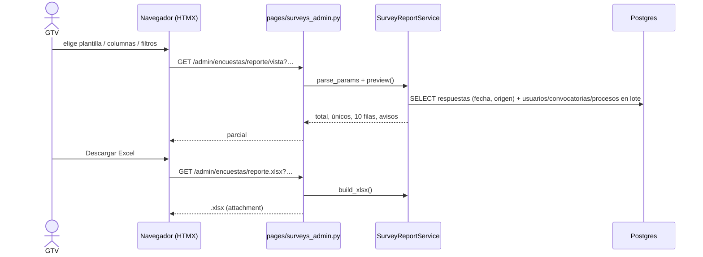

# Reporte Excel de la encuesta de egresados

> **Objetivo:** que Gestión Tecnológica y Vinculación arme sola, sin pedir nada a sistemas, el Excel que le soliciten (p. ej. Prácticas Profesionales: carrera + «¿acepta recibir correos?» de cada egresado para compartir ofertas de empleo).

| | |
|---|---|
| **Actor(es)** | 🛠️ GTV (`titulatec_tech_management`) y `admin` |
| **Permiso(s)** | `titulatec.survey.api.export` (el mismo del CSV; sin DML nuevo) |
| **Trigger** | Clic en «Reporte Excel» en la bandeja Encuestas |
| **Precondiciones** | Algún formulario de encuesta (`titulatec_survey_forms`) |
| **Sub-flujos** | — |
| **Estado final** | Ninguno: solo lectura. No se audita (§20: las lecturas no van a la bitácora) |

## Ruta en la app (UI)

1. `/titulatec/admin/encuestas` → «Reporte Excel» (`#tt-surveys-report-link`). El botón vecino, «CSV (datos crudos)», es el export de siempre, sin cambios.
2. `/titulatec/admin/encuestas/reporte?form_id=N` → tarjetas a la izquierda (Plantillas · Columnas · Filtros · Orden de filas · Hojas y formato) y, pegada a la derecha, la vista previa con «Descargar Excel» y «Copiar liga».
3. Toda la configuración viaja en el query string: la página la pinta el servidor (`parse_params`), así que una liga copiada o una plantilla abren exactamente igual. El navegador recuerda la última (`localStorage` `tt.surveyReport.v1`) y la restaura al entrar sin `cols`.

## Secuencia

## Pasos detallados

| # | Actor | UI / dónde | Acción | Endpoint | Service · método | Efecto en BD | Eventos / Notif |
|---|---|---|---|---|---|---|---|
| 1 | 🛠️ | `/admin/encuestas/reporte` | abre el constructor | `GET /reporte` | `parse_params`, `catalog`, `semesters` | — | — |
| 2 | 🛠️ | tarjetas | cambia algo (con `delay`) o reordena | `GET /reporte/vista` | `preview` | — | — |
| 3 | 🛠️ | «Descargar Excel» | descarga | `GET /reporte.xlsx` | `build_xlsx`, `filename` | — | — |

## Qué hace cada parámetro (contrato del servicio)

- `cols` (orden = orden de columnas), `orden` (hasta 3 `llave:asc|desc`; vacíos al final; texto sin acentos/mayúsculas).
- Periodos: `desde`/`hasta` sobre la fecha de respuesta (atajos por semestre A = ene–jun, B = jul–dic) y `egreso_desde`/`egreso_hasta` sobre `anio_egreso`.
- `f_<llave>` sobre cualquier pregunta de opción (`radio`, `select`, `multiselect`, `scale`); valores de una misma llave = O, llaves distintas = Y; `__vacio__` = sin respuesta.
- `origen` (plataforma/importada), `unico=1` (la respuesta más reciente por nº de control; se aplica ANTES de los filtros de opción: quien contestó «Si» y luego «No» no aparece al filtrar «Si»).
- `encabezado` corto (con la pregunta completa como nota de celda) / pregunta / clave; `hojas`; `cruce_filas` × `cruce_cols`.
- Lo que se descarta por inválido sale como aviso en la vista previa y en la hoja «Parámetros».

## El libro

Hojas `Respuestas` (tabla de Excel con autofiltro, encabezado fijo, tipos reales: fechas, años, promedio y escalas como número), `Resumen` (KPIs, por carrera con % que acepta correos, por mes, por origen, con gráficas), `Distribución` (cada columna de opción elegida: conteo, %, barra de datos y gráfica), `Cruce` (matriz de conteos y % por fila con escala de color) y `Parámetros` (quién, cuándo, filtros, columnas con su pregunta completa y aviso de datos personales).

**Seguridad:** todo texto se escribe con `write_string` y el libro se abre con `strings_to_formulas=False`: ninguna respuesta de un anónimo se convierte en fórmula (mismo objetivo que `escape_formula` del CSV, sin el `'` visible).

## Caminos alternos / errores ❗

- Sin `titulatec.survey.api.export` → 403 en las tres rutas (igual que el CSV).
- `form_id` inexistente: la página muestra «Sin formulario»; la vista previa responde 404 con `X-Tt-Error`; el `.xlsx`, 404.
- Sin filas con esos filtros: el libro sale con encabezados y la fila «Sin respuestas con estos filtros».
- Las tres rutas van declaradas ANTES de `/{response_id}` (invariante del docstring de `surveys_admin.py`).

## Flujos relacionados

- ← [Liberación de la encuesta por GTV](phase2_tech_management_survey_release.md)
- ← [Previas e importación de la encuesta desde Excel](xcut_prior_clearances.md)
