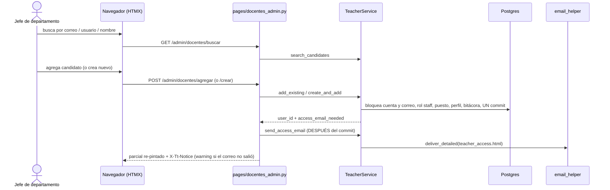

# Catálogo de docentes por departamento (pestaña «Docentes»)

> **Objetivo:** que cada departamento académico mantenga a sus docentes (los que pueden ser sinodales) con **una sola cuenta por persona**, su grado y su cédula, y que la persona reciba su acceso a la plataforma sin crear cuentas duplicadas ni tocar las de nadie con privilegios.

| | |
|---|---|
| **Actor(es)** | 🔗 Jefe de departamento / coordinador de vinculación (`titulatec_vinculacion`) de su departamento; 🎓 `titulatec_titulaciones` y `admin` operan cualquier departamento mapeado (R-D) |
| **Permiso(s)** | abrir: `titulatec.teacher.page.list` · toda acción **y la búsqueda de cuentas** (expone nombres y correos): `titulatec.teacher.api.manage` |
| **Trigger** | clic en «Docentes» (`bi-person-badge`) → `/titulatec/admin/docentes` |
| **Precondiciones** | corte > fase 4 (con 3: estado vacío y acciones 400, R-G) · puesto `docente_{depto}` sembrado por `init-titulatec-fase-2` (`NO_POSITION_MSG` si falta) · rol `staff` de la app `itcj` existente |
| **Sub-flujos** | ⤵ [asignación de sinodales](phase4_department_assign_synodals.md) (consume el catálogo) |
| **Estado final** | la persona tiene el puesto `docente_{depto}` vigente, un `TeacherProfile` (grado + cédula) y rol `staff` en `itcj` |

## Ruta en la app (UI)

1. `/titulatec/admin/docentes` (selector de departamento si opera varios). Lista del departamento, ordenada por apellido: nombre en orden natural («Nombre(s) Paterno Materno», el mismo de Sinodales, el expediente y el oficio), correo, grado, cédula, estado de la cuenta («Activa», «Sin primer acceso» = `last_login IS NULL`, «Desactivada») y asignaciones vigentes.
2. Buscador de cuentas (por correo institucional sin distinguir mayúsculas, usuario o nombre) que muestra candidatos; cada uno indica si es alumno, está inactivo, ya entró o ya es docente del departamento. Un candidato de **alumno** (puede aparecer como dueño de un correo al crear) muestra solo su nombre y «Cuenta de alumno»: ni su correo ni su usuario. La búsqueda exige `teacher.api.manage` también cuando llega como `?q=` de la página (quien solo ve no busca). Tras un swap de candidatos la vista no salta a un error viejo: el scroll al `#tt-doc-error` solo ocurre cuando se re-pintó `#tt-doc-body` entero.
3. Elegir un candidato → «Agregar» (grado + cédula, y correo institucional si la cuenta no tiene). O «Crear nuevo» (nombres, apellido paterno, materno opcional, correo institucional, grado, cédula; casilla «Es otra persona» si solo coincide el nombre).
4. Por fila: «Editar» (grado y cédula), «Quitar del departamento» y «Reenviar acceso» (solo si la cuenta está activa, sin privilegios y nunca ha entrado). `has_privileges` (varias consultas) solo se pregunta para las filas «Sin primer acceso» y para quien puede gestionar: antes corría por cada fila (N+1).

## Secuencia

## Pasos detallados

| # | Actor | UI / dónde | Acción | Endpoint | Service · método | Efecto en BD | Eventos / Notif |
|---|---|---|---|---|---|---|---|
| 1 | 🔗 | Docentes | Abre el catálogo | `GET /admin/docentes`, `/body` | `TeacherService.roster` | — | — |
| 2 | 🔗 | Buscador | Busca cuentas | `GET /admin/docentes/buscar` | `TeacherService.search_candidates` | — | — |
| 3 | 🔗 | Candidato | Agrega una cuenta existente | `POST /admin/docentes/agregar` | `TeacherService.add_existing` | rol `staff`/`itcj` si falta, puesto `docente_{depto}`, `titulatec_teacher_profiles` (upsert), correo si la cuenta no tenía | bitácora `teacher.added` (banderas: `privileged_account`, `credential_reset`, `email_written`, …) |
| 4 | 🔗 | Formulario | Crea una cuenta nueva | `POST /admin/docentes/crear` | `TeacherService.create_and_add` | `core_users` (usuario = parte local del correo, contraseña temporal con `must_change_password`), rol `staff`/`itcj`, puesto, perfil | bitácora `teacher.added` |
| 5 | 🤖 | tras el commit | Manda el acceso | (dentro de 3, 4 y 7) | `TeacherService.send_access_email` | — | correo `email/teacher_access.html` (usuario, contraseña temporal, liga, aviso de cambio) |
| 6 | 🔗 | Fila | Edita grado y cédula | `POST /admin/docentes/editar` | `TeacherService.update_profile` | `titulatec_teacher_profiles` (el cambio se ve en todos sus departamentos) | bitácora |
| 7 | 🔗 | Fila | Reenvía el acceso | `POST /admin/docentes/reenviar` | `TeacherService.reset_access` | restablece la contraseña temporal + `must_change_password` + revoca sesiones | bitácora `teacher.access_reset` |
| 8 | 🔗 | Fila | Quita del departamento | `POST /admin/docentes/quitar` | `TeacherService.remove_from_department` | termina el puesto `docente_{depto}` (`end_date`); nunca borra cuenta, perfil ni rol `staff` | bitácora `teacher.removed` |

## Reglas que el servicio garantiza

- **Una cuenta por persona (D3).** Crear se bloquea si el correo ya existe (`EmailTakenError`, sin distinguir mayúsculas; `core_users.email` no es UNIQUE, así que buscar dueños y escribir el correo van bajo `pg_advisory_xact_lock` por correo) o si el usuario (parte local) ya lo tiene otra cuenta (`USERNAME_TAKEN_MSG`, sin inventar sufijos). Si solo coincide el nombre, crear exige `confirm_other_person` (`NameMatchError`). El dominio del correo debe estar en `TITULATEC_TEACHER_EMAIL_DOMAINS` (default `cdjuarez.tecnm.mx`). Las cuentas de alumno (`control_number`) no se reutilizan ni se restablecen aquí: un docente que también es alumno tiene una cuenta staff aparte.
- **Enmienda de seguridad de R-B (2026-10-21, revisión de la Task 4).** El departamento **nunca** toca las credenciales de una cuenta **con privilegios** ni **reactiva** una inactiva. `TeacherService.has_privileges` es verdadero con cualquiera de: rol global distinto de NULL o `staff`; algún `UserAppRole` distinto de (`itcj`, `staff`); algún puesto vigente que no sea `docente_*`; algún permiso directo de usuario o de puesto, en cualquier app. Sin esto, un jefe de departamento podía dejar con la contraseña conocida de la plataforma la cuenta de un administrador que aún no entraba. Consecuencias:
  - cuenta **inactiva** → `INACTIVE_ACCOUNT_MSG` («pide a un administrador que la reactive»), tenga o no privilegios;
  - cuenta activa **con privilegios** → se agrega como docente **sin** tocar su contraseña (`access_email_needed = False`; «Reenviar acceso» da `PRIVILEGED_RESET_MSG`);
  - cuenta activa **sin privilegios** que nunca entró → se restablece la contraseña temporal con cambio obligatorio y se manda el acceso;
  - una cuenta que **ya entró** no se toca.
- **Contraseña temporal = `DEFAULT_PASSWORD`** (`itcj2.core.utils.security`), con `must_change_password` y las sesiones vivas revocadas en la MISMA transacción (`session_service.bump_version(db=db)`). **Jamás** va a logs, bitácora, eventos, headers ni respuestas HTML: solo viaja en el cuerpo del correo de acceso. `send_access_email` solo envía si la contraseña SIGUE siendo la temporal (si la persona ya la cambió el correo mentiría) y la cuenta está activa, no es de alumno y no tiene privilegios; si no, devuelve `(False, motivo)` y la ruta avisa con `X-Tt-Notice-Kind: warning` (el alta no se deshace; queda «Reenviar acceso»).
- **Correo de la cuenta**: si no tiene, se le escribe el institucional capturado; si ya tiene otro, no se sobrescribe y los avisos van a ese.
- **Una transacción por acción.** `authz_service.grant_role` y `positions_service.assign_user_to_position` hacen `db.commit()` por dentro, por eso NO se usan: la fila del rol `staff` y la del puesto se insertan directo y la bitácora viaja en la misma transacción.
- **Quitar (RF2)**: se bloquea (`HAS_ASSIGNMENTS_MSG`) mientras la persona tenga sinodales vigentes en procesos `active` u `on_hold` de carreras de ese departamento; hay que sustituirla antes. El puesto se bloquea (`FOR UPDATE`) antes de contar, así que quien asigna con `is_teacher_of(lock=True)` espera o deja de verlo docente.
- **Rutas**: validación → 200 con el cuerpo re-pintado y el mensaje en el formulario; guardas (corte, quitar o reenviar rechazados) → 400 + `X-Tt-Error`; éxito → `X-Tt-Notice`. Un departamento ajeno es 403. **Nunca se registra en el log el texto de una excepción de BD** (trae parámetros SQL: hash y correo): solo se muestra el mensaje de un `ValueError` del servicio (R3).

## Estado resultante

- `core_user_positions`: puesto `docente_{depto}` vigente (`allows_multiple`: una persona puede serlo de varios departamentos, con UN perfil compartido).
- `core_position_app_roles`: `docente_*` → `titulatec_sinodal`, que **no** conserva ningún permiso `*.read.all` (R-A, ver abajo). La autorización por proceso de un sinodal la dará la asignación vigente en la fase 5.

## Caminos alternos / errores ❗

- Corte ≤ fase 4 → `INERT_MSG`, sin escribir y sin correo.
- Grado fuera de 2–150 caracteres o cédula fuera de 5–12 dígitos → `DEGREE_MSG` / `LICENSE_MSG` (200 con el formulario).
- Correo sin dominio permitido, ya existente o con usuario que tiene forma de número de control → mensajes del servicio, sin crear nada.
- Cuenta sin usuario, o sin correo y sin institucional capturado → no se puede agregar.

## Despliegue y la trampa de R-A

Los permisos (`teacher.page.list`, `teacher.api.manage`), los puestos `docente_*` y sus roles entran por `titulatec init-titulatec-fase-2` (ver [carreras por departamento](xcut_program_departments.md#despliegue)). **R-A:** `titulatec_sinodal` traía `titulatec.document.api.read.all`; con el alcance por departamento, un jefe que además fuera docente habría abierto actas, CURP y certificados de cualquier alumno de su departamento. El DML `fase_2/02_sinodales.sql` le **revoca** todo `*.read.all` y la verificación del comando lo comprueba. `init-titulatec` (el `03`) se lo vuelve a dar, por eso hay que correr `init-titulatec-fase-2` **después**.

## Flujos relacionados

- ⤵ [Asignación de sinodales](phase4_department_assign_synodals.md) · [Carreras por departamento](xcut_program_departments.md)
- ↔ [Alcance por carrera](engine_officer_scope.md) · [Glosario](_glossary.md)
